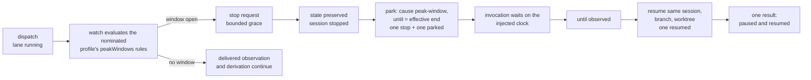
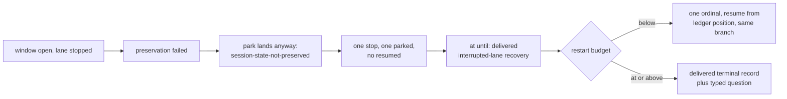

---
change:
  ref: GH-413
  type: feat
  status: Proposed
  slug: peak-pausing-dispatch-lane
  title: "M4-S42: Peak pausing for a lane started by dispatch: it stops at the window's start and resumes at the window's end"
  owners: ["engineering"]
  service: delivery-os
  milestone: "M4: Jaiship-native delivery"
  labels:
    - change
    - m4
    - peak-pausing
    - dispatch
    - lane-lifecycle
    - config
  version_impact: minor
  audience: internal
  security_impact: low
  risk_level: medium
  dependencies:
    internal:
      - "delivered peak-pause decision functions and the bounded-grace stop rule (composed by the dispatch run path, not re-derived)"
      - "delivered durable park record family with the episode frame and the closed preservation classification (reused unchanged)"
      - "delivered taxonomy v2 `stop`, `parked`, `resumed`, and `park-edge` kinds with their declared payloads (unchanged)"
      - "delivered dispatch engine: one-shot session loop, progress-based liveness cadence, capability-gated terminate with its declared grace, recorded-attempt resume, restart budget, and the delivered result and summary"
      - "delivered provider profile nomination recorded at admission, and the per-profile peak-window rule data with its derived grace bound"
      - "delivered status, brief, lanes, and board park projections, and the window-scoped zero-spend evidence over telemetry v2"
      - "delivered typed configuration layer (the lane policy branch) and the injected clock, delay, and transport seams"
    external: []
---

# CHANGE SPECIFICATION

> **PURPOSE**: Extend provider peak pausing from daemon-supervised lanes to every lane a one-shot `dispatch` starts, so a lane stops at its nominated profile's window's start, is parked with the window's end, and resumes itself at that end, and expose the same bounded-grace stop as the operator command `dispatch stop <ref>`.

## 1. SUMMARY

A lane started by `dispatch` today runs straight through a provider peak window whenever no resident daemon supervises it: admission gating refuses a *new* dispatch inside a window, and only the daemon watches and parks an *in-flight* lane. This change gives the dispatch run path its own life-long profile-window watch, using the delivered decision rules, park record family, preservation classification, and taxonomy v2 episode events, so the one invocation parks the lane at the window's start and resumes the same session in the same worktree and branch at the window's end, returning one result whose summary states that the lane was paused and resumed. The same bounded-grace stop becomes an operator command, `dispatch stop <ref>`, which parks a running lane with a named cause and a declared end and never kills beyond the delivered terminate path.

## 2. CONTEXT

### 2.1 Current State Snapshot

Provider peak windows are declared per profile as versioned rule data (windows on a declared zone's clock, multipliers, before/after buffers, a bounded grace whose maximum is the smallest declared buffer) and are already enforced at two points:

- **Admission gating.** A new dispatch inside an open window is refused at admission, so profiles in window are ineligible for new dispatches.
- **Daemon supervision.** The resident daemon runs the profile-window watch once per supervision cycle: it stops an in-flight lane with a bounded grace, parks it with cause `peak-window` and `until` at the effective window end, records the closed preservation classification `preserved | session-state-not-preserved`, emits exactly one `stop`, one `parked`, and one `park-edge` per episode under a shared episode id, resumes at the effective end (session resume for `preserved`, the delivered interrupted-lane recovery for `session-state-not-preserved`), and surfaces the episode on `status.laneParks`, the brief park fields, the `lanes` `parked:<cause>` projection with `until`, the board `PARKED` section, and the window-scoped zero-spend evidence.

The typed `dispatch` engine is the regular delivery path. One invocation claims the repository lease, provisions the lane's worktree, spawns or resumes the lifecycle session, watches it with progress-based liveness, and derives one result from artifact, ledger, tracker, and CI truth. It records the provider profile nominated at admission on its attempt and lane records, so the nomination an enforcement decision needs already exists on every dispatch lane.

The current-truth peak-pausing page states the degradation explicitly in its daemon-absent section: *without a resident daemon there is no window watcher and no mid-flight park*, and the composition-fact read reports `peakEnforcement.mode` as `iteration-start-gating` whenever the running composition supplies no watcher ports. That statement is the gap this change closes for lanes started by `dispatch`.

### 2.2 Pain Points / Gaps

- **An in-flight dispatch lane is unwatched without a daemon.** A lane started by `dispatch` on a host with no resident daemon has no window watcher at all, so it bills at peak rates through the whole window. Observed on 2026-11-25: a lane committed at 07:22Z on a weekday, inside a declared 06:00-10:00Z peak window that applied to it, and `status` reported no park, because no park existed to report.
- **The one-shot invocation has no episode concept.** `dispatch` returns when its session loop ends; there is no path in which one invocation parks, waits, and resumes, so a window that opens mid-lane can only be respected by an external supervisor.
- **The pause rule belongs to the nominated profile, not to the chain's first entry.** The lane-watch rules are the nominated profile's declared `peakWindows` branch. A preference chain whose first entry declares no windows would silently exempt a lane nominated to a later profile that does declare them, if the rule source were read from the chain's head or from a default.
- **There is no operator stop.** Stopping a lane today means terminating the session out of band, which leaves no park record, no classified episode, no preserved-session classification, and no bounded grace, so an operator who wants a lane to stop and come back has no supported command and no evidence.
- **A stopped lane reads like a dead lane.** With no park fact on `dispatch status`, a policy stop and a crashed owner are indistinguishable to the operator.

## 3. PROBLEM STATEMENT

Because peak-window enforcement for an in-flight lane depends on a resident daemon that a one-shot `dispatch` does not require, a delivery cannot be held inside its nominated profile's declared window, so it bills peak-rate tokens through the window, the operator's declared rule is unenforced, and no surface can explain the difference between a lane stopped on purpose and a lane that died.

## 4. GOALS

- **G-1**: A lane started by `dispatch` is watched for its whole life and pauses whenever the profile nominated at admission declares an open window.
- **G-2**: The pause is a first-class episode: one bounded-grace stop, one park with the window's end, one resume at that end, exactly-once ledger evidence.
- **G-3**: Nothing is lost or duplicated: the same session, branch, worktree, change folder, phases, and queue state survive the episode, and no second session is ever started for the work item.
- **G-4**: One `dispatch` invocation spans the episode and still returns exactly one result for the work item, stating that the lane was paused and resumed.
- **G-5**: The episode is visible on `dispatch status`, `lanes`, and `board` with the park cause and the window's end.
- **G-6**: Operators can request the same bounded-grace stop for a running lane and get the same classified episode, with a truthful refusal when the lane is not running.
- **G-7**: An operator can turn automatic pausing off and get today's admission-gating-only behaviour, declared, named, and defaulted on.

### 4.1 Success Metrics / KPIs

| Metric | Target |
|---|---|
| Lanes started by `dispatch` that make a billable model call inside their nominated profile's open window | 0 |
| Peak-pause episodes with exactly one `stop`, one `parked`, and one `park-edge`; and one `resumed` where state was preserved | 100% |
| Billable calls attributable to a parked lane between park and resume, over present telemetry | 0 |
| Work items that acquire a second session because of an episode | 0 |
| Branch, change folder, phase, and queue-state divergence caused by an episode | 0 |
| Lag between the window-open observation and the park record, measured in observation cadences | at most 1 |
| Lag between the recorded park end and the resume decision, measured in observation cadences | at most 1 |
| Paused dispatch lanes returned to the operator as a single result at the end of the invocation | 100% |

### 4.2 Non-Goals

- **NG-1**: No change to the resident daemon's supervision cycle, its watch, or its own park and resume behaviour.
- **NG-2**: No parallel lanes and no multi-lane concurrency (parallel lanes, GH-412).
- **NG-3**: No weekday-only or calendar-aware window policy; windows stay declared rule data (weekday-only window policy, GH-382).
- **NG-4**: No resident-mode or always-on dispatch daemon work (resident mode, GH-395).
- **NG-5**: No shell-orchestrator work; the typed dispatch path is the delivery path.
- **NG-6**: No new park cause, no new event kind, no new record kind, no new error identity, no new result token, and no second kill path.
- **NG-7**: No read surface for a declared or currently open window as an object of its own.
- **NG-8**: No change to admission gating (a new dispatch inside a window is still refused exactly as delivered).

## 5. FUNCTIONAL CAPABILITIES

| ID | Capability | Rationale |
|----|------------|-----------|
| F-1 | Life-long dispatch-owned window watch | A lane's whole life must be covered by the watcher that owns it, with no dependency on a resident daemon. |
| F-2 | The nominated profile's declared window rules decide the pause | The pause must read the same lane-watch rule data the daemon's watch reads, on the profile the lane actually nominated, not the chain's first entry or a default. |
| F-3 | Bounded-grace stop and exactly-once park at the window's start | The pause must be a recorded episode with a bound and an end, not an ad-hoc kill. |
| F-4 | Automatic window-end resume inside the same invocation | The episode must end without an operator command or a new dispatch, on the same session and branch. |
| F-5 | Nothing lost and no second session | Work preservation and per-ref single-flight are the episode's non-negotiable invariants. |
| F-6 | Park visibility on `dispatch status`, `lanes`, and `board` | An episode that cannot be seen reads as a dead lane. |
| F-7 | One invocation, one result that states the pause and the resume | The one-shot contract must survive the episode: one work item, one result, truthful summary. |
| F-8 | Named setting that disables pausing, declared default on | An operator must be able to return to today's behaviour deliberately, and the default must not be a silent second behaviour. |
| F-9 | Operator command `dispatch stop <ref>` | The same bounded-grace stop must be reachable on demand, with the same episode shape. |
| F-10 | Classified refusal when the lane is not running | A stop request must never write a phantom episode or an unexplained failure. |
| F-11 | Inherited owner-hold precedence and per-lane isolation | The delivered precedence and isolation rules bind the dispatch-owned watch exactly as they bind the daemon's. |
| F-12 | Episode zero-spend evidence | "Paused" must be a falsifiable cost claim, not a state label. |

### 5.1 Capability Details

**F-1 Life-long dispatch-owned window watch.** From the moment the lane's session is first acquired to its terminal classification, the dispatch run path runs the same profile-window watch the daemon runs, once per observation, before the session is observed for the next step. It evaluates the same nominated profile's lane-watch rule data against the same injected clock through the same decision functions, so the two compositions cannot drift into different answers for the same lane and instant. The watch covers a window that opens mid-iteration and a window that opens while the lane is between iterations; it ends only when the lane reaches its terminal classification. A composition that supplies no watch ports keeps its delivered behaviour, and pausing disabled by F-8 supplies none.

**F-2 The nominated profile's declared window rules decide the pause.** The lane-watch rule data is the **nominated profile's `peakWindows` branch**, the same rule data the daemon's watch reads, taken from the profile recorded at admission (a stored record field, never a re-nomination and never a rendering-time inference). The lane pauses when that branch declares a window open on its declared zone's clock, buffers included. The rule source is the nominated profile, not the preference chain's first or base entry and not any default: a chain whose first entry declares no `peakWindows` does not exempt a lane nominated to a later profile that does declare them. A profile with no `peakWindows` branch has no lane-watch enforcement, so its lanes are never stopped for peak reasons; the provider-entry `peak` windows that gate admission are a separate, unchanged rule source and never drive the lane watch. Windows are read with the delivered fail-closed validation; this change adds no window declaration mechanism and no new rule field. Where several of the nominated profile's windows overlap, enforcement unions the intervals and the park's end is the effective end of the contiguous open interval. The ticket's phrase "any provider that its seats resolve to" names the intent from the seat side: enforcement follows the profile the lane's seats were admitted under. The operative rule remains that profile's declared windows. A lane resuming on a classified absent nomination is not window-pausable, exactly as delivered.

**F-3 Bounded-grace stop and exactly-once park at the window's start.** When a window opens, the lane receives one stop request, the stopped session's state is preserved, and the lane lands parked with cause `peak-window`, the profile named, `until` at the effective window end, and the recorded stop instant. The applied grace is the profile's declared default, bounded by the derived maximum so it can never outlast the buffer protecting the window, and the deadline is recorded. Exactly one `stop` and one `parked` event are recorded with the episode id, under one fence, exactly once across any number of observations; the park record is append-only with read-time expiry and no in-place mutation. The park carries the closed preservation classification; a preservation failure never refuses the park and never extends the grace. The stop composes with the delivered supervision, liveness, and safe-boundary contracts and adds no kill path of its own.

**F-4 Automatic window-end resume inside the same invocation.** At the recorded effective end, observed by read-time expiry through the same injected clock, the invocation resumes the lane by its preservation classification. A `preserved` episode resumes the preserved session identity through the delivered session resume path, attach-and-continue on the same branch and in the same worktree, consuming no restart ordinal and starting no fresh spawn, and records exactly one `resumed` event. A `session-state-not-preserved` episode does not attempt a session resume; it routes to the delivered interrupted-lane recovery on the same branch, consuming exactly one restart ordinal under the delivered restart budget and resume economics, with budget exhaustion appending the delivered terminal exhaustion record and raising the delivered typed question. That recovery is a restart admission and emits no `resumed` event. The resume needs no operator command and no new dispatch. Resume admission re-evaluates the same nominated profile's window rules and never resumes a lane into an observed open window: safety outranks punctuality, so a lane whose window rule changed during the episode stays parked rather than resuming early.

**F-5 Nothing lost and no second session.** The episode leaves the lane's branch, change folder, recorded phases, and queue state unchanged: nothing is deleted, rewritten, requeued, or duplicated. The recorded worktree is reused, never re-provisioned. Per-ref single-flight holds the reference for the whole parked interval, so a second dispatch of the same work item is refused exactly as delivered, and a resumed lane never starts a second session for the work item.

**F-6 Park visibility on `dispatch status`, `lanes`, and `board`.** A dispatch-owned episode is a delivered durable park record, so `lanes` renders `parked:peak-window` with the delivered `until` and `board` lists the row in its `PARKED` section through the same projection the daemon's episodes use; no parallel surface and no second vocabulary are introduced. `dispatch status` gains an additive optional park fact for the addressed lane: the cause, the window's end, and the recorded stop instant, carried verbatim from the park record, absent when no park stands. While an open park episode stands, `dispatch status` does not classify the lane as stale: a recorded policy pause is the explanation for a stopped owner, not evidence of a crash. The delivered `probe` verdict and the delivered `delivering` derivation are otherwise unchanged, so a stopped session still answers `delivering: false`.

**F-7 One invocation, one result that states the pause and the resume.** The one invocation returns exactly one result for the work item after the episode ends. Its token, exit projection, and derivation order are unchanged and no episode can invent a token. Its summary states that the lane was paused and resumed, naming the cause and the episode's end, and the machine envelope carries an additive bounded episode fact (episode id, cause, park end, and resume instant, or the preservation classification when the resume was a recovery) so the claim is checkable from the answer alone. The episode facts are bounded evidence, not a new result shape.

**F-8 Named setting that disables pausing, declared default on.** One boolean key in the delivered typed lane policy branch, `lane.disable-peak-pausing`, disables automatic pausing. Unset or `false` keeps pausing on, which is the declared default; `true` composes no in-flight window watch, so behaviour is exactly today's: admission gating only, no stop, no park, no episode, and no claim of one. The key's effective value is resolved for each admitted change, so it applies to the lane a dispatch starts and never rewrites a lane already parked; it is declared through the delivered layered configuration and is not a new per-work-item override store. A non-boolean value is the delivered configuration refusal naming the key. With pausing disabled the composition-fact read reports `iteration-start-gating`, and the delivered window-scoped evidence is not synthesized for a park that never happened.

**F-9 Operator command `dispatch stop <ref>`.** The command sends a running lane the same bounded-grace stop request the watcher sends and parks it under the same episode frame. It never kills: it issues one stop request, sends no signal of its own, and leaves the delivered bounded-grace terminate path as the only signalling route, so there is no second kill mechanism. Through that delivered path TERM reaches the matched session's identified process tree, KILL follows only after the delivered declared grace and only over a target still listed, and an unknown session is success. The request preserves session state, parks the lane with the operator's declared cause and end under the same episode frame as a window stop (episode id, grace deadline, stop instant, preservation classification), and records exactly one `stop` and one `parked` event with the same payloads. It refuses a cause outside the delivered closed park-cause set, and it applies that cause's delivered `until` rule rather than inventing one. The command is available whether or not automatic pausing is enabled: the setting governs automatic policy, not operator intent. The parked lane resumes at its declared end by the same classification-routed resume; where the cause carries no end, the delivered operator resume path applies.

**F-10 Classified refusal when the lane is not running.** A stop request for a work item whose newest lane in the resolved repository is not running is refused before any write: the refusal is a classified delivered identity at its delivered exit, its bounded summary names the work item and the observed lane state, and it appends no park record, no episode event, and no attempt, lane, or queue record. Nothing is signalled, nothing is parked, and the refusal is indistinguishable in cost from a read.

**F-11 Inherited owner-hold precedence and per-lane isolation.** An active owner hold changes nothing about the watch: the hold is a read-time gate that parks nothing and writes no park record, so the dispatch-owned watch still parks `peak-window` with `until`, and a hold-active window-end resume refuses the delivered owner-hold precondition and proceeds once the hold clears, leaving the existing park record byte-unchanged. Isolation holds lane by lane and profile by profile: the decision reads one lane's recorded nomination and that profile's window state only, so lanes nominated to other profiles keep running, keep their leases, and keep their supervision unchanged, and only lanes parked for a given window resume at its end.

**F-12 Episode zero-spend evidence.** The waiting invocation makes no billable model call, spawns no session, and issues no provider request between the park and the resume, so the delivered window-scoped reading (the count of billable model calls attributable to the parked lane from the park instant through the park end, both boundaries inclusive) remains the episode's proof and reads zero over present telemetry. Telemetry absence stays a classified outcome carried by the reading's telemetry state and never renders as zero. A seeded mid-window call on the lane reads non-zero, so the claim can fail.

## 6. USER & SYSTEM FLOWS

**Flow 1: a window opens while a dispatch lane runs.**



**Flow 2: state could not be preserved.**



**Flow 3: operator stop.**

```
Operator runs dispatch stop <ref> --cause <closed cause> [--until <iso>]
  -> the addressed lane is resolved in the resolved repository
  -> not running? classified refusal naming the work item, nothing written
  -> running? the same bounded-grace stop request, the same terminate path
  -> one stop, one parked with the operator's cause and end
  -> at the declared end (or by the delivered operator resume when the cause carries none)
     the lane resumes by its preservation classification
```

**Flow 4: pausing disabled.** `dispatch <ref>` composes no in-flight watch, admission gating refuses a new dispatch inside a window exactly as delivered, the composition-fact read reports `iteration-start-gating`, no park, stop, or resume is recorded or claimed, and the delivered result is byte-identical to the pre-change behaviour.

**Flow 5: a second dispatch of a parked work item.** The per-ref single-flight predicate refuses `queue.single-flight` with the live holder, exactly as delivered; no second session, no second episode, and the parked lane is untouched.

## 7. SCOPE & BOUNDARIES

### 7.1 In Scope

- A profile-window watch owned by the one-shot dispatch run path, covering the lane's whole life, using the delivered decision rules and clock.
- The nominated profile's declared `peakWindows` rules as the pause input, read from the recorded nomination, with overlap unioning and the chain-first-no-window non-exemption.
- The bounded-grace stop, the exactly-once `stop` and `parked` episode, the closed preservation classification, and the recorded window end.
- The in-invocation wait until the effective end, and the classification-routed resume with the delivered recovery on the not-preserved branch.
- The one result whose summary states the pause and the resume, with the additive bounded episode fact.
- The additive park fact on `dispatch status`, and the confirmation that `lanes` and `board` show dispatch-owned parks through the delivered projections.
- The operator command `dispatch stop <ref>` with the same stop, park, and event shape, and its classified not-running refusal.
- One boolean configuration key that disables automatic pausing, defaulted on.
- The declared replacement truth for the daemon-absent paragraph and the composition-fact read, to be reconciled into current truth in the system-spec-update phase.

### 7.2 Out of Scope

- [OUT] Any change to the resident daemon's supervision cycle, watch cadence, park, or resume behaviour.
- [OUT] Parallel lanes, multi-lane concurrency, or worktree-per-runner scheduling.
- [OUT] Weekday-only, holiday-aware, or otherwise calendar-shaped window policy.
- [OUT] Resident-mode or always-on dispatch work.
- [OUT] Shell-orchestrator changes; the shell entry points keep their delivered fallback status.
- [OUT] Any new park cause, event kind, record kind, schema identity, error identity, or result token.
- [OUT] A read surface for a declared or open window as an object, and any query of provider quota or provider API.
- [OUT] Changing admission gating, the nomination rule, or the four no-nomination refusal identities.
- [OUT] Manual resume of an operator-stopped lane before its declared end (the delivered operator resume path is the only manual route).
- [OUT] Automatic recovery of an episode whose dispatch process was killed during the wait; the park record stands and the delivered resume path applies.

### 7.3 Deferred / Maybe-Later

- A single operator read that lists every paused lane with its episode history across repositories.
- A declared maximum episode duration with an operator policy for windows longer than it.
- Retiring the operator-shaped park record's minimal episode frame in favour of one writer for all parks.
- Extending the same watch to a composition that supervises several lanes in one process (parallel lanes).

## 8. INTERFACES & INTEGRATION CONTRACTS

### 8.1 REST / HTTP Endpoints

N/A. No HTTP or REST surface is added or changed. The operator surfaces in this change are CLI surfaces (`dispatch stop`, the additive park fact on `dispatch status`, and the existing `lanes`, `board`, and `spend --window-evidence` reads), specified in sections 5 and 8.3.

### 8.2 Events / Messages

The taxonomy v2 kinds and their payloads are reused unchanged. This change adds a producer for dispatch-owned episodes and the operator stop path; it adds no kind, no payload field, and no version.

| Topic | Kind | Payload (unchanged) | Producer | Rule |
|---|---|---|---|---|
| `dispatch.attempt` | `stop` | `ref`, `graceDeadline`, `providerProfile`, `windowEnd`, `stoppedAt`, `episodeId` | The dispatch-owned watch and `dispatch stop` | Exactly one per episode, emitted only over a park record whose episode frame is complete |
| `dispatch.attempt` | `parked` | `ref`, `reason`, `providerProfile`, `until`, `preservation`, `recordedAt`, `episodeId` | The dispatch-owned watch and `dispatch stop` | Exactly one per episode, carrying the closed preservation classification |
| `dispatch.attempt` | `resumed` | `ref`, `sessionRef`, `branch`, `reDispatched`, `resumedAt`, `episodeId` | The dispatch invocation's resume decision | Exactly one per preserved episode, with the no-re-dispatch fact; never emitted by a restart recovery |
| `queue.graph` | `park-edge` | `ref`, `cause`, `until?`, `episodeId`, `recordedAt` | The delivered park projection, now fed by dispatch-owned episodes too | Exactly one per episode; the operator-shaped minimal record still projects this kind alone |

Every frame stays inside the delivered eight-field envelope, the per-(topic, lane) sequence, the overflow carriage, and the bounded evidence budget. An episode's frames share one episode id, so the ledger alone reconstructs the episode.

### 8.3 Data Model Impact

| ID | Element | Description |
|----|---------|-------------|
| DM-1 | Durable park record, episode frame | Reused unchanged in shape: cause, the nominated profile, `until`, the recorded stop instant, the grace deadline, the episode id, and the closed preservation classification. A dispatch-owned stop writes the complete episode frame; the operator release writer keeps its minimal frame. |
| DM-2 | Durable lane record | Unchanged. The park is not a lane state: the lane record keeps its delivered `active` and `terminal` states, and the open park is joined at read time. |
| DM-3 | `dispatch status` payload | Additive optional park fact for the addressed lane: cause, park end, recorded stop instant, and the preservation classification when recorded. Absent when no park stands; every delivered member and line unchanged. |
| DM-4 | Dispatch result payload | Additive optional bounded episode fact: episode id, cause, park end, resume instant, and the preservation classification where no session resume happened. No new token, no new key in the delivered result keys, and no change to the derivation. |
| DM-5 | Dispatch result summary | The human summary gains the pause and resume statement for a spanning invocation; the delivered key set and the verbose detail line keep their delivered shape. |
| DM-6 | Configuration key for disabling pausing | One boolean in the delivered typed lane policy branch, unset by default, meaning automatic pausing is on; `true` supplies no in-flight watch. |
| DM-7 | Composition-fact read | The delivered `peakEnforcement` block keeps its two members and its two mode values; the reading rule is restated so a watch supplied by either composition reports `window-watch`, and `parkClaimed` stays derived from durable park records. |

No record kind, schema identity, or state-store layout is added. Pre-change park and lane records read normally.

### 8.4 External Integrations

N/A. No provider, tracker, or transport API is added or called. Windows are declared local rule data, the decision is pure over the injected clock, and the wait performs no network access.

### 8.5 Backward Compatibility

- With no open park, every delivered surface (`dispatch status`, `lanes`, `board`, `brief`, the dispatch result) is byte-identical: the new members are optional and absent, and no line is added.
- With pausing disabled by the setting, a dispatch behaves byte-for-byte as today: admission gating only, no watch, no episode, `iteration-start-gating`.
- The delivered taxonomy is unchanged: no kind, payload field, or version moves; a v2 consumer needs no change.
- The delivered park cause set, preservation classification, and window rule data keep their closed values; the operator-shaped release grammar and its `park-edge`-only projection are unchanged.
- Pre-change lanes and records, including a lane resuming on a classified absent nomination, read exactly as delivered and are simply not window-pausable.
- The delivered `dispatch` grammar, refusal identities, exit taxonomy, and result tokens are unchanged; `dispatch stop` joins the family without changing an existing invocation.

## 9. NON-FUNCTIONAL REQUIREMENTS (NFRs)

| ID | Requirement | Threshold |
|----|-------------|-----------|
| NFR-1 | Bounded-grace stop: the recorded stop deadline never exceeds the profile's derived maximum grace, and each stop issues exactly one terminate request through the delivered terminate path with zero additional signal or kill paths. | deadline ≤ `graceSecondsMax`; terminate requests per stop = 1; added signal paths = 0; the delivered TERM→KILL escalation grace stays the delivered declared value (20 000 ms default). |
| NFR-2 | Exactly-once episode: across any number of observations, one episode yields one `stop`, one `parked`, one `park-edge`, and, for a preserved episode only, one `resumed`, all sharing one episode id. | duplicates = 0; missing required frame = 0; episode ids per episode = 1. |
| NFR-3 | Zero billable model calls attributable to the parked lane between the park instant and the park end, both boundaries inclusive, over present telemetry; telemetry absence is a classified outcome, never a fabricated zero. | count = 0 with telemetry present; a seeded in-window call reads greater than 0; 100% of episodes carry the delivered telemetry-state disclosure. |
| NFR-4 | Restart ordinal accounting: a preserved episode consumes no restart ordinal and starts no fresh spawn; a not-preserved episode consumes exactly one ordinal under the delivered restart budget and raises the delivered typed question at exhaustion. | ordinals on the preserved path = 0; ordinals per not-preserved recovery = 1; fresh re-dispatches = 0; second sessions per work item = 0. |
| NFR-5 | Determinism and hermeticity: identical declared configuration, lane-watch rule data, injected clock, and injected transport produce identical decisions, records, events, and summaries across repeated runs. | byte-identical paired-run output; live network calls = 0; real sleeps above the declared seam = 0; credential reads = 0 in tests. |
| NFR-6 | Observation latency: the park lands within one observation cadence of the window-open observation, and the resume decision lands within one cadence of the recorded park end. | lag ≤ 1 cadence each way, cadence = the delivered liveness cadence (`lane.liveness-interval`, 30 000 ms default); the measured lag is recorded as episode evidence. |
| NFR-7 | Wait cost and boundedness: the wait between park and resume issues no billable call, no session operation, and no provider request, observes the clock at most once per wake, and never busy-loops; the effective end is re-derived from the clock at each wake rather than pinned as a computed duration. | billable calls during the wait = 0; session operations during the wait = 0; wakes ≤ elapsed time / cadence + 1; busy-loop paths = 0. |
| NFR-8 | Vocabulary economy and evidence bounds: the change adds no event kind, record kind, schema identity, result token, or error-table row, and a refusal reuses a delivered classified identity; every added evidence value stays inside the delivered budget. | added kinds and identities = 0; added error rows = 0; payload fields ≤ 20 and ≤ 1024 bytes per event frame. |
| NFR-9 | Additive interface and bounded reads: with no open park every payload and line is byte-identical, and the additive reads stay bounded and reuse the delivered store. | changed delivered field = 0; new stores = 0; additional bounded park-record reads on `dispatch status` ≤ 1; added unbounded reads = 0. |

## 10. TELEMETRY & OBSERVABILITY REQUIREMENTS

- **Episode evidence is the ledger.** The four delivered kinds are the episode's audit trail; this change adds no metric, no counter, and no telemetry record family, and the wait's own wakeups are not recorded as telemetry.
- **Cost evidence.** The delivered window-scoped reading, scoped from the park instant through the park end, is the zero-spend proof for a dispatch-owned episode exactly as for a daemon-owned one, with the delivered telemetry-state disclosure and the delivered exclusion reasons.
- **Surface evidence.** `dispatch status` (additive park fact and no false stale classification for a parked lane), `lanes` (`parked:peak-window` with `until` and the composition-fact mode), the brief park line, and the board `PARKED` row are the operator-readable evidence; none of them may report a park, stop, or resume the records do not show.
- **Latency evidence.** The observation lag from window-open to park, and from park end to resume, is recorded with the episode so the NFR-6 bounds are checkable rather than asserted.
- **Alerts.** No new alert is declared. An existing lane-health consumer that reads `stale` continues to see a truthful `probe` verdict, with the park fact as the explanation; an operator alert on a parked lane exceeding the declared window end plus one cadence is a natural follow-on, not part of this change.

## 11. RISKS & MITIGATIONS

| ID | Risk | Impact | Probability | Mitigation | Residual Risk |
|----|------|--------|-------------|------------|---------------|
| RSK-1 | Two watchers (a daemon and a dispatch invocation) observe the same lane and produce a duplicate episode or a double stop. | H | L | The lane populations are disjoint by ownership: the daemon watches its own supervised lanes and never reads a dispatch lane, and the dispatch invocation watches the lane it started. The park record stays one-per-open-episode under one fence, and the event projection is exactly-once per episode. | L |
| RSK-2 | A blocked invocation reads as a hang: the operator, or an outer automation timeout, sees no output for the length of the window and kills the process. | M | M | The park record lands before the wait, `dispatch status`, `lanes`, and `board` show the park and its end, the invocation is the documented behaviour of a paused lane, and a kill leaves the park standing for the delivered resume path. The release note states the behaviour. | M |
| RSK-3 | A killed waiting process leaves an `active` lane record whose owner is gone while the park stands, so the lane reads stale. | M | M | The park fact on `dispatch status` explains the stopped owner, the park record is the resumable artifact, and the delivered resume path recovers the lane. | M |
| RSK-4 | Preservation failures consume restart ordinals and the budget is exhausted during an episode. | M | L | The delivered recovery, exhaustion record, and typed question apply unchanged; the episode still enforces the window. | L |
| RSK-5 | An operator disables pausing and silently reintroduces peak spend. | H | L | The default is pausing on, the composition-fact read declares `iteration-start-gating` while disabled, the setting is a declared documented key, and the release note names the consequence. | M |
| RSK-6 | A window rule changes during an episode, so the recorded end no longer matches the rule and a lane would resume into an open window. | M | L | Resume admission re-evaluates the nominated profile's window rules and never resumes into an observed open window; the episode stays parked rather than resuming early, and configuration validation keeps mid-episode drift rare. | L |
| RSK-7 | The operator stop is used to park lanes for causes unrelated to cost, polluting the episode population with unexplained pauses. | L | M | The cause is required from the delivered closed set, the episode is recorded with the operator's cause and end, and the park is visible on the delivered surfaces. | L |
| RSK-8 | The dispatch-owned watch and the daemon's watch diverge over time as each evolves. | M | M | One shared decision contract with the same rules and clock, parity fixtures over both compositions, and the supersession recorded so the two paths are governed by one stated rule. | L |

## 12. ASSUMPTIONS

- The nomination recorded at admission is sufficient to decide the pause for every lane this change watches; no lane needs a re-nomination to be pausable.
- The delivered lane-watch rule data is the whole input: a nominated profile either declares `peakWindows` (and is enforced) or declares none (and is not), so no provider set has to be derived at decision time.
- A one-shot invocation may legitimately occupy a process for the length of a window; the operator's expectations and any outer timeout are a documentation concern, not a scheduling one.
- The delivered terminate path is the only signalling route and is capable on every harness that this path spawns, as it is for the delivered stall path.
- A parked window is bounded by the declared rule data in practice, so the wait ends without operator action.
- The delivered park projections already render any `peak-window` park record, so no projection change beyond the additive `dispatch status` fact is needed.
- The system-spec-update phase owns reconciling the current-truth pages; this spec states the replacement truth it expects.

## 13. DEPENDENCIES

| Direction | Item | Notes |
|-----------|------|-------|
| Depends on | Delivered peak-pause decision functions and the bounded-grace stop | The same rules, clock, and answers; this change composes them, it does not re-derive them. |
| Depends on | Delivered durable park record family and preservation classification | The episode's record and its closed classification are reused unchanged. |
| Depends on | Delivered taxonomy v2 episode kinds | `stop`, `parked`, `resumed`, `park-edge` with their declared payloads. |
| Depends on | Delivered dispatch session loop, liveness cadence, terminate, resume, and restart budget | The watch rides the loop and the stop rides the terminate path. |
| Depends on | Delivered provider profile nomination at admission | The pause decision's key. |
| Depends on | Delivered status, brief, lanes, board, and spend read projections | The episode's surfaces and cost evidence. |
| Depends on | Delivered typed configuration layer and injected clock, delay, and transport seams | The setting's home and the determinism the acceptance fixtures need. |
| Blocks | Parallel lanes and multi-lane supervision | A per-lane watch contract is a precondition for more than one lane per process. |
| Informative | Weekday-only window policy | A separate item; this change keeps windows declared rule data. |

## 14. OPEN QUESTIONS

None. The brief is complete for this change: the pause input, the stop bound, the resume routing, the surfaces, the setting's shape and default, and the operator command's behaviour are all stated, and the remaining namings (exact field names for the additive status and result members) are delivery-level details pinned against the delivered declarations and tested, not product decisions.

## 15. DECISION LOG

| ID | Decision | Rationale | Date |
|----|----------|-----------|------|
| DEC-1 | **Intentional supersession.** The dispatch run path supplies the profile-window watch for the lanes it starts, so the current statement "without a resident daemon there is no window watcher and no mid-flight park" no longer holds. The replacement truth: a lane is watched by the composition that owns it (the daemon for supervised lanes, the dispatch invocation for lanes it started), and a composition that supplies neither degrades to iteration-start gating. | A watcher that exists only when a second process happens to run is not an enforcement of a declared rule for the lane the operator started. The statement, not the mechanism, is what changes. | 2026-11-26 |
| DEC-2 | **The disabling key is `lane.disable-peak-pausing`,** a boolean in the delivered typed lane policy branch: unset or `false` keeps automatic pausing on (the declared default), `true` supplies no in-flight watch and restores today's admission-gating-only behaviour; a non-boolean value is the delivered configuration refusal naming the key. Its effective value is resolved for each admitted change (per lane) through the delivered layered configuration; it is not a new per-work-item override store and not a new configuration source. | It mirrors the delivered `lane.disable-worktrees` exception exactly, so one pattern covers both policy escapes, the default is recoverable by inspecting absence, and no new configuration mechanism is invented. | 2026-11-26 |
| DEC-3 | **Reuse, never parallel.** The change composes the delivered decision functions, park record family, preservation classification, taxonomy v2 kinds, and window-scoped evidence; it defines no parallel vocabulary, no second event family, and no second kill path. | A second vocabulary would make one operation two contracts and would split the audit trail the operator relies on. | 2026-11-26 |
| DEC-4 | **One invocation spans the episode.** The one-shot path parks, waits until the effective end, resumes, and then returns one result for the work item whose summary states the pause and the resume; it never re-dispatches, never starts a second session, and never splits the invocation into two results. | The operator asked for a delivery, not for an episode to manage; one invocation and one result keep the one-shot contract intact while honouring the window. | 2026-11-26 |
| DEC-5 | **Stop composition and ordinal accounting.** The stop reuses the delivered terminate path with its declared grace and adds no signal path; a preserved episode consumes no restart ordinal, and the not-preserved branch routes to the delivered interrupted-lane recovery with its budget, classification, and typed-question escalation. | The delivered machinery already solves stop, recovery, and budget accounting; a new path would duplicate each of them. | 2026-11-26 |
| DEC-6 | **Composition-fact read restated, no new mode.** `peakEnforcement.mode` reports `window-watch` when the running composition supplies a profile-window watch (daemon-owned or dispatch-owned) and `iteration-start-gating` otherwise, including when the setting disables pausing; `parkClaimed` stays derived from durable park records. No third mode value is introduced. | The mode names which enforcement is active, not which process is running; adding a mode would move a published contract to describe an implementation detail. | 2026-11-26 |
| DEC-7 | **`dispatch stop` writes a complete watcher-shaped episode frame,** so one `stop` and one `parked` are emitted with the declared payloads, deliberately distinct from the operator-shaped minimal park record produced by the release grammar, which keeps projecting the `park-edge` alone. | The command actually stops a session, records a grace deadline, and classifies preservation, so its record carries the episode frame; the minimal frame stays the release writer's contract. | 2026-11-26 |
| DEC-8 | **The not-running refusal reuses the delivered unmet-precondition identity** at its delivered user-validation exit, with a bounded summary naming the work item and the observed lane state, appending nothing. No error identity, error-table row, or reason token is added. | The family already refuses an unmet admission precondition with this identity; a stop request's precondition is the same shape, and vocabulary economy is a delivered discipline. | 2026-11-26 |
| DEC-9 | **A parked lane is not reported stale.** While an open park episode stands, `dispatch status` reports the park fact and does not classify the lane stale; the probe verdict and `delivering` are otherwise unchanged, so a stopped session still answers `delivering: false`. | A recorded policy pause is a cause, not a defect: reporting a crash would send the operator after a fault that does not exist and would make the episode's evidence contradict the surface. | 2026-11-26 |
| DEC-10 | **The setting disables automatic pausing only.** `dispatch stop` remains available and identical whether or not pausing is enabled. | The setting governs policy the system applies by itself; an operator's explicit request is a different authority and must not be silently suppressed. | 2026-11-26 |
| DEC-11 | **The wait reuses the delivered liveness cadence and re-derives the end.** No new timing key is added; the wait wakes at most once per delivered cadence, observes the injected clock, and re-derives the effective end, and resume admission re-checks the nominated profile's window rules so a rule change can only defer a resume, never advance it. | A second cadence key would let the watch and the liveness watcher drift, and a pinned duration would let a config change resume a lane into an open window. | 2026-11-26 |

**Decision records warranted (non-blocking).** Two decisions amend published contracts and should outlive the change as records: DEC-1, because it supersedes a stated current-truth degradation and restates the composition-fact reading (a technical decision record); and DEC-7 together with DEC-6, because the operator episode frame and the two-value mode reading are contract-level statements a future reader will need without reading this change. The remaining decisions are implementation-shaping and are adequately carried here and in the delivered pages.

## 16. AFFECTED COMPONENTS (HIGH-LEVEL)

| Component | Impact |
|---|---|
| Dispatch run path (one-shot invocation and its session loop) | Updated: composes the watch, owns the episode, waits, resumes, and answers once |
| Peak-pause decision layer | Composed unchanged; one shared decision contract with the daemon's watch |
| Park record family and preservation classification | Composed unchanged; dispatch-owned episodes write the complete episode frame |
| Event projection for the taxonomy v2 episode kinds | Updated: producer coverage for dispatch-owned episodes and the operator stop, same kinds and payloads |
| Dispatch result derivation and summary | Updated additively: one result, summary states the pause and the resume, bounded episode fact |
| Dispatch operator surface (`status`, and the new `stop`) | Updated additively for the park fact; new command in the same family grammar |
| Lane, status, brief, and board park projections | Composed unchanged; `dispatch status` gains the additive park fact and the parked-not-stale rule |
| Spend read side and telemetry v2 attribution | Composed unchanged; the episode's zero-spend evidence applies as delivered |
| Configuration layer (lane policy branch) | One boolean key added |
| System specification pages for peak pausing, dispatch engine, resident daemon, profiles, taxonomy, status, brief, board, and spend | Reconciled in the system-spec-update phase to the replacement truth (DEC-1, DEC-6, DEC-7) |
| Test fixtures and seams (injected clock, delay, transport) | Extended for episode fixtures; no production seam added |

## 17. ACCEPTANCE CRITERIA

| ID | Criterion | Linked |
|----|-----------|--------|
| AC-F1-1 | **Given** a dispatch lane and the daemon's watch over an equivalent lane nominated to the same profile, **when** both evaluate that profile's `peakWindows` rule data at the same instant, **then** both take the same stop or no-stop decision through the same decision rules and the same clock, and neither composition derives its own rule (parity fixture) | F-1, NFR-5 |
| AC-F1-2 | **Given** a lane started by dispatch under a nominated profile whose window opens mid-iteration, and separately a lane whose window opens while it is between iterations, **when** the watch runs, **then** both lanes park, and the watch remains active until the lane's terminal classification (fixture, brief requirement 1) | F-1 |
| AC-F1-3 | **Given** identical configuration, lane-watch rule data, injected clock, and injected transport, **when** the same fixture is run twice, **then** decisions, park records, events, and the returned summary are byte-identical, with no real sleep, no network call, and no credential read (determinism fixture) | F-1, NFR-5, NFR-7 |
| AC-F2-1 | **Given** a preference chain whose base (first) profile declares no `peakWindows` and a lane nominated to a later profile in that chain whose declared windows are open, **when** the watch runs, **then** the lane parks with cause `peak-window` and `until` at the effective end of that profile's open window (fixture, ticket AC2) | F-2, F-3 |
| AC-F2-2 | **Given** a lane whose nominated profile declares no `peakWindows` branch, **when** the watch runs across a period in which other profiles' windows are open, **then** the lane is never stopped for peak reasons and no park, stop, or resume is recorded, while the provider-entry `peak` windows still gate admission exactly as delivered (fixture, ticket AC5) | F-2, F-11 |
| AC-F3-1 | **Given** a running dispatch lane and a window of its nominated profile that opens at a known instant, **when** the watch observes the open window, **then** the lane receives exactly one bounded-grace stop request, parks with `until` equal to the window's effective end and the recorded stop instant, and records one `stop` and one `parked` sharing one episode id (fixture with an injected clock and transport, ticket AC1) | F-3, NFR-1, NFR-2 |
| AC-F3-2 | **Given** a park episode under observation, **when** the episode is inspected, **then** the park landed within one observation cadence of the window-open observation, and the measured lag is recorded with the episode (fixture, ticket AC1) | F-3, NFR-6 |
| AC-F4-1 | **Given** a preserved episode whose recorded end is observed, **when** the resume decision runs, **then** the lane resumes the preserved session on the same branch and in the same worktree, records exactly one `resumed` with the no-re-dispatch fact, consumes no restart ordinal, and starts no second session for the work item (fixture, ticket AC3) | F-4, F-5, NFR-4 |
| AC-F4-2 | **Given** an episode whose session state could not be preserved, **when** the park end is observed, **then** no session resume is attempted, the lane routes to the delivered interrupted-lane recovery on the same branch consuming exactly one restart ordinal, no `resumed` event is emitted, and budget exhaustion appends the delivered terminal record and raises the delivered typed question (fixture) | F-4, NFR-4 |
| AC-F5-1 | **Given** a complete park and resume episode, **when** the branch, the change folder, the recorded phases, and the queue state are compared before and after, **then** none has changed, the recorded worktree is reused, and a second dispatch of the same work item is refused `queue.single-flight` for the whole parked interval (fixture, ticket AC3) | F-5, NFR-4 |
| AC-F6-1 | **Given** an open park episode on a lane started by dispatch, **when** `dispatch status <ref>` is read, **then** it reports the park cause and the window's end from the park record, does not classify the lane stale, and reports the observed probe verdict (fixture, ticket AC6) | F-6, DM-3 |
| AC-F6-2 | **Given** the same episode, **when** `lanes` and `board` are read, **then** `lanes` renders `parked:peak-window` with the recorded `until` and `board` lists the row in its `PARKED` section from the same durable park record, with no additional read and no second vocabulary (fixture, ticket AC6) | F-6, NFR-9 |
| AC-F6-3 | **Given** no open park, **when** `dispatch status`, `lanes`, `board`, `brief`, and a dispatch result are read, **then** every delivered field and line is byte-identical to the pre-change output and the added members are absent (regression) | F-6, NFR-9 |
| AC-F7-1 | **Given** one dispatch invocation that spans an episode, **when** it completes, **then** it returns exactly one result for the work item, its token and exit are the same tokens the same truth would produce without an episode, its summary states that the lane was paused and resumed, and the machine envelope carries the bounded episode fact (fixture, ticket AC7) | F-7, DM-4, DM-5 |
| AC-F8-1 | **Given** the disabling key unset or `false`, **when** a dispatch lane is admitted and runs through a window, **then** it parks as specified; **given** the key `true`, **when** the same lane runs through a window, **then** no watch, stop, park, resume, or episode event occurs, behaviour equals the delivered admission gating, and the composition-fact read reports `iteration-start-gating` (fixture, brief requirement 7) | F-8, NFR-9 |
| AC-F8-2 | **Given** the disabling key `true`, **when** `dispatch stop <ref>` is issued for a running lane, **then** the stop, park, and events are identical to the enabled case (fixture) | F-8, F-9, F-10 |
| AC-F9-1 | **Given** a running lane and an injected clock, **when** `dispatch stop <ref>` is issued with a cause and an end, **then** the lane receives the same bounded-grace stop request a window-open stop sends, parks with the declared cause and end, and records one `stop` and one `parked` with the same payloads as a window-open stop (fixture with an injected clock, ticket B1) | F-9, NFR-1, NFR-2 |
| AC-F9-2 | **Given** a `dispatch stop`, **when** the session is stopped, **then** the command sends no signal of its own, exactly one stop request reaches the delivered terminate path with its declared grace (TERM before KILL, KILL only over a still-listed target, an unknown session treated as success), and no second signal or kill mechanism exists (fixture, ticket B1) | F-9, NFR-1 |
| AC-F10-1 | **Given** a work item whose newest lane in the resolved repository is not running, **when** `dispatch stop <ref>` is issued, **then** the command refuses with the delivered classified identity at its delivered exit, the bounded summary names the work item and the observed lane state, and no park record, episode event, attempt, lane, or queue record is written (fixture, ticket B2) | F-10, NFR-8 |
| AC-F11-1 | **Given** an active owner hold, **when** a window of the lane's nominated profile opens for a dispatch lane, **then** the lane still parks `peak-window` with `until`, the hold writes no park record of its own, and the resume admission refuses the delivered owner-hold precondition appending nothing, then resumes once the hold clears with the park record byte-unchanged (fixture) | F-11 |
| AC-F11-2 | **Given** two dispatch lanes nominated to different profiles, one whose profile has an open window and one whose profile has none open, **when** the episode runs, **then** only the first parks and resumes, and the second keeps running with its lease and supervision unchanged (fixture, ticket AC5) | F-11, F-2 |
| AC-F12-1 | **Given** a completed episode, **when** the window-scoped reading is taken from the park instant through the park end over present telemetry, **then** the count of billable calls attributable to the lane is zero, the telemetry state is disclosed, and the reading names its basis (fixture, ticket AC4) | F-12, NFR-3 |
| AC-F12-2 | **Given** the same episode and a seeded billable call attributable to the lane inside the interval, **when** the reading is taken, **then** the count is greater than zero, so the zero claim is falsifiable (fixture, ticket AC4) | F-12, NFR-3 |

### Ticket acceptance-criteria traceability

Ticket AC1 (one stop request, park with `until` at the window's end, one `stop` and one `parked`) maps to AC-F3-1 and AC-F3-2. Ticket AC2 (chain-first-no-window does not exempt) maps to AC-F2-1. Ticket AC3 (resume from preserved state, one `resumed`, no second session) maps to AC-F4-1 and AC-F5-1. Ticket AC4 (no billable call between park and resume) maps to AC-F12-1 and AC-F12-2. Ticket AC5 (a lane whose nominated profile declares no window is never stopped) maps to AC-F2-2 and AC-F11-2. Ticket AC6 (`dispatch status` reports the park and the end) maps to AC-F6-1, with the delivered projections covered by AC-F6-2 and AC-F6-3. Ticket AC7 (one result whose summary states paused and resumed) maps to AC-F7-1. Owner-comment-1 AC B1 (`dispatch stop` equals a window-open stop) maps to AC-F9-1 and AC-F9-2. Owner-comment-1 AC B2 (not-running refusal by name, nothing written) maps to AC-F10-1. AC-F1-1 to AC-F1-3, AC-F4-2, AC-F8-1, AC-F8-2, and AC-F11-1 are spec-decomposed criteria the brief's capabilities and constraints require.

## 18. ROLLOUT & CHANGE MANAGEMENT (HIGH-LEVEL)

- **One change, one release.** The capability ships as one additive behaviour addition on the typed dispatch path, behind a declared default that is on. A versioned release note states the behaviour change and names the disabling key, so an operator who needs today's behaviour can set it before upgrading.
- **No migration, no flag rollout.** Pre-change lanes, records, and configuration load and behave exactly as delivered; there is no data migration and no schema version move.
- **Delivery order.** The setting and its validation, then the watch and the episode, then the wait and the resume, then the surfaces and the one-result summary, then the operator command. Each step leaves the delivered behaviour intact when its part is not exercised.
- **Communication.** The operator-facing consequence is stated in the release note and in the delivery guide for the dispatch family: a dispatch may now remain in flight for the length of a window, and `dispatch status`, `lanes`, and `board` explain why.
- **Rollback.** Setting the disabling key restores the delivered behaviour without a code change; a full revert needs no data repair because the change adds no record kind and mutates no existing record.
- **Documentation reconciliation.** The system-spec-update phase reconciles the peak-pausing page's daemon-absent statement, the composition-fact reading, and the taxonomy page's operator-shaped-park sentence to the replacement truth this spec states (DEC-1, DEC-6, DEC-7).

## 19. DATA MIGRATION / SEEDING (IF APPLICABLE)

N/A. No record kind, schema identity, or store layout changes; no existing record is rewritten, backfilled, or reseeded. A park record written before this change reads normally, and a lane with no dispatch-owned episode is not retroactively paused.

## 20. PRIVACY / COMPLIANCE REVIEW

N/A beyond the delivered posture. The change adds no personal data, no customer data, no credential read, and no external transmission. The profile nomination it reads is already recorded by the delivered admission rule. The refusal summary is bounded and identifier-only, so a work-item reference appears but no payload, prompt, transcript, or credential does.

## 21. SECURITY REVIEW HIGHLIGHTS

- **No new kill path.** The stop reuses the delivered terminate operation with exact-identity matching, TERM before KILL, KILL only after the declared grace and only over a target still listed, and idempotence on an unknown session. No broad pattern, no process-group signal, and no second mechanism is introduced.
- **Local-only authority.** `dispatch stop` reads and writes local durable state and signals only the session it identifies; it opens no network path, reads no provider or tracker API, and carries no secret.
- **No new privilege.** The waiting invocation holds the lease it already held for the lane; the wait adds no capability, no elevated context, and no credential use.
- **Bounded, identifier-only refusals.** The not-running refusal names the work item and the observed lane state within the delivered evidence bound, so an error path cannot become an exfiltration channel.
- **Configuration is not a secret.** The disabling key is a non-sensitive typed boolean; an invalid value is refused by name with the delivered configuration identity and no partial effect.

## 22. MAINTENANCE & OPERATIONS IMPACT

- **One watch contract, two compositions.** The daemon-owned and dispatch-owned watches must stay the same decision contract; the parity fixture is the guard, and DEC-1's replacement truth is the single stated rule.
- **Long-running invocations become normal.** Operational tooling that assumes a dispatch finishes in one phase-length window needs to read `dispatch status` rather than only elapsed time. A parked lane is the expected explanation and is visible on three surfaces.
- **Episode archaeology.** The shared episode id reconstructs an episode from the ledger alone, and the window-scoped reading proves the cost claim for the same interval.
- **Support path for a stuck park.** A park whose end never seems to arrive is diagnosable from the recorded stop instant, the recorded end, and the observation lag; the delivered operator resume remains the manual route, and no new unpark command exists.
- **Configuration discipline.** Pausing is on unless the operator turns it off, so an unexpected peak spend is answered first by checking that key and the composition-fact read.

## 23. GLOSSARY

| Term | Definition |
|---|---|
| Product | One or more repositories that together form a single deliverable, planned and delivered as one. |
| Repository | One git repository belonging to exactly one product. |
| Main checkout | The clone's primary working tree, which stays on the base branch. |
| Worktree | A linked git worktree of a main checkout, created for one work item; never the main checkout itself. |
| Lane | One work item's delivery in one repository, resumable across attempts through the durable lane record. |
| Peak window | A declared, versioned interval in a profile's `peakWindows` branch, with a declared zone, a multiplier, and buffers, during which its providers are treated as expensive; the window opens at start minus the before-buffer and ends at end plus the after-buffer. |
| Effective window end | The instant a window closes, buffers included; the park's `until`, recomputed from the same derivation admission gating uses. |
| Bounded-grace stop | A stop request with a recorded deadline, after which the session is not asked again; the applied grace never outlasts the buffer protecting the window. |
| Park episode | One stop-then-resume cycle: one `stop`, one `parked`, one `park-edge`, optionally one `resumed`, sharing one episode id. |
| Episode id | The identifier that joins the frames and records of one episode across many observations. |
| Preservation classification | The closed value `preserved` or `session-state-not-preserved` carried by the park record, deciding which resume route applies. |
| Dispatch-owned watch | The profile-window watch composed by the one-shot dispatch run path for the lane it started, as opposed to the daemon's watch over its supervised lanes. |
| Composition fact | Which enforcement a composition actually supplies, as opposed to what some other process happens to be running. |
| Nominated profile's window rules | The `peakWindows` branch of the profile recorded at admission: the lane-watch rule data the pause decision reads, the same data the daemon's watch reads. A profile with no branch has no lane-watch enforcement. |
| Zero-spend evidence | The delivered count of billable model calls attributable to the parked lane between the park instant and the park end, both boundaries inclusive, over present telemetry. |
| Admission gating | The delivered refusal of a new dispatch while a candidate profile is inside a declared window. |

## 24. APPENDICES

### A. The intentional supersession, stated as before and after

**Before (current truth, peak-pausing daemon-absent section):** without a resident daemon there is no window watcher and no mid-flight park; a composition without the watch declares `peakEnforcement: { mode: "iteration-start-gating", parkClaimed: false }`, behaviour is the delivered iteration-start gating, and no surface reports a park, stop, or resume that did not happen.

**After (replacement truth this change expects):** a lane is watched by the composition that owns it. The resident daemon watches the lanes it supervises; the one-shot dispatch run path watches the lane it started, for that lane's whole life, using the same nominated profile's lane-watch rule data, the same clock, and the same decisions. The composition fact is therefore "does this composition supply a profile-window watch", not "is a daemon running": a composition that supplies a watch by either route reports `window-watch`, a composition that supplies none, including one whose operator disabled pausing, reports `iteration-start-gating`, and `parkClaimed` remains derived from durable park records so no read claims a park that did not happen. Runs with no composed watch still synthesize no zero-spend episode reading for a park that never happened.

### B. The disabling key as declared

| Property | Value |
|---|---|
| Key | `lane.disable-peak-pausing`, one boolean in the delivered typed lane policy branch |
| Default | Unset, meaning automatic pausing is on |
| `false` | Automatic pausing on |
| `true` | No in-flight window watch; admission gating only; the composition-fact read reports `iteration-start-gating` |
| Invalid value | The delivered configuration refusal, naming the key, with no partial effect |
| Scope of effect | Resolved for each admitted change (per lane); never rewrites a lane already parked; never disables `dispatch stop` |
| Interaction with other keys | None; independent of the liveness cadence, restart budget, and worktree keys |

### C. Episode ledger shape (reused, for review convenience)

One `queue.park` record with a complete episode frame (cause, profile, `until`, stop instant, grace deadline, episode id, preservation classification) projects one `queue.graph/park-edge`; for a `peak-window` episode with a complete frame it projects one `dispatch.attempt/stop` and one `dispatch.attempt/parked`; a recovered preserved record projects one `dispatch.attempt/resumed` with the no-re-dispatch fact; a recovered not-preserved record projects no `resumed`. No frame is duplicated across observations, and no record is mutated in place.

## 25. DOCUMENT HISTORY

| Version | Date | Author | Changes |
|---------|------|--------|---------|
| 1.0 | 2026-11-26 | @spec-writer | Initial specification from the GH-413 brief and its first owner comment |

---

## AUTHORING GUIDELINES

Authored from the GH-413 ticket body and its first owner comment (2026-11-25), read together with the delivered peak-pausing, dispatch-engine, resident-daemon, provider-profile, event-taxonomy, spend, status, brief, and board pages, the three binding technical decisions on the refusal, the taxonomy version, and the preservation classification, and the delivery vocabulary. No requirement is invented beyond the brief: mechanisms are named as the delivered ones they compose, the surfaces named are the delivered ones, and the new names are limited to the disabling key, the additive status and result members, and the operator command. The one supersession is stated as a replacement truth so the system-spec-update phase reconciles rather than re-derives it, and the decisions that amend published contracts are flagged as record-worthy without blocking delivery. Text avoids em and en dashes per the owner's documented preference.

## VALIDATION CHECKLIST

- [x] `change.ref` matches provided `workItemRef` (GH-413)
- [x] `owners` has at least one entry (`engineering`)
- [x] `status` is "Proposed"
- [x] All sections present in order (1-25 + guidelines + checklist)
- [x] ID prefixes consistent and unique (F-, AC-, NFR-, RSK-, DEC-, DM-, OQ-, G-, NG-)
- [x] Acceptance criteria reference at least one F-/NFR-/DM- ID and use Given/When/Then
- [x] NFRs include measurable values
- [x] Risks include Impact & Probability
- [x] No implementation details (no file-level code paths, no step-by-step tasks)
- [x] No content duplicated from linked docs (delivered mechanisms are referenced, not restated)
- [x] Front matter validates per front_matter_rules, including the milestone equal to the pm-notes milestone
