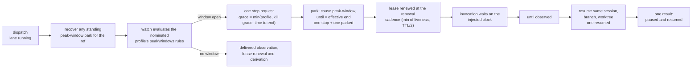
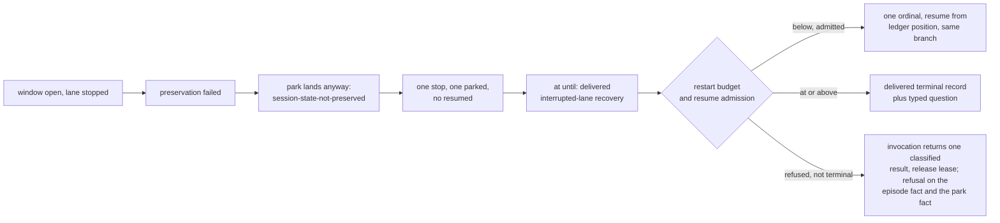

---
change:
  ref: GH-413
  type: feat
  status: Proposed
  slug: peak-pausing-dispatch-lane
  title: "M4-S42: Peak pausing for a lane started by dispatch: it stops at the window's start and resumes at the window's end"
  owners: ["engineering"]
  service: delivery-os
  milestone: "M4: Jaiship-native delivery"
  labels:
    - change
    - m4
    - peak-pausing
    - dispatch
    - lane-lifecycle
    - config
  version_impact: minor
  audience: internal
  security_impact: low
  risk_level: medium
  dependencies:
    internal:
      - "delivered peak-pause decision functions and the bounded-grace stop rule (composed by the dispatch run path, not re-derived)"
      - "delivered durable park record family with the episode frame and the closed preservation classification (reused unchanged)"
      - "delivered taxonomy v2 `stop`, `parked`, `resumed`, and `park-edge` kinds with their declared payloads (unchanged)"
      - "delivered dispatch engine: one-shot session loop, progress-based liveness cadence, capability-gated terminate with its single grace input, recorded-attempt resume, restart budget, and the delivered result and summary"
      - "delivered repository lease claim and its delivered renewal path, with the lease TTL bound"
      - "delivered provider profile nomination at admission, and the per-profile peak-window rule data with its derived grace bound"
      - "delivered status, brief, lanes, and board park projections, and the window-scoped zero-spend evidence over telemetry v2"
      - "delivered typed configuration layer (the lane policy branch) and the injected clock, delay, and transport seams"
    external: []
---

# CHANGE SPECIFICATION

> **PURPOSE**: Extend provider peak pausing from daemon-supervised lanes to every lane a one-shot `dispatch` starts: the lane parks when its nominated profile's declared window is open, keeps its lease live through the pause, is parked with the window's end, resumes itself at that end, and exposes the same bounded-grace stop as the operator command `dispatch stop <ref>` for the one cause the delivered episode framing supports.

## 1. SUMMARY

A lane started by `dispatch` today runs straight through a provider peak window whenever no resident daemon supervises it: only the daemon watches and parks an in-flight lane, and nothing else holds a lane inside its nominated profile's declared window. This change gives the dispatch run path its own life-long profile-window watch over the nominated profile's `peakWindows` rules, evaluated at every observation for the whole lane, so the invocation parks the lane at the window's start, keeps the repository lease live through the pause, resumes the same session in the same worktree and branch at the window's end, and returns one result whose summary states that the lane was paused and resumed. Because a park lasts hours while the delivered lease does not renew, the lane's lease is kept live at a renewal cadence derived from the liveness interval and the lease TTL, so per-ref single-flight holds for the whole parked interval. The same bounded-grace stop becomes the operator command `dispatch stop <ref>`, restricted to the `peak-window` cause the delivered projection and resume path already frame, handed to the owning invocation through the durable lane record, and written only after a confirmed terminate. One case is a declared residual rather than a capability: a dispatch admitted while its nominated profile's window is already open spawns and is parked at the first observation, so one observation cadence plus the applied grace of billing precedes the park.

## 2. CONTEXT

### 2.1 Current State Snapshot

Peak-window rule data exists in two separate places, and they are enforced at different points:

- **Profile `peakWindows`** are lane-watch rule data. They drive the in-flight lane watch and take no part in profile eligibility or admission. A profile with no branch has no lane-watch enforcement.
- **Provider-entry `peak`** windows gate admission: a new dispatch whose candidate profile is inside a declared window is refused at admission. They do not drive the lane watch.

The daemon runs the profile-window watch once per supervision cycle: it stops an in-flight lane with a bounded grace, parks it with cause `peak-window` and `until` at the effective window end, records the closed preservation classification `preserved | session-state-not-preserved`, emits exactly one `stop`, one `parked`, and one `park-edge` per episode under a shared episode id, resumes at the effective end (session resume for `preserved`, the delivered interrupted-lane recovery for `session-state-not-preserved`), and surfaces the episode on `status.laneParks`, the brief park fields, the `lanes` `parked:<cause>` projection with `until`, the board `PARKED` section, and the window-scoped zero-spend evidence.

The typed `dispatch` engine is the regular delivery path. One invocation claims the repository lease, provisions the lane's worktree, spawns or resumes the lifecycle session, watches it with progress-based liveness, terminates a corroborated stall through the capability-gated terminate operation with its single grace input, and derives one result from artifact, ledger, tracker, and CI truth. The nomination is recorded on the **attempt** record at the terminal classification; the durable lane record carries no nomination, so a running lane has no stored nomination for a watch, a cross-process stop, or a resume after a killed invocation to read.

Two delivered facts bound the episode. The dispatch claim takes the repository lease and never renews, and a lease is stale at the lease TTL (90 000 ms default), so the lease does not survive a park that lasts hours. The composition-fact read on `lanes` reports `peakEnforcement` from the composition that supplies a watch; no production composition supplies the profile-window watch today, so the field reads `iteration-start-gating` in production.

Because profile `peakWindows` take no part in admission, a dispatch admitted while its nominated profile's window is already open is not refused: it spawns, and the watch can only park it at its first observation. This change keeps that exposure bounded rather than closing it: one observation cadence (`lane.liveness-interval`, 30 000 ms default) plus the applied grace (bounded by `coordinator.kill-grace`, 20 000 ms default) of billing precedes the park, because calls already in flight complete during the stop grace. The case is declared out of scope with that residual (section 7.2).

The current-truth peak-pausing page states the degradation explicitly in its daemon-absent section: *without a resident daemon there is no window watcher and no mid-flight park*. That statement is the gap this change closes for lanes started by `dispatch`.

### 2.2 Pain Points / Gaps

- **An in-flight dispatch lane is unwatched without a daemon.** A lane started by `dispatch` on a host with no resident daemon has no window watcher at all, so it bills at peak rates through the whole window. Observed on 2026-11-25: a lane committed at 07:22Z on a weekday, inside a declared 06:00-10:00Z peak window that applied to it, and `status` reported no park, because no park existed to report.
- **A window already open at dispatch start costs one cadence plus the grace.** Profile `peakWindows` do not gate admission and the watch has no session to stop before one exists, so the first session spawns inside the window and bills until the first observation parks it, and calls already in flight complete during the stop grace. This change bounds that exposure to one observation cadence plus the applied grace and declares it, rather than adding a pre-session representation the delivered layer cannot express.
- **The one-shot invocation has no episode concept.** `dispatch` returns when its session loop ends; there is no path in which one invocation parks, waits, and resumes, so a window that opens mid-lane can only be respected by an external supervisor.
- **The pause rule belongs to the nominated profile, not to the chain's first entry.** The lane-watch rules are the nominated profile's declared `peakWindows` branch. A preference chain whose first entry declares no windows would silently exempt a lane nominated to a later profile that does declare them, if the rule source were read from the chain's head or from a default. Conversely, a host whose nominated profile declares no windows gets no pausing at all, because the shipped `provider.profiles` branch is empty.
- **The nomination is durable only at the end.** The attempt record that carries it is appended at the terminal classification, so a running or parked lane has no stored profile for the park and event payloads, for a stop issued by another process, or for a resume after the invocation is killed.
- **The lease does not survive the park.** A lease is stale after the lease TTL, the dispatch claim never renews, and the admission verdict treats a stale lease as takeable, so a second `dispatch` of the same work item is admitted a TTL into an hours-long park.
- **There is no operator stop.** Stopping a lane today means terminating the session out of band, which leaves no park record, no classified episode, no preserved-session classification, and no bounded grace, so an operator who wants a lane to stop and come back has no supported command and no evidence.
- **A parked lane is silent, and silence reads as a stall.** The repository's own liveness probes are activity-keyed; a lane that is stopped and waiting for a window produces no activity, so an outer probe applies its stall threshold and kills the waiting invocation.

## 3. PROBLEM STATEMENT

Because peak-window enforcement for an in-flight lane depends on a resident daemon that a one-shot `dispatch` does not require, and because the lease that protects the lane expires long before a window ends, a delivery cannot be held inside its nominated profile's declared window without either billing peak-rate tokens or risking a second session for the same work item, the operator's declared rule is unenforced, and no surface can explain the difference between a lane stopped on purpose and a lane that died.

## 4. GOALS

- **G-1**: A lane started by `dispatch` is watched for its whole life and pauses whenever the profile nominated at admission declares an open window, with the already-open-at-start exposure bounded by one observation cadence plus the applied grace.
- **G-2**: The pause is a first-class episode: one bounded-grace stop, one park with the window's end, one resume at that end, exactly-once ledger evidence.
- **G-3**: Nothing is lost or duplicated: the same session, branch, worktree, change folder, phases, and queue state survive the episode, the lease stays live so per-ref single-flight holds, and no second session is ever started for the work item.
- **G-4**: One `dispatch` invocation spans the episode and still returns exactly one result for the work item, stating that the lane was paused and resumed.
- **G-5**: The episode is visible on `dispatch status`, `lanes`, and `board` with the park cause and the window's end, and the composition-fact read states which enforcement the composition supplies.
- **G-6**: Operators can request the same bounded-grace stop for a running lane and get the same classified episode, with a truthful refusal when the lane is not running.
- **G-7**: An operator can turn automatic pausing off and get today's admission-gating-only behaviour, declared, named, and defaulted on.

### 4.1 Success Metrics / KPIs

| Metric | Target |
|---|---|
| Billable model calls after the first observation while a declared window of the nominated profile is open | 0 |
| Billing exposure of a dispatch admitted while its nominated profile's window is already open | one observation cadence (`lane.liveness-interval`, 30 000 ms default) plus the applied grace (bounded by `coordinator.kill-grace`, 20 000 ms default), no billable call after the park instant |
| Episodes with exactly one `stop`, one `parked`, and one `park-edge`; and one `resumed` where state was preserved | 100% |
| Billable calls attributable to a parked lane between park and resume, over present telemetry | 0 |
| Work items that acquire a second session because of an episode | 0 |
| Lease takeovers of a work item while its lane is running or parked | 0 |
| Branch, change folder, phase, and queue-state divergence caused by an episode | 0 |
| Stop requests landing within one observation cadence of the window-open observation, measured at the stop seam | 100% |
| Parks landing no later than the window-open observation plus the applied grace | 100% |
| Resume decisions landing within one cadence of the recorded park end | 100% |
| Paused dispatch lanes returned to the operator as a single result at the end of the invocation | 100% |
| Reference host: the profile its lanes are nominated to declares `peakWindows` including the incident's 06:00-10:00Z window | verified before Done, as a hand-off precondition |

**Measurement basis.** Population: dispatch lanes started by the changed binary on the reference host, plus the fixture lanes of the change's own acceptance suites. Method: the durable episode records and their events for the episode and lease targets; the delivered window-scoped spend reading for the cost targets; the delivered surfaces for the visibility targets. Window: the fixture-level targets are measured on every run of the change's suites; the reference-host population is observed from the first lane after the upgrade, and the rule-set precondition is verified before Done. A target over an empty population is reported as not yet measured, never as met.

### 4.2 Non-Goals

- **NG-1**: No change to the resident daemon's supervision cycle, its watch, or its own park and resume behaviour.
- **NG-2**: No parallel lanes and no multi-lane concurrency (parallel lanes, GH-412).
- **NG-3**: No weekday-only or calendar-aware window policy; windows stay declared rule data (weekday-only window policy, GH-382).
- **NG-4**: No resident-mode or always-on dispatch daemon work (resident mode, GH-395).
- **NG-5**: No shell-orchestrator work; the typed dispatch path is the delivery path.
- **NG-6**: No new park cause, no new event kind, no new record kind, no new error identity, no new result token, and no second kill path.
- **NG-7**: No read surface for a declared or currently open window as an object of its own.
- **NG-8**: No change to provider-entry admission gating, and no participation of profile `peakWindows` in eligibility or admission.
- **NG-9**: No provider-entry `peak` window in the lane watch; that rule source stays the admission gate it is today.
- **NG-10**: No pre-session park. A dispatch admitted inside its nominated profile's window spawns and is parked at the first observation, with the exposure bounded by one observation cadence plus the applied grace (section 7.2).

## 5. FUNCTIONAL CAPABILITIES

| ID | Capability | Rationale |
|----|------------|-----------|
| F-1 | Life-long dispatch-owned window watch | A lane's whole life must be covered by the watcher that owns it, with no dependency on a resident daemon. |
| F-2 | The nominated profile's declared window rules decide the pause, from a stored nomination | The pause must read the same lane-watch rule data the daemon's watch reads, on the profile the lane actually nominated, and it must be readable while the lane runs. |
| F-3 | Bounded-grace stop and exactly-once park at the window's start | The pause must be a recorded episode with a bound and an end, not an ad-hoc kill. |
| F-4 | Automatic window-end resume inside the same invocation, with a declared outcome when recovery refuses | The episode must end without an operator command or a new dispatch, and it must never wait silently after a refusal. |
| F-5 | Nothing lost, no second session, and a lease that stays live through the park | Work preservation and per-ref single-flight are the episode's non-negotiable invariants, and the delivered lease alone does not survive an hours-long pause. |
| F-6 | Park visibility and a declared composition-fact read | An episode that cannot be seen reads as a dead lane, and the machine read must state which enforcement the composition supplies. |
| F-7 | One invocation, one result that states the pause and the resume | The one-shot contract must survive the episode: one work item, one result, truthful summary. |
| F-8 | Named setting that disables pausing, declared default on | An operator must be able to return to today's behaviour deliberately, and the default must not be a silent second behaviour. |
| F-9 | Operator command `dispatch stop <ref>` for the `peak-window` cause | The same bounded-grace stop must be reachable on demand, in the one cause shape the delivered projection and resume path frame. |
| F-10 | Classified refusal when the lane is not running | A stop request must never write a phantom episode or an unexplained failure. |
| F-11 | Inherited owner-hold precedence and per-lane isolation | The delivered precedence and isolation rules bind the dispatch-owned watch exactly as they bind the daemon's. |
| F-12 | Episode zero-spend evidence | "Paused" must be a falsifiable cost claim, not a state label. |

### 5.1 Capability Details

**F-1 Life-long dispatch-owned window watch.** From the moment the lane's first session is acquired to its terminal classification, the dispatch run path runs the same profile-window watch the daemon runs at every observation, evaluated before the session is observed for the next step, through the same decision functions and the same injected clock, so the two compositions cannot drift into different answers for the same lane and instant. The watch covers a window that opens mid-iteration and a window that opens while the lane is between iterations; it ends only when the lane reaches its terminal classification. When the window is already open at the first observation, the lane is parked there, which is the change's single declared exposure: one observation cadence plus the applied grace of billing precedes the park, and no billable call follows the park instant (sections 7.2 and 11). Before its first stop decision for a reference, the watch also recovers any standing park for that reference (F-3). A composition that supplies no watch ports keeps its delivered behaviour, and pausing disabled by F-8 supplies none.

**F-2 The nominated profile's declared window rules decide the pause, from a stored nomination.** The lane-watch rule data is the **nominated profile's `peakWindows` branch**, the same rule data the daemon's watch reads, taken from the profile recorded at admission. The record that carries it while the lane runs is the durable lane record's additive optional `providerProfile`, written on **every `active` record the invocation appends** (the first acquisition and every restart or resume iteration), so a latest-wins read always finds it and the watch, a stop issued by another process, the park and event payloads, and a resume after a killed invocation all read a stored field rather than an in-memory value or a rendering-time inference. No lane is re-nominated. The lane pauses when that branch declares a window open on its declared zone's clock, buffers included. The rule source is the nominated profile, not the preference chain's first or base entry and not any default: a chain whose first entry declares no `peakWindows` does not exempt a lane nominated to a later profile that does declare them. A profile with no `peakWindows` branch has no lane-watch enforcement, so its lanes are never stopped for peak reasons; the provider-entry `peak` windows that gate admission are a separate, unchanged rule source and never drive the lane watch. Windows are read with the delivered fail-closed validation; this change adds no window declaration mechanism and no new rule field. The pause decision is the delivered first-match evaluation: the park's end is the effective end of the **first open window** the decision returns, not a union of overlapping intervals. Where two of the nominated profile's windows overlap in effect, the lane may therefore resume at the first window's end and be parked again at the next observation into the second, as a separate episode (a known consequence recorded in RSK-13). The ticket's phrase "any provider that its seats resolve to" names the intent from the seat side: enforcement follows the profile the lane's seats were admitted under. The operative rule remains that profile's declared windows. A lane whose record carries no nomination, including a pre-change lane resuming on a classified absent nomination, is not window-pausable, exactly as delivered, and the absence is never fabricated.

**F-3 Bounded-grace stop and exactly-once park at the window's start.** Before its first stop decision for a reference, and at the first observation of an invocation that resumes a lane carrying a standing park, the run path **recovers that standing park through the delivered mutating park pass** (`recoverQueueParks`: the clear-observed marker, the recovered record, and the `park-auto-recovery` incident), so an expired, orphaned, refused, or budget-exhausted park is closed before a new episode. **The already-parked rule is occupancy**: any standing `peak-window` park for the reference, whatever its `until`, suppresses a new stop, because two active parks for one reference permanently degrade every park-reading surface through the delivered duplicate invariant, which an append-only history cannot repair. If the standing park cannot be recovered, the run is refused as a classified failure and starts no new episode rather than parking twice. When a window opens, the lane receives one stop request and the lane lands parked with cause `peak-window`, the profile named, `until` at the **effective end of that first open window**, and the recorded stop instant. The stop sequence is fixed. One stop request is sent. Exactly one terminate call is issued through the delivered terminate path, carrying `graceMs` equal to the smallest of three quantities: the remaining profile grace deadline, the delivered kill grace (`coordinator.kill-grace`, 20 000 ms default), and the time from the stop instant to the effective window end. TERM reaches the matched session's identified process tree first; KILL follows only after that grace and only over a target still listed, so the escalation can never outlast the buffer that protects the window. The recorded grace deadline is the profile-bounded deadline, it never exceeds the profile's derived maximum, and an unknown session is success. Exactly one `stop` and one `parked` event are recorded with the episode id, under one fence, exactly once across any number of observations; the park record is append-only with read-time expiry and no in-place mutation. The park carries the closed preservation classification; a preservation failure never refuses the park and never extends the grace. Where the nominated profile's windows overlap in effect, each park is its own episode with its own `stop`, `parked`, and `park-edge`, so a lane can resume and be parked again (RSK-13). The stop composes with the delivered supervision, liveness, and safe-boundary contracts and adds no kill path of its own.

**F-4 Automatic window-end resume inside the same invocation, with a declared outcome when recovery refuses.** At the recorded effective end, observed by read-time expiry through the same injected clock, the invocation resumes the lane by its preservation classification. A `preserved` episode resumes the preserved session identity through the delivered session resume path, attach-and-continue on the same branch and in the same worktree, consuming no restart ordinal and starting no fresh spawn, and records exactly one `resumed` event. A `session-state-not-preserved` episode does not attempt a session resume; it routes to the delivered interrupted-lane recovery on the same branch, consuming exactly one restart ordinal under the delivered restart budget and resume economics, with budget exhaustion appending the delivered terminal exhaustion record and raising the delivered typed question. That recovery is a restart admission and emits no `resumed` event. **When the recovery refuses without being terminal** (the delivered uneconomical-resume and unverifiable-state refusals), the invocation **returns one classified result** instead of waiting again: the lane stays parked, no further attempt is made, the lease is released on return so the delivered operator resume path can take the ref, and the result is the delivered derivation over the same truth (the token and exit that truth produces without an episode) with a summary that names the refusal and the park end rather than claiming a pause and a resume. The refusal is also carried on the invocation's bounded episode fact and on the `dispatch status` park fact with the recorded end, so the parked state is visible after the invocation is gone. The resume needs no operator command and no new dispatch for the ordinary paths. Resume admission re-evaluates the same nominated profile's window rules and never resumes a lane into an observed open window: safety outranks punctuality, so a lane whose window rule changed during the episode stays parked rather than resuming early. **An operator resume of a lane that still carries a standing park** recovers that park first through the delivered mutating pass and then, because the window is open, parks again as a new exactly-once episode with the recovery's evidence (the clear-observed marker, the recovered record, and the `park-auto-recovery` incident) preceding the new stop; the lane is never double-parked.

**F-5 Nothing lost, no second session, and a lease that stays live through the park.** The episode leaves the lane's branch, change folder, recorded phases, and queue state unchanged: nothing is deleted, rewritten, requeued, or duplicated, and a reference never carries two parks because a standing park is recovered before a new episode (F-3). The recorded worktree is reused, never re-provisioned. Because a park lasts hours and the delivered lease is stale after its TTL while the dispatch claim does not renew, the lane **keeps its lease live for the whole run and the whole park** by a bounded renewal through the delivered lease renewal path, using the existing lease record, at a renewal cadence of `min(lane.liveness-interval, queue.lease-ttl / 2)`, so the heartbeat cannot reach the TTL between renewals even when the liveness interval is at or above the TTL. The renewal is a no-op unless the **live lease's latest heartbeat is this invocation's own last write** (the invocation remembers the heartbeat instant it last wrote). The holder and the reference do not identify an invocation, and the lease identity does not either: a re-dispatch's admission claim takes the delivered `renewed` arm, which preserves the lease identity and acquisition instant while appending a newer heartbeat, so the earlier invocation's remembered instant stops matching and its renewal becomes a no-op. The key therefore needs no change to the claim. A lease that has gone stale but whose latest heartbeat is still this invocation's own last write is still the lane's own: nobody took it, and the renewal revives it through the delivered same-holder arm, which does not require the lease to be live. A no-op renewal (a later write is not this invocation's) appends nothing, extends nothing, and surfaces bounded evidence `lease:not-owned`; the invocation continues its current wait without claiming a live lease and re-checks at the next observation, because the wait itself needs no ownership. When it next needs to act as owner (before a resume, a `dispatch stop` it issues, or any owner-state write), an invocation that no longer holds the lease must not act: it returns one classified result with the park standing and the observation, and the delivered operator resume path applies. The renewal never acquires an absent lease, takes over a stale one, or displaces another holder, and it does not pass the owner-hold gate, so a parked lane under an active hold keeps renewing and the hold still parks nothing. Renewals ride bounded waits: the lane renews at each wake, at most once per renewal cadence, and a bounded tracker or claim wait is not renewed. No new queue record kind, no schema change, and no second exclusion mechanism are introduced. With the lease live, per-ref single-flight holds for the whole parked interval, a second dispatch of the same work item is refused at every point on both sides of the lease TTL, and a resumed lane never starts a second session for the work item. A renewal failure is retried at the next cadence and is surfaced as lease evidence rather than silently swallowed.

**F-6 Park visibility and a declared composition-fact read.** A dispatch-owned episode is a delivered durable park record, so `lanes` renders `parked:peak-window` with the delivered `until` and `board` lists the row in its `PARKED` section through the same projection the daemon's episodes use; no parallel surface and no second vocabulary are introduced. `dispatch status` gains an additive optional park fact for the addressed lane: the cause, the window's end, the recorded stop instant, the preservation classification, and any recorded recovery refusal, carried verbatim from the park record, absent when no park stands. The delivered lane-view derivation is **unchanged**: `stale` is true exactly when the advisory owner probe is `dead`, and `delivering` is its negation, so a healthy parked lane whose invocation is alive and waiting answers `stale: false` and `delivering: true`, and only an orphaned park answers `stale: true`, with the park fact explaining that nothing will resume it. The delivered `probe` verdict is reported as observed, and no derivation is redefined for the parked case. The verdict by probe is therefore:

| Owner probe (parked lane) | `stale` | `delivering` | What the additive park fact adds |
|---|---|---|---|
| `live` | `false` | `true` | The pause is explained; the invocation is alive, holds the lease, and will resume at the recorded end. |
| `unknown` | `false` | `true` | The delivered rule holds, because an unknown probe never asserts staleness; the park fact explains the pause. |
| `dead` | `true` | `false` | The park is orphaned: nothing will resume it, and only the delivered resume path or an operator can. |

The `lanes` machine read's `peakEnforcement` block keeps its two members and its two mode values; its **mode input is the reading composition's own effective configuration**, not another process: the read reports `window-watch` when the composition's configuration has automatic pausing enabled and the watch is therefore composed, and `iteration-start-gating` when pausing is disabled or no watch is composed. `parkClaimed` stays derived from durable park records.

**F-7 One invocation, one result that states the outcome.** The one invocation returns exactly one result for the work item after the episode ends. Its token, exit projection, and derivation order are unchanged and no episode can invent a token. For an episode that resumed, the summary states that the lane was paused and resumed, naming the cause and the episode's end; for a not-preserved episode whose recovery refused without being terminal (F-4), the summary names the refusal and the park end, because the lane was paused and was not resumed; and for an invocation that lost the lease (F-5), the summary names the lost lease and the park end, because that invocation no longer acts as the owner. The machine envelope carries an additive bounded episode fact (episode id, cause, park end, resume instant, the preservation classification where no session resume happened, and the refusal where a recovery refused) so the outcome is checkable from the answer alone. The episode facts are bounded evidence, not a new result shape.

**F-8 Named setting that disables pausing, declared default on.** One boolean key in the delivered typed lane policy branch, `lane.disable-peak-pausing`, disables automatic pausing. Unset or `false` keeps pausing on, which is the declared default; `true` composes no in-flight window watch, so behaviour is exactly today's: admission gating only, no stop, no park, no episode, and no claim of one. The key's effective value is resolved for each admitted change, so it applies to the lane a dispatch starts and never rewrites a lane already parked; it is declared through the delivered layered configuration and is not a new per-work-item override store. A non-boolean value is the delivered configuration refusal naming the key. With pausing disabled the composition-fact read reports `iteration-start-gating`, and the delivered window-scoped evidence is not synthesized for a park that never happened.

**F-9 Operator command `dispatch stop <ref>` for the `peak-window` cause.** The command sends a running lane the same bounded-grace stop request the watcher sends, for the one cause this change admits: `peak-window`. It requires an end instant (`--until`). Any other cause, or a missing end, is refused `input.value.rejected` at the grammar boundary before any write, the missing end carrying the delivered `until-required` reason (DEC-21). The cause set is narrowed deliberately: the delivered event projection frames `stop`, `parked`, and `resumed` only over `peak-window` parks with a complete episode frame, and the delivered resume decision reads only `peak-window` parks, so admitting another cause would promise an episode the delivered machinery cannot frame or resume without a new kind, a projection change, and a second resume path. The command never kills: it sends no signal of its own and leaves the delivered terminate path as the only signalling route, with the same `graceMs` composition as F-3. It resolves the run **from the durable lane record**: the session identity, and the tree root to match, which is the recorded worktree path when the record carries one and otherwise the resolved repository's main checkout (the in-checkout shape). It issues the stop through the delivered terminate path, and it writes the complete watcher-shaped episode frame (episode id, grace deadline, stop instant, preservation classification, profile from the record's nomination) **only after a confirmed terminate**, so exactly one `stop` and one `parked` are emitted with the same payloads as a window-open stop. A terminate that is not confirmed, because no live process matched the recorded session's exact identity, is the not-running refusal of F-10 and writes nothing: the terminate operation's own idempotence on an unknown session is its contract, not this command's licence to record an episode for a stop that never happened. Because the session belongs to another process, the record is the hand-off channel: when the owning invocation's collection resolves at session end, it withholds terminal classification for **at least the applied grace plus one observation cadence** and re-reads the park record for its ref, because the terminate call awaits the whole grace; an open `peak-window` park lands it in the wait and resume path, and if no park appears in that interval it classifies exactly as delivered. The withhold is a result-latency cost on every session end, about 50 s at the defaults (a 20 000 ms applied grace plus a 30 000 ms observation cadence), and it applies whether or not automatic pausing is enabled, because it is the run path's own post-collection rule. The command is available whether or not automatic pausing is enabled: the setting governs automatic policy, not operator intent. The success contract is declared: one human line naming the work item, the cause, the park end, and the episode id; machine data with the work item, the cause, the park end, the episode id, and the preservation classification; exit `0`.

**F-10 Classified refusal when the lane is not running.** A stop request is resolved against the newest lane record for the work item in the resolved repository. **Running** means that record is `active`, carries a session identity, **and has no open park of any cause standing for the ref**. The delivered duplicate invariant counts every cause, so an open park of any cause makes the lane unparkable by this command, not only a `peak-window` one. A terminal record, an absent record, an active record with no session identity, and an already-parked active record are all not running; the already-parked case is the delivered unmet-precondition refusal, its bounded summary naming the observed parked state, so a second stop can never append a second park for one ref. A request against a lane that is not running is refused before any write: the refusal is a classified delivered identity at its delivered exit, its bounded summary names the work item and the observed lane state, and it appends no park record, no episode event, and no attempt, lane, or queue record. Nothing is signalled, nothing is parked, and the refusal is indistinguishable in cost from a read. A request whose terminate is not confirmed is the same refusal and writes nothing (F-9). A request that races a session end resolves exactly one classified outcome: either the lane is still running, the terminate is confirmed, and the episode lands, or the session has ended and the request is the not-running refusal, never both frames and never a partial episode.

**F-11 Inherited owner-hold precedence and per-lane isolation.** An active owner hold changes nothing about the watch: the hold is a read-time gate that parks nothing and writes no park record, so the dispatch-owned watch still parks `peak-window` with `until`, and a hold-active window-end resume refuses the delivered owner-hold precondition and proceeds once the hold clears, leaving the existing park record byte-unchanged. Isolation holds lane by lane and profile by profile: the decision reads one lane's recorded nomination and that profile's window state only, so lanes nominated to other profiles keep running, keep their leases, and keep their supervision unchanged, and only lanes parked for a given window resume at its end.

**F-12 Episode zero-spend evidence.** The waiting invocation makes no billable model call, spawns no session, and issues no provider request between the park and the resume, so the delivered window-scoped reading (the count of billable model calls attributable to the parked lane from the park instant through the park end, both boundaries inclusive) remains the episode's proof and reads zero over present telemetry. Telemetry absence stays a classified outcome carried by the reading's telemetry state and never renders as zero. A seeded mid-window call on the lane reads non-zero, so the claim can fail. Billing before the park is outside this reading's scope and is the declared residual of one observation cadence plus the applied grace (section 7.2).

## 6. USER & SYSTEM FLOWS

**Flow 1: a window opens while a dispatch lane runs.**



**Flow 2: state could not be preserved.**



**Flow 3: operator stop.**

```
Operator runs dispatch stop <ref> --cause peak-window --until <iso>
  -> grammar: another cause, or a missing end, is refused input.value.rejected
     (a missing end reuses the delivered until-required reason) before any read
  -> resolve the newest lane record for the work item in the resolved repository
  -> not running? (terminal, absent, no session identity, an open park of any cause
     already standing, or a terminate that cannot be confirmed)
     the delivered unmet-precondition refusal, naming the observed state, nothing written
  -> running? read the stored nomination from the record and the tree root
     (recorded worktree path when present, otherwise the main checkout)
  -> one stop through the delivered terminate path (graceMs = min of the three bounds)
  -> only after a confirmed terminate, write the complete episode frame: one stop,
     one parked, payloads identical to a window-open stop, cause peak-window
  -> the owning invocation withholds classification for at least the applied grace plus one observation cadence
     after its collection resolves, re-reads the park record, and if an open
     peak-window park is there it renews the lease, waits, and resumes at the end
  -> the command answers one human line and machine data (ref, cause, until, episode id,
     preservation) at exit 0

Operator resume during an open window (the lane was parked and then left):
  -> the invocation recovers the standing park first through the delivered mutating pass
     (clear-observed marker, recovered record, park-auto-recovery incident)
  -> the window is still open, so it parks again as a new exactly-once episode
  -> the lane is never double-parked
```

**Flow 4: pausing disabled.** `dispatch <ref>` composes no in-flight watch, provider-entry admission gating applies exactly as delivered, the composition-fact read reports `iteration-start-gating`, no park, stop, or resume is recorded or claimed, and the delivered result is byte-identical to the pre-change behaviour.

**Flow 5: a second dispatch of a running or parked work item.** The lane's lease is live for the whole run and park, renewed at `min(lane.liveness-interval, queue.lease-ttl / 2)`, so the per-ref single-flight predicate refuses `queue.single-flight` with the live holder on both sides of the lease TTL; no second session, no second episode, and the parked lane is untouched.

## 7. SCOPE & BOUNDARIES

### 7.1 In Scope

- A profile-window watch owned by the one-shot dispatch run path, at every observation for the lane's whole life, using the delivered decision rules and clock.
- The nominated profile's declared `peakWindows` rules as the pause input, read from the nomination stored on the durable lane record, with the delivered first-open-window end and the chain-first-no-window non-exemption.
- The bounded-grace stop with its single `graceMs` composition, the exactly-once `stop` and `parked` episode, the closed preservation classification, and the recorded window end.
- **Recovery of a standing park before a new episode**: the delivered mutating park pass closes an expired, orphaned, refused, or budget-exhausted park (the clear-observed marker, the recovered record, and the `park-auto-recovery` incident) before the first stop decision and at the first observation of a resuming invocation, with occupancy meaning that any standing `peak-window` park for the ref suppresses a new stop.
- The in-invocation wait until the effective end, the classification-routed resume with the delivered recovery on the not-preserved branch, and the returned classified result when that recovery refuses without being terminal.
- The lane's lease kept live through the run and the park at `min(lane.liveness-interval, queue.lease-ttl / 2)`, using the delivered renewal path and the existing lease record, as a no-op unless the live lease's latest heartbeat is the invocation's own last write, and without passing the owner-hold gate.
- The one result whose summary states the pause and the resume, with the additive bounded episode fact and the refusal where one was recorded.
- The additive park fact on `dispatch status` with the delivered lane-view verdict unchanged, and the confirmation that `lanes` and `board` show dispatch-owned parks through the delivered projections.
- The configuration-derived `peakEnforcement.mode` rule, and the one intended value change it causes on a production composition with pausing enabled.
- The additive optional `providerProfile` on the durable lane record, carried on every `active` record the invocation appends, absent on pre-change records and never fabricated.
- The operator command `dispatch stop <ref>` for the `peak-window` cause only, with its `--until` requirement, its running predicate (including "no open park of any cause stands for the ref"), its confirmed-terminate rule before any park write, its record-mediated hand-off to the owning invocation, its success contract, and its classified refusals.
- One boolean configuration key that disables automatic pausing, defaulted on.
- The declared replacement truth for the daemon-absent paragraph and the composition-fact read, and the wider page set named in section 16, to be reconciled into current truth in the system-spec-update phase.

### 7.2 Out of Scope

- [OUT] Any change to the resident daemon's supervision cycle, watch cadence, park, or resume behaviour.
- [OUT] Parallel lanes, multi-lane concurrency, or worktree-per-runner scheduling.
- [OUT] Weekday-only, holiday-aware, or otherwise calendar-shaped window policy.
- [OUT] Resident-mode or always-on dispatch work.
- [OUT] Shell-orchestrator changes; the shell entry points keep their delivered fallback status, and the activity-keyed liveness consumers are handled as an operator precondition (section 12, RSK-2), not as code here.
- [OUT] Any new park cause, event kind, record kind, schema identity, error identity, or result token.
- [OUT] A read surface for a declared or open window as an object, and any query of provider quota or provider API.
- [OUT] Changing provider-entry admission gating, the nomination rule, or the four no-nomination refusal identities.
- [OUT] Honouring provider-entry `peak` windows in the lane watch, or letting profile `peakWindows` gate admission.
- [OUT] `dispatch stop` for any cause other than `peak-window`, and manual resume of an operator-stopped lane before its declared end (the delivered operator resume path is the only manual route).
- [OUT] **A park before the first session.** A dispatch admitted while its nominated profile's window is already open spawns; the watch parks it at the first observation, so one observation cadence (`lane.liveness-interval`, 30 000 ms default) plus the applied grace (`coordinator.kill-grace`, 20 000 ms default) of billing precedes the park, and no billable call follows the park instant because calls already in flight complete during the stop grace. The pre-session representation is absent because the delivered projection, resume half, and lane view cannot express a park with no session and no lane record (DEC-14, withdrawn).
- [OUT] Automatic recovery of an episode whose dispatch process was killed during the wait, **until the lane runs again**: the park record stands, the lane record keeps the nomination, and the next invocation (or the operator resume path) recovers the standing park through the delivered mutating pass before any new episode (F-3).

### 7.3 Deferred / Maybe-Later

- A single operator read that lists every paused lane with its episode history across repositories.
- A declared maximum episode duration with an operator policy for windows longer than it.
- Retiring the operator-shaped park record's minimal episode frame in favour of one writer for all parks.
- Extending `dispatch stop` to further causes, once the projection and resume framing for them exists.
- Extending the same watch to a composition that supervises several lanes in one process (parallel lanes).

## 8. INTERFACES & INTEGRATION CONTRACTS

### 8.1 REST / HTTP Endpoints

N/A. No HTTP or REST surface is added or changed. The operator surfaces in this change are CLI surfaces (`dispatch stop`, the additive park fact on `dispatch status`, and the existing `lanes`, `board`, and `spend --window-evidence` reads), specified in sections 5 and 8.3.

### 8.2 Events / Messages

The taxonomy v2 kinds and their payloads are reused unchanged. This change adds a producer for dispatch-owned episodes and the operator stop path; it adds no kind, no payload field, and no version.

| Topic | Kind | Payload (unchanged) | Producer | Rule |
|---|---|---|---|---|
| `dispatch.attempt` | `stop` | `ref`, `graceDeadline`, `providerProfile`, `windowEnd`, `stoppedAt`, `episodeId` | The dispatch-owned watch and `dispatch stop`, for `peak-window` only | Exactly one per episode in which a session was stopped; emitted only over a park record whose episode frame is complete |
| `dispatch.attempt` | `parked` | `ref`, `reason`, `providerProfile`, `until`, `preservation`, `recordedAt`, `episodeId` | The dispatch-owned watch and `dispatch stop`, for `peak-window` only | Exactly one per episode in which a session was stopped, carrying the closed preservation classification; `dispatch stop` writes it only after a confirmed terminate |
| `dispatch.attempt` | `resumed` | `ref`, `sessionRef`, `branch`, `reDispatched`, `resumedAt`, `episodeId` | The dispatch invocation's resume decision | Exactly one per preserved episode, with the no-re-dispatch fact; never emitted by a restart recovery |
| `queue.graph` | `park-edge` | `ref`, `cause`, `until?`, `episodeId`, `recordedAt` | The delivered park projection, now fed by dispatch-owned episodes too | Exactly one per episode; the operator-shaped minimal record still projects this kind alone |

Every frame stays inside the delivered eight-field envelope, the per-(topic, lane) sequence, the overflow carriage, and the bounded evidence budget. An episode's frames share one episode id, so the ledger alone reconstructs the episode. The `providerProfile` in `stop` and `parked` is read from the durable lane record's stored nomination, never re-resolved. Where the nominated profile's windows overlap in effect, each episode is framed separately, so a lane can produce consecutive episodes (RSK-13). A standing park closed before a new episode is the delivered recovery record, so the delivered projection's own rules frame it and this change adds no kind or frame of its own.

### 8.3 Data Model Impact

| ID | Element | Description |
|----|---------|-------------|
| DM-1 | Durable park record, episode frame | Reused unchanged in shape: cause, the nominated profile, `until`, the recorded stop instant, the grace deadline, the episode id, and the closed preservation classification. A dispatch-owned stop writes the complete episode frame; the operator release writer keeps its minimal frame; a standing park is closed by the delivered recovery record with its clear-observed marker and `park-auto-recovery` incident, in the same family and the same shape, before a new episode. |
| DM-2 | Durable lane record | One additive optional member: `providerProfile`, the nomination, carried on **every `active` record the invocation appends** (first acquisition and every restart or resume) so a latest-wins read always finds it. It is absent on pre-change records and is never fabricated, defaulted, or inferred. The lane's delivered `active` and `terminal` states, its other members, and its schema identity are unchanged; the park is still not a lane state, and the open park is joined at read time. |
| DM-3 | `dispatch status` payload | Additive optional park fact for the addressed lane: cause, park end, recorded stop instant, preservation classification, and any recorded recovery refusal. Absent when no park stands; every delivered member and line unchanged, and the delivered `stale`/`delivering` derivation untouched. |
| DM-4 | Dispatch result payload | Additive optional bounded episode fact: episode id, cause, park end, resume instant, the preservation classification where no session resume happened, and the refusal where a recovery refused. No new token, no new key in the delivered result keys, and no change to the derivation. |
| DM-5 | Dispatch result summary | The human summary gains the pause and resume statement for a spanning invocation; the delivered key set and the verbose detail line keep their delivered shape. |
| DM-6 | Configuration key for disabling pausing | One boolean in the delivered typed lane policy branch, unset by default, meaning automatic pausing is on; `true` supplies no in-flight watch. |
| DM-7 | Composition-fact read | The delivered `peakEnforcement` block keeps its two members and its two mode values. Its mode input is the reading composition's own effective configuration: `window-watch` when automatic pausing is enabled and the watch is composed, `iteration-start-gating` when pausing is disabled or no watch is composed. `parkClaimed` stays derived from durable park records. |
| DM-8 | `dispatch stop` success output | Human: one line naming the work item, the cause, the park end, and the episode id. Machine: the work item, the cause, the park end, the episode id, and the preservation classification, at exit `0`. Written only after a confirmed terminate and the park append. No new envelope shape and no new key family. |
| DM-9 | Lease liveness during the episode | The existing repository lease is kept live by the delivered renewal path at `min(lane.liveness-interval, queue.lease-ttl / 2)` for the run and the park, as a no-op unless the live lease's latest heartbeat is the invocation's own last write, and without passing the owner-hold gate. A no-op renewal writes nothing, extends nothing, and surfaces the bounded evidence `lease:not-owned`. No new record kind, no schema change, and no new exclusion mechanism. |

No record kind, schema identity, or state-store layout is added. Pre-change park and lane records read normally.

### 8.4 External Integrations

N/A. No provider, tracker, or transport API is added or called. Windows are declared local rule data, the decision is pure over the injected clock, the lease lives in local state, and the wait performs no network access.

### 8.5 Backward Compatibility

- With no open park, every delivered field and line is byte-identical to the pre-change output, with **one intended exception**: `lanes --json`'s `peakEnforcement.mode` moves from `iteration-start-gating` to `window-watch` on a production composition where automatic pausing is enabled, because that composition now supplies the watch. Every other member, `parkClaimed`, and every human line are unchanged, and with pausing disabled the field keeps its delivered value.
- With pausing disabled by the setting, a dispatch behaves byte-for-byte as today: admission gating only, no watch, no episode, `iteration-start-gating`.
- The delivered taxonomy is unchanged: no kind, payload field, or version moves; a v2 consumer needs no change.
- The delivered park cause set, preservation classification, and window rule data keep their closed values; the operator-shaped release grammar and its `park-edge`-only projection are unchanged; `dispatch stop` admits only `peak-window`.
- The durable lane record gains one additive optional member, carried on every `active` record the invocation appends; a pre-change record reads normally, reports no nomination, and is not window-pausable. The attempt record's nomination and its terminal-classification timing are unchanged.
- The delivered lane-view derivation (`stale`, `delivering`, `probe`) is unchanged, including for a parked lane.
- The delivered `dispatch` grammar, refusal identities, exit taxonomy, and result tokens are unchanged; `dispatch stop` joins the family without changing an existing invocation.
- The lease record, its TTL, and its renewal outcomes are unchanged; only who renews and how often is added.

## 9. NON-FUNCTIONAL REQUIREMENTS (NFRs)

| ID | Requirement | Threshold |
|----|-------------|-----------|
| NFR-1 | Bounded-grace stop: the stop request issues exactly one terminate call through the delivered terminate path, with `graceMs` equal to the smallest of the remaining profile grace deadline, the delivered kill grace, and the time to the effective window end; TERM precedes KILL, and KILL only follows over a target still listed. The recorded deadline never exceeds the profile's derived maximum, and no additional signal or kill path exists. | terminate calls per stop = 1; recorded deadline ≤ `graceSecondsMax`; applied `graceMs` ≤ each of the three bounds; added signal paths = 0. |
| NFR-2 | Exactly-once episode: across any number of observations, one episode yields one `stop`, one `parked`, one `park-edge`, and, for a preserved episode only, one `resumed`, all sharing one episode id. | duplicates = 0; missing required frame = 0; episode ids per episode = 1. |
| NFR-3 | Zero billable model calls attributable to the parked lane between the park instant and the park end, both boundaries inclusive, over present telemetry; telemetry absence is a classified outcome, never a fabricated zero. Billing before the park is outside this count and is the declared residual of one observation cadence plus the applied grace (section 7.2). | count = 0 with telemetry present; a seeded in-window call reads greater than 0; 100% of episodes carry the delivered telemetry-state disclosure. |
| NFR-4 | Restart ordinal accounting: a preserved episode consumes no restart ordinal and starts no fresh spawn; a not-preserved episode consumes at most one ordinal per observation under the delivered restart budget and raises the delivered typed question at exhaustion; a non-terminal recovery refusal consumes no additional ordinal and ends the invocation with one classified result, releasing the lease on return. | ordinals on the preserved path = 0; ordinals per admitted not-preserved recovery = 1; fresh re-dispatches = 0; second sessions per work item = 0; waiting invocations after a refusal = 0. |
| NFR-5 | Determinism and hermeticity: identical declared configuration, lane-watch rule data, injected clock, and injected transport produce identical decisions, records, events, and summaries across repeated runs. | byte-identical paired-run output excluding the intended mode value; live network calls = 0; real sleeps above the declared seam = 0; credential reads = 0 in tests. |
| NFR-6 | Observation and park bounds, stated as the one bound the record can prove: the park instant is no later than the window-open observation plus the applied grace, with the observation instant taken as the recorded `graceDeadline` minus the profile grace; the resume decision lands within one cadence of the recorded park end. The stop-request instant is taken from the stop seam by the tests, not from the record, because the record's stop instant is stamped when the stop resolves. | park instant ≤ (graceDeadline − profile grace) + applied grace; resume lag ≤ 1 cadence (delivered liveness cadence, 30 000 ms default); added evidence fields = 0. |
| NFR-7 | Wait cost and boundedness: the wait between park and resume issues no billable call, no session operation, and no provider request, observes the clock at most once per wake, renews the lease at most once per renewal cadence and no more than once per wake, and never busy-loops; the effective end is re-derived from the clock at each wake rather than pinned as a computed duration. The wake bound is expressed on the smaller of the two cadences, because a renewal wake can fall between observations when `queue.lease-ttl / 2` is below `lane.liveness-interval`. | billable calls during the wait = 0; session operations during the wait = 0; lease renewals per wake ≤ 1 and at most one per renewal cadence; wakes ≤ elapsed time / `min(lane.liveness-interval, queue.lease-ttl / 2)` + 1; renewals during a bounded tracker or claim wait = 0; busy-loop paths = 0. |
| NFR-8 | Vocabulary economy and evidence bounds: the change adds no event kind, record kind, schema identity, result token, or error-table row, and a refusal reuses a delivered classified identity; every added evidence value stays inside the delivered budget. | added kinds and identities = 0; added error rows = 0; payload fields ≤ 20 and ≤ 1024 bytes per event frame. |
| NFR-9 | Additive interface and bounded reads: with no open park every delivered field and line is byte-identical except the one intended composition-fact mode value; the additive reads stay bounded and reuse the delivered store. | changed delivered fields = 1 (`peakEnforcement.mode` on a production composition with pausing enabled); every other delivered field = 0; new stores = 0; additional bounded park-record reads on `dispatch status` ≤ 1; added unbounded reads = 0. |
| NFR-10 | Lease liveness through the run and the park: the lane's lease is renewed at `min(lane.liveness-interval, queue.lease-ttl / 2)`, so its heartbeat age never reaches the lease TTL between renewals even when the liveness interval is at or above the TTL, and no second dispatch of the work item is admitted. The renewal is a no-op unless the live lease's latest heartbeat is the invocation's own last write, never passes the owner-hold gate, and an invocation that has lost the lease does not resume or continue as owner. | heartbeat age < lease TTL (90 000 ms default) throughout, including an interval-above-TTL configuration; takeovers during a run or park while the owner renews = 0; renewals ≤ 1 per renewal cadence; renewals that acquire, take over, or displace a lease = 0; no-op renewals surfaced as `lease:not-owned` = 100%; renewals by a non-owner that extend the lease = 0; renewals during a bounded tracker or claim wait = 0; renewal failures surfaced = 100%. |

## 10. TELEMETRY & OBSERVABILITY REQUIREMENTS

- **Episode evidence is the ledger.** The four delivered kinds are the episode's audit trail; this change adds no metric, no counter, and no telemetry record family, and the wait's own wakeups are not recorded as telemetry. A standing park closed before a new episode is the delivered recovery record with its `park-auto-recovery` incident, which is the recovery's evidence.
- **Cost evidence.** The delivered window-scoped reading, scoped from the park instant through the park end, is the zero-spend proof for a dispatch-owned episode exactly as for a daemon-owned one, with the delivered telemetry-state disclosure and the delivered exclusion reasons.
- **Surface evidence.** `dispatch status` (the additive park fact, with the delivered `stale`/`delivering` verdict reported as observed), `lanes` (`parked:peak-window` with `until`, the configuration-derived mode, and the delivered `leaseHolder` while the lease is live), the brief park line, and the board `PARKED` row are the operator-readable evidence; none of them may report a park, stop, resume, or lease the records do not show.
- **Lease evidence.** Lease liveness is readable from the existing lease record's heartbeat age and the delivered `leaseHolder` lane field; no new telemetry is added. The renewal cadence is `min(lane.liveness-interval, queue.lease-ttl / 2)`, so the heartbeat age is also the operational proof that a waiting invocation is alive. A renewal failure is recorded as bounded lease evidence so a stale lease is explained rather than inferred.
- **Latency evidence.** The one bound the record can prove is that the park instant is no later than the window-open observation plus the applied grace, with the observation instant taken as the recorded `graceDeadline` minus the profile grace; the resume lag is derived from `until` and `resumedAt`. The stop-request instant is measured at the stop seam by the tests, because the record's stop instant is stamped when the stop resolves. No evidence field is added.
- **Alerts.** No new alert is declared. An existing lane-health consumer that reads `stale` continues to see the delivered verdict, and the park fact explains a dead owner; an operator alert on a parked lane exceeding the declared window end plus one cadence is a natural follow-on, not part of this change.

## 11. RISKS & MITIGATIONS

| ID | Risk | Impact | Probability | Mitigation | Residual Risk |
|----|------|--------|-------------|------------|---------------|
| RSK-1 | Two watchers (a daemon and a dispatch invocation) observe the same lane and produce a duplicate episode or a double stop. | H | L | The lane populations are disjoint by ownership: the daemon watches its own supervised lanes and never reads a dispatch lane, and the dispatch invocation watches the lane it started. The park record stays one-per-open-episode under one fence, and the event projection is exactly-once per episode. | L |
| RSK-2 | A parked lane is silent by design, and an activity-keyed liveness consumer reads that silence as a stall and kills the waiting invocation, leaving the park with no owner. Named consumers: the repository's `pm-liveness`, `deliver-ticket`, and `ceo-loop` stall detection, whose threshold is the `CEO_LOOP_STALL_MINUTES` setting (10 minutes default), and any operator probe with the same shape. | H | M | The park record lands before the wait and is visible on three surfaces; the release note and the operations guidance state that a parked lane is expected to be silent; the operator relaxes or excludes a parked lane from activity-keyed stall detection before dispatching into a window. That relaxation is a declared precondition of the real-episode hand-off (section 18.1). A kill leaves the park standing and the lane record's nomination intact for the delivered resume path. | M |
| RSK-3 | A killed waiting process leaves an `active` lane record whose owner is gone while the park stands, so the lane reads stale and nothing resumes it. | M | M | The delivered derivation is kept rather than suppressed: `stale: true` with a dead probe is the truthful signal, and the park fact on `dispatch status` explains it. The lane record retains the nomination, and the park is resumable through the delivered operator resume path; the next invocation, or that resume, recovers the standing park through the delivered mutating pass before any new episode (F-3), so the orphan cannot accumulate a second park. The release note states the manual route. | L |
| RSK-4 | Preservation failures consume restart ordinals and the budget is exhausted during an episode. | M | L | The delivered recovery, exhaustion record, and typed question apply unchanged; the episode still enforces the window. | L |
| RSK-5 | An operator disables pausing and silently reintroduces peak spend. | H | L | The default is pausing on, the composition-fact read declares `iteration-start-gating` while disabled, the setting is a declared documented key, and the release note names the consequence. | M |
| RSK-6 | A window rule changes during an episode, so the recorded end no longer matches the rule and a lane would resume into an open window. | M | L | Resume admission re-evaluates the nominated profile's window rules and never resumes into an observed open window; the episode stays parked rather than resuming early, and configuration validation keeps mid-episode drift rare. | L |
| RSK-7 | A stop request finds no stoppable session, or races a session end: an already-parked lane, a stale record whose session is gone, an unconfirmed terminate, or a collection that resolves before the park is durable. | M | M | The running predicate excludes an open park of any cause and the park is written only after a confirmed terminate, so an already-parked or dead lane is the not-running refusal and no second park is appended; the owning invocation withholds classification for at least the applied grace plus one observation cadence and re-reads the park record, so a park that lands just after session end still routes it into the wait and resume path. One classified outcome per request is asserted. | L |
| RSK-8 | The dispatch-owned watch and the daemon's watch diverge over time as each evolves. | M | M | One shared decision contract with the same rules and clock, parity fixtures over both compositions, and the supersession recorded so the two paths are governed by one stated rule. | L |
| RSK-9 | The rule set is empty on a host: the shipped `provider.profiles` branch declares no `peakWindows`, so a host that has not declared them gets no pausing, and the cost KPI would pass vacuously. | H | M | Declared deployment precondition (sections 12 and 18): only a profile declaring `peakWindows` is pausable. The KPI is re-based to a window of a profile that declares windows, the reference host is verified to declare them before Done, and the release note states the precondition. | M |
| RSK-10 | The lease renewals fail or are starved, so the lease goes stale during a park and a second dispatch is admitted. | M | L | The renewal runs at `min(lane.liveness-interval, queue.lease-ttl / 2)` on the same injected delay seam, so the interval cannot outrun the TTL; a failure is retried at the next cadence and surfaced as lease evidence, and the single-flight refusal is asserted before, at and after each TTL boundary, including an interval-above-TTL configuration. | L |
| RSK-11 | The composition-fact mode value changes for a consumer that pinned the old value with no park open. | L | M | The change is declared as the one intended value change in section 8.5 and NFR-9, the two-value vocabulary is unchanged, `parkClaimed` is unaffected, and the release note names it. | L |
| RSK-12 | A dispatch admitted while its nominated profile's window is already open bills for one observation cadence plus the applied grace before the first park, including calls already in flight during the stop grace. | M | M | The case is declared out of scope with that bound (section 7.2), the cost KPI is re-based to "no billable call after the park instant", the bound is stated in the release note and the hand-off expectations, and no pre-session representation is promised. | M |
| RSK-13 | Overlapping windows of the nominated profile produce churn: on the tracked profile the 04:00-04:05Z overlap lets a lane resume and be parked again within one cadence, so two episodes and a short resume appear where one park might be expected. | L | M | The delivered first-open-window behaviour is stated rather than unioned (F-2), each episode is exactly-once and separately framed, the churn is a declared consequence in the hand-off expectations, and changing it would amend the decision layer and needs its own decision. | L |
| RSK-14 | A second park is appended for one reference, for example when a standing expired park is not treated as occupancy. Two active parks permanently fail every park-reading surface through the delivered duplicate invariant, and the append-only history cannot repair it. | H | L | The watch's already-parked rule is occupancy (any standing `peak-window` park for the ref, whatever its `until`), the run path recovers a standing park through the delivered mutating pass before its first stop decision and at the first observation of a resuming invocation, an unrecoverable standing park refuses the run with no new episode, and the stop command excludes an open park of any cause. The standing-expired-park arm is tested. | L |

## 12. ASSUMPTIONS

- **Nomination source.** The profile a lane is nominated to is recorded at admission; the durable lane record gains the additive nomination this change needs on every `active` record it appends, while the attempt record keeps carrying it only at the terminal classification. A pre-change record with no nomination is not pausable and is never given a fabricated one.
- **Deployment precondition and reference host.** Only a profile that declares `peakWindows` is pausable, and the shipped defaults declare none: the `provider.profiles` branch ships empty, and the only window the product ships is a provider-entry `peak` window that gates admission and never drives the lane watch. The reference host is verified: its tracked `.jaiship/config.yaml` declares profile `delivery` with `peakWindows` at 01:00-04:00 and 06:00-10:00 UTC, which covers the incident's window, so a lane nominated to that profile is pausable there.
- **Already-open window at admission.** Profile `peakWindows` do not gate admission, so a dispatch admitted inside its nominated profile's window spawns; the first observation parks it. One observation cadence plus the applied grace of billing precedes the park (calls already in flight complete during the stop grace), and that is the declared residual the change accepts rather than a capability it claims.
- **Long-running invocation and silence.** A one-shot invocation may legitimately occupy a process for the length of a window, and a parked lane is silent by design. Activity-keyed liveness consumers (`pm-liveness`, `deliver-ticket`, `ceo-loop`) must be relaxed or must exclude a parked lane before a lane is dispatched into a window; that is an operator precondition, not shell-orchestrator code in this change.
- **Terminate path.** The delivered terminate path is the only signalling route and is capable on every harness this path spawns, as it is for the delivered stall path; its single `graceMs` input is the one grace the stop can carry, and its confirmed-terminate outcome is what authorises a park write.
- **Bounded wait and the refusal return.** A parked window is bounded by the declared rule data in practice, so the wait ends without operator action. When the not-preserved recovery refuses without being terminal, the invocation returns one classified result and releases the lease, so the delivered operator resume path can take the reference; the lane stays parked and the refusal remains visible on the episode and park facts.
- **Lease renewal.** The delivered renewal path is available to the one-shot invocation, updates the existing lease's heartbeat without appending a new record kind, and is a no-op unless the live lease's latest heartbeat is the invocation's own last write; a no-op writes nothing, extends nothing, surfaces `lease:not-owned`, and is re-checked at the next observation. The renewal cadence is `min(lane.liveness-interval, queue.lease-ttl / 2)`, so the two independent operator keys cannot produce a heartbeat gap at or above the TTL, and the renewal deliberately does not pass the owner-hold gate. An invocation that has lost the lease does not resume or continue as owner; it returns one classified result with the park standing, and the operator resume path applies.
- **Park projections.** The delivered park projections already render any `peak-window` park record, so no projection change beyond the additive `dispatch status` fact is needed.
- **Pages.** The system-spec-update phase owns reconciling the current-truth pages named in section 16; this spec states the replacement truth it expects.
- **Delivery constraint.** Delivery never searches the file system outside the checkout and the change folder; every fact this spec states is reachable from the repository and the change folder.

## 13. DEPENDENCIES

| Direction | Item | Notes |
|-----------|------|-------|
| Depends on | Delivered peak-pause decision functions and the bounded-grace stop | The same rules, clock, and answers; this change composes them, it does not re-derive them. |
| Depends on | Delivered durable park record family and preservation classification | The episode's record and its closed classification are reused unchanged. |
| Depends on | Delivered taxonomy v2 episode kinds | `stop`, `parked`, `resumed`, `park-edge` with their declared payloads. |
| Depends on | Delivered dispatch session loop, liveness cadence, terminate, resume, and restart budget | The watch rides the loop, the stop rides the terminate path, and the wait rides the cadence. |
| Depends on | Delivered repository lease claim, its renewal path, and the lease TTL | Per-ref single-flight across a park that outlives the TTL, at the derived renewal cadence. |
| Depends on | Delivered park fold and its one-open-park-per-reference behaviour | The stop's already-parked predicate, the watch's occupancy rule, and the guarantee that no second park is appended for one ref. |
| Depends on | Delivered mutating park pass (`recoverQueueParks`) | Closes a standing park (the clear-observed marker, the recovered record, the `park-auto-recovery` incident) before a new episode, and refuses the run when it cannot. |
| Depends on | Delivered provider profile nomination at admission | The pause decision's key, now stored on the lane record for the lane's life. |
| Depends on | Delivered status, brief, lanes, board, and spend read projections | The episode's surfaces and cost evidence. |
| Depends on | Delivered typed configuration layer and injected clock, delay, and transport seams | The setting's home, the determinism the acceptance fixtures need, and the mode input. |
| Depends on | Reference-host profile configuration declaring `peakWindows` | The deployment precondition (section 12). |
| Blocks | Parallel lanes and multi-lane supervision | A per-lane watch and lease contract is a precondition for more than one lane per process. |
| Informative | Weekday-only window policy | A separate item; this change keeps windows declared rule data. |

## 14. OPEN QUESTIONS

None blocking. The DoR iteration-1 owner question is answered from tracked repository truth (section 12), and the three questions TDR-0078 left open are settled here:

| Question | Settled answer |
|---|---|
| What a no-op renewal surfaces, and whether it extends the lease | It appends nothing and extends nothing, surfaces the bounded evidence `lease:not-owned`, and the invocation continues its current wait without claiming a live lease, re-checking at the next observation (F-5, NFR-10). |
| Whether the invocation resumes on a lease it no longer holds | No. It may finish its current wait, but when it next needs to act as owner (before a resume, a `dispatch stop` it issues, or any owner-state write) it must not act: it returns one classified result with the park standing and the observation, and the delivered operator resume path applies (F-5, F-7, DEC-13). |
| Renewals around the run's bounded waits | The lane renews at each wake, at most once per renewal cadence; a bounded tracker or claim wait is not renewed (F-5, NFR-7, Appendix D). |

The remaining namings (the exact field names of the additive status and result members) are delivery-level details pinned against the delivered declarations and tested, not product decisions.

## 15. DECISION LOG

| ID | Decision | Rationale | Date |
|----|----------|-----------|------|
| DEC-1 | **Intentional supersession.** The dispatch run path supplies the profile-window watch for the lanes it starts, so the current statement "without a resident daemon there is no window watcher and no mid-flight park" no longer holds. The replacement truth: a lane is watched by the composition that owns it (the daemon for supervised lanes, the dispatch invocation for lanes it started), and a composition that supplies neither degrades to iteration-start gating. | A watcher that exists only when a second process happens to run is not an enforcement of a declared rule for the lane the operator started. The statement, not the mechanism, is what changes. | 2026-11-26 |
| DEC-2 | **The disabling key is `lane.disable-peak-pausing`,** a boolean in the delivered typed lane policy branch: unset or `false` keeps automatic pausing on (the declared default), `true` supplies no in-flight watch and restores today's admission-gating-only behaviour; a non-boolean value is the delivered configuration refusal naming the key. Its effective value is resolved for each admitted change (per lane) through the delivered layered configuration; it is not a new per-work-item override store and not a new configuration source. | It mirrors the delivered `lane.disable-worktrees` exception exactly, so one pattern covers both policy escapes, the default is recoverable by inspecting absence, and no new configuration mechanism is invented. | 2026-11-26 |
| DEC-3 | **Reuse, never parallel.** The change composes the delivered decision functions, park record family, preservation classification, taxonomy v2 kinds, lease renewal path, and window-scoped evidence; it defines no parallel vocabulary, no second event family, no new record kind, and no second kill path. | A second vocabulary would make one operation two contracts and would split the audit trail the operator relies on. | 2026-11-26 |
| DEC-4 | **One invocation spans the episode.** The one-shot path parks, waits until the effective end, resumes, and then returns one result for the work item whose summary states the pause and the resume; it never re-dispatches, never starts a second session, and never splits the invocation into two results. | The operator asked for a delivery, not for an episode to manage; one invocation and one result keep the one-shot contract intact while honouring the window. | 2026-11-26 |
| DEC-5 | **One terminate call, one composed grace, and the delivered ordinal accounting.** The stop issues exactly one terminate call through the delivered terminate path with `graceMs` equal to the smallest of the remaining profile grace deadline, the delivered kill grace, and the time to the effective window end, so escalation cannot outlast the buffer; a preserved episode consumes no restart ordinal, and the not-preserved branch routes to the delivered interrupted-lane recovery with its budget, classification, and typed-question escalation. | Two unbounded graces side by side cannot both hold; taking the smallest of the three makes "never outlives the buffer" true by construction, and the delivered machinery already solves stop, recovery, and budget accounting. | 2026-11-26 |
| DEC-6 | **Composition-fact read: the mode input is the reading composition's effective configuration, and this is the one intended value change.** The `lanes` read reports `peakEnforcement.mode` as `window-watch` when automatic pausing is enabled and the watch is therefore composed, and `iteration-start-gating` when pausing is disabled or no watch is composed. It is never derived from another process's state. Because the production dispatch composition now supplies the watch, the field moves to `window-watch` there with no park open, which is carved out of the byte-identical promise; `parkClaimed` stays derived from durable park records and no third mode value is introduced. | The field names which enforcement the composition supplies, and a field nobody can observe truthfully is worse than one declared change. Keeping the two delivered values preserves the published vocabulary. | 2026-11-26 |
| DEC-7 | **`dispatch stop` writes a complete watcher-shaped episode frame for `peak-window` only,** so one `stop` and one `parked` are emitted with the declared payloads, deliberately distinct from the operator-shaped minimal park record produced by the release grammar, which keeps projecting the `park-edge` alone. | The command actually stops a session, records a grace deadline, and classifies preservation, so its record carries the episode frame; the minimal frame stays the release writer's contract. | 2026-11-26 |
| DEC-8 | **The not-running refusal reuses the delivered unmet-precondition identity** at its delivered user-validation exit, with a bounded summary naming the work item and the observed lane state, appending nothing. No error identity, error-table row, or reason token is added. | The family already refuses an unmet admission precondition with this identity; a stop request's precondition is the same shape, and vocabulary economy is a delivered discipline. | 2026-11-26 |
| DEC-9 | **The delivered lane-view derivation is unchanged for a parked lane.** `stale` is true exactly when the advisory owner probe is `dead` and `delivering` is its negation; a live parked lane answers `stale: false` and `delivering: true`, an unknown probe answers the same, and an orphaned park answers `stale: true` with the additive park fact explaining that nothing will resume it. No derivation is redefined and no signal is suppressed. | A published derivation changed for one new state is a contract change with a worse failure mode than a truthful stale verdict: suppressing `stale` on the orphaned case would hide the one case an operator must act on. | 2026-11-26 |
| DEC-10 | **The setting disables automatic pausing only.** `dispatch stop` remains available and identical whether or not pausing is enabled. | The setting governs policy the system applies by itself; an operator's explicit request is a different authority and must not be silently suppressed. | 2026-11-26 |
| DEC-11 | **The wait reuses the delivered liveness cadence for observation, and a derived cadence for renewal, and re-derives the end.** No new timing key is added; the wait wakes at most once per delivered cadence for observation, renews the lease at most once per renewal cadence (a renewal wake may fall between observations), and re-derives the effective end, and resume admission re-checks the nominated profile's window rules so a rule change can only defer a resume, never advance it. The "once per delivered cadence" reading, and any trigger that stops a lane on a second cadence, exempt the derived renewal cadence: a heartbeat between observations is a renewal, not an extra observation. | A second cadence key would let the watch, the liveness watcher, and the renewal drift apart, and a pinned duration would let a config change resume a lane into an open window; a wake bound stated on the observation cadence alone would be violated, correctly, whenever half the TTL is the smaller interval. | 2026-11-26 |
| DEC-12 | **Rule source and deployment precondition.** The lane-watch rule data is the nominated profile's `peakWindows` branch, as the daemon's watch reads it; provider-entry `peak` windows gate admission only. Only a profile declaring `peakWindows` is pausable, and the shipped defaults declare none. The reference host's tracked `.jaiship/config.yaml` declares profile `delivery` with `peakWindows` at 01:00-04:00 and 06:00-10:00 UTC, which covers the incident, so the observed case is in scope. | The rule source is the one the delivered watch already implements, and this change is not the place to widen admission. Recording the precondition and the verified host turns a silent no-op into a declared deployment fact. | 2026-11-26 |
| DEC-13 | **The lane keeps its lease live through the run and the park, at a derived renewal cadence, keyed on its own last heartbeat write.** A bounded renewal at `min(lane.liveness-interval, queue.lease-ttl / 2)`, through the delivered renewal path, keeps per-ref single-flight across an hours-long park even when the liveness interval is at or above the TTL. The renewal is a no-op unless the live lease's latest heartbeat is this invocation's own last write: a re-dispatch's admission claim takes the delivered `renewed` arm, which preserves the lease identity and acquisition instant while appending a newer heartbeat, so the earlier invocation's remembered instant stops matching and its renewal becomes a no-op. A no-op appends and extends nothing, surfaces `lease:not-owned`, and the invocation continues its current wait without claiming a live lease, re-checking at the next observation; an invocation that no longer holds the lease must not resume or continue as owner and returns one classified result with the park standing, after which the operator resume path applies. The renewal never acquires, takes over, or displaces, it does not pass the owner-hold gate, so a parked lane under a hold keeps renewing, and it rides bounded waits: renew at each wake, at most once per renewal cadence, and not during a bounded tracker or claim wait. This amends the delivered no-renewal rule for the dispatch claim and is recorded as TDR-0078 through the decision advisor. No new queue record kind, schema, or exclusion mechanism is added. | The delivered lease is stale after 90 s and the claim never renews, so "no second session for the work item" cannot hold through a park without renewal. Tying the cadence to the TTL rather than to the liveness interval alone is what makes the invariant true for every legal configuration of the two independent keys, and a heartbeat-write key is the only ownership test the delivered `renewed` arm leaves intact: holder, ref, and lease identity all survive a re-dispatch. | 2026-11-26 |
| DEC-14 | **Withdrawn: a pre-session park is out of scope.** The change first proposed parking before the first session when the nominated profile's window was already open. The delivered projection and resume half cannot express a park with no session and no lane record without a new representation, and the pre-session case would leave the lane invisible on `dispatch status`. The case is instead declared out of scope with a bounded residual: the dispatch spawns and is parked at the first observation, so one observation cadence plus the applied grace of billing precedes the park. | A representation the delivered layer cannot express is worse than a declared, measured exposure: the park edge would claim a stop that never happened, or emit a resume for a session that never existed. The residual is one cadence plus the grace and is visible in the cost KPI. | 2026-11-26 |
| DEC-15 | **`dispatch stop` admits `peak-window` only, resolves the run from the record, writes only after a confirmed terminate, and hands off through the record.** The command requires `--until`; a disallowed cause or a missing end is the grammar refusal (DEC-21). Its running predicate excludes an open park of any cause, because the delivered duplicate invariant counts every cause, so an already-parked lane is refused and never parked twice. It resolves the session identity and the tree root from the durable lane record (the recorded worktree path when present, otherwise the main checkout), calls the delivered terminate path, and writes the complete episode frame only after a confirmed terminate; a terminate with no live exact identity match is the not-running refusal and writes nothing. The owning invocation withholds classification for at least the applied grace plus one observation cadence after its collection resolves, re-reads the park record, and enters the wait and resume path when an open `peak-window` park for its ref is there. | The delivered projection frames `stop`, `parked`, and `resumed` only over `peak-window` parks and the resume decision reads only those; admitting another cause would need a new kind, a projection change, and a second resume path. Confirmed termination is what separates a real stop from a phantom episode. The record is already durable, shared, and read by the invocation, so it needs no control channel; the grace-plus-cadence re-read is the only window in which the park can land after collection. | 2026-11-26 |
| DEC-16 | **The durable lane record gains an additive optional `providerProfile`, on every `active` record.** It is written on the first acquisition and on every restart or resume iteration, so a latest-wins read always finds it; the watch, the stop path, the park and event payloads, and a resume after a killed invocation read it. It is absent on pre-change records and never fabricated. | The attempt record carries the nomination only at the terminal classification, so without this member a running or parked lane has no stored source and a cross-process stop would have to guess. A first-record-only field would be invisible after the first restart, which is exactly when the stop path needs it. | 2026-11-26 |
| DEC-17 | **The latency bound is the one the record can prove, and the tests measure the rest at the seam.** The park instant is no later than the window-open observation plus the applied grace, with the observation instant taken as the recorded `graceDeadline` minus the profile grace; the stop-request instant is taken from the stop seam by the tests, because the record's stop instant is stamped when the stop resolves. The resume lag is derived from `until` and `resumedAt`. | The park record is appended after the stop resolves, so "stop within one cadence, derived from the record's stop instant" would measure observation to park and count the grace twice; stating only the provable bound keeps the claim checkable with no new field and no false violation when the kill grace exceeds the cadence. | 2026-11-26 |
| DEC-18 | **A non-terminal recovery refusal returns one classified result and releases the lease.** When the not-preserved recovery refuses without being terminal, the invocation stops waiting: the lane stays parked, the result is the delivered derivation over the same truth with a summary naming the refusal and the park end (not a pause-and-resume summary), the refusal is carried on the episode and park facts, and the lease is released on return so the delivered operator resume path can take the reference. | A waiting invocation holds a live renewed lease, so the operator resume path would be refused `queue.single-flight` until it ended; re-parks silently after a refusal are the unbounded wait the delivered escalation exists to prevent. Returning one honest result is the only shape that is both visible and actionable. | 2026-11-26 |
| DEC-19 | **Activity-keyed liveness is a declared operations precondition.** A parked lane is silent by design; the repository's `pm-liveness`, `deliver-ticket`, and `ceo-loop` stall detection must be relaxed or must exclude a parked lane before a lane is dispatched into a window, and that relaxation is a precondition of the real-episode hand-off. | The repository's own probes would kill the waiting invocation and orphan the park; this is an operator setting, outside the shell-orchestrator scope of the change, so it is declared rather than coded. | 2026-11-26 |
| DEC-20 | **The park end is the delivered first open window's end, and overlapping windows produce consecutive episodes.** The change states the delivered first-match behaviour rather than a union: where windows overlap in effect, the lane may resume at the first window's end and be parked again at the next observation into the second, as a separate, exactly-once episode. | The composed decision function returns the first open window's own end and is outside this change's fences; promising a union would be a claim the layer cannot honour, and changing it would amend the decision layer and need its own decision. The churn is declared as a known consequence instead. | 2026-11-26 |
| DEC-21 | **The `dispatch stop` grammar refusals reuse the delivered invocation identity.** A cause other than `peak-window`, and a missing end, are `input.value.rejected` at the grammar boundary before any lane read; the missing end carries the delivered `until-required` reason. The reason is reused, not the comparison: the delivered release grammar emits that reason under its own invocation identity, and this command's identity is the dispatch family's. | The identity is the family's delivered invocation refusal and the reason is already declared, so naming them costs no new identity, row, or token, which NFR-8 and DEC-8 both require. | 2026-11-26 |

**Decision records and their scope.** Two technical decision records are authored as `Proposed` in this change, with owner acceptance outside Done:

- **TDR-0077** carries the dispatch-owned watch contract: DEC-1 (the supersession), DEC-3 (reuse, never parallel), DEC-6 (the configuration-derived mode input and the one intended value change), DEC-12 (the rule source and deployment precondition), and DEC-15 (the `peak-window`-only stop, the confirmed-terminate rule, the record-mediated hand-off, and the success contract). These amend published statements or add a contract surface a future reader needs without this change. DEC-14 is withdrawn and is carried by no record; its residual is stated in section 7.2 and RSK-12.
- **TDR-0078** carries DEC-13: the amendment to the delivered no-renewal rule for the dispatch claim, so the lease may be renewed through a run and a park at its derived cadence.

**Why the remaining decisions stay change-local.** DEC-2, DEC-4, DEC-5, DEC-7, DEC-10, DEC-11, DEC-16, DEC-17, DEC-18, DEC-19, DEC-20 and DEC-21 shape this change's implementation of surfaces already governed by delivered contracts; none of them moves a published derivation, identity, vocabulary, or protocol. DEC-8 and DEC-9 are named explicitly because they look contract-level and are not: DEC-8 reuses a delivered identity at its delivered exit, which the vocabulary-economy rule already governs, and DEC-9 records that a published derivation is *unchanged*, so there is nothing to amend. DEC-20 restates the delivered first-match behaviour rather than changing it, and DEC-21 reuses a delivered identity and reason.

## 16. AFFECTED COMPONENTS (HIGH-LEVEL)

| Component | Impact |
|---|---|
| Dispatch run path (one-shot invocation and its session loop) | Updated: the standing-park recovery, the watch, the episode, the wait, the resume, the post-collection park re-read, the lease renewal, and one answer |
| Peak-pause decision layer | Composed unchanged; one shared decision contract with the daemon's watch, first-open-window end included |
| Park record family and preservation classification | Composed unchanged; dispatch-owned stops write the complete episode frame, and a standing park is closed by the delivered recovery record before a new episode |
| Durable lane record | Additive optional nomination, carried on every `active` record the invocation appends |
| Repository lease path | Updated: the lane renews through the delivered renewal path at `min(lane.liveness-interval, queue.lease-ttl / 2)` for the run and the park, as a no-op unless the live lease's latest heartbeat is the invocation's own last write, outside an owner hold |
| Harness terminate input | Composed with the single composed `graceMs`; no new operation |
| Event projection for the taxonomy v2 episode kinds | Updated: producer coverage for dispatch-owned episodes and the operator stop, same kinds and payloads |
| Dispatch result derivation and summary | Updated additively: one result, summary states the pause and resume or the refusal, bounded episode fact |
| Dispatch operator surface (`status`, and the new `stop`) | Updated additively for the park fact; new command in the same family grammar, `peak-window` only, park written after a confirmed terminate |
| Lane, status, brief, board, and lanes-mode projections | `dispatch status` gains the additive park fact; the delivered verdict is unchanged; the mode input is configuration-derived |
| Spend read side and telemetry v2 attribution | Composed unchanged; the episode's zero-spend evidence applies as delivered |
| Configuration layer (lane policy branch) | One boolean key added |
| Test fixtures and seams (injected clock, delay, transport, lease clock) | Extended for episode, lease and standing-park fixtures, including an interval-above-TTL arm; no production seam added beyond the watch composition and the composition's park-recovery call |

**Current-truth pages to reconcile in the system-spec-update phase, one reason each (18 pages).**

- `doc/spec/features/feature-peak-pausing.md`: the daemon-absent statement, the composition-fact mode rule, and the episode's producer set.
- `doc/spec/features/feature-dispatch-engine.md`: the lane record's nomination, the run order's post-collection park re-read, the lease renewal, and the operator surface (`dispatch stop`, the `status` park fact).
- `doc/spec/features/feature-resident-daemon.md`: the shared composition-fact sentence it restates for the watch it composes.
- `doc/spec/features/feature-provider-profiles.md`: profile `peakWindows` now drive the one-shot watch too, with the pausability precondition named.
- `doc/spec/features/feature-event-taxonomy.md`: which producer emits the episode frames, and the operator-shaped-park sentence.
- `doc/spec/features/feature-scheduling-engine.md`: the composition-fact rule and the `queue.park` writers row gain the dispatch-owned writer.
- `doc/spec/features/feature-config-layer.md`: the lane policy branch gains the disabling key, its default, and its refusal.
- `doc/guides/engine-first-operations.md`: the dispatch family and its one-shot run path gain the watch and the operator stop.
- `doc/spec/features/feature-status-digest.md`: the park fact's added members and the unchanged `stale`/`delivering` verdict.
- `doc/spec/features/feature-brief.md`: the park fields now include dispatch-owned episodes.
- `doc/spec/features/feature-board.md`: the `PARKED` population's writer set grows to the dispatch-owned watch.
- `doc/spec/features/feature-spend.md`: the window-scoped reading's consumer set grows to dispatch-owned episodes.
- `doc/spec/features/feature-autonomous-delivery.md`: the dispatch family grammar gains `dispatch stop`.
- `doc/overview/glossary.md`: the mode rule and the bounded-grace definition.
- `doc/overview/architecture-overview.md`: the one-shot dispatch paragraph.
- `doc/spec/nonfunctional.md`: the added NFR thresholds (lease liveness at the derived cadence, stop composition, the declared admission residual).
- `doc/quality/test-specs/test-spec-dispatch-engine.md`: the new suites and the extended arms are mapped.
- `doc/guides/change-lifecycle.md`: the park, the operator stop, and the liveness precondition appear where the lifecycle is described.

## 17. ACCEPTANCE CRITERIA

| ID | Criterion | Linked |
|----|-----------|--------|
| AC-F1-1 | **Given** a dispatch lane and the daemon's watch over an equivalent lane nominated to the same profile, **when** both evaluate that profile's `peakWindows` rule data at the same instant, **then** both take the same stop or no-stop decision through the same decision rules and the same clock, and neither composition derives its own rule (parity fixture) | F-1, NFR-5 |
| AC-F1-2 | **Given** a lane started by dispatch under a nominated profile whose window opens mid-iteration, and separately a lane whose window opens while it is between iterations, **when** the watch runs, **then** both lanes park, and the watch remains active until the lane's terminal classification (fixture, brief requirement 1) | F-1 |
| AC-F1-3 | **Given** identical configuration, lane-watch rule data, injected clock, and injected transport, **when** the same fixture is run twice, **then** decisions, park records, events, and the returned summary are byte-identical apart from the intended composition-fact mode value, with no real sleep, no network call, and no credential read (determinism fixture) | F-1, NFR-5, NFR-7 |
| AC-F2-1 | **Given** a preference chain whose base (first) profile declares no `peakWindows` and a lane nominated to a later profile in that chain whose declared windows are open, **when** the watch runs, **then** the lane parks with cause `peak-window` and `until` at the effective end of that profile's first open window (fixture, ticket AC2) | F-2, F-3 |
| AC-F2-2 | **Given** a lane whose nominated profile declares no `peakWindows` branch, **when** the watch runs across a period in which other profiles' windows are open, **then** the lane is never stopped for peak reasons and no park, stop, or resume is recorded, while the provider-entry `peak` windows still gate admission exactly as delivered (fixture, ticket AC5) | F-2, F-11 |
| AC-F2-3 | **Given** a lane admitted under a nominated profile, **when** its durable lane record is read after the first acquisition, after a restart iteration, and after a post-park resume, **then** every `active` record carries the nomination, so a latest-wins read always finds it and the park and event payloads carry the same profile; a pre-change record with no nomination reads as absent, is never window-pausable, and is never given a fabricated value (fixture, finding 8) | F-2, DM-2 |
| AC-F3-1 | **Given** a running dispatch lane and a window of its nominated profile that opens at a known instant, **when** the watch observes the open window, **then** the lane receives exactly one bounded-grace stop request, parks with `until` equal to the window's effective end and the recorded stop instant, and records one `stop` and one `parked` sharing one episode id (fixture with an injected clock and transport, ticket AC1) | F-3, NFR-1, NFR-2 |
| AC-F3-2 | **Given** a park episode under observation, **when** the park instant is compared with the window-open observation, **then** the park instant is no later than that observation plus the applied grace, with the observation instant taken as the recorded `graceDeadline` minus the profile grace, and the stop-request instant measured at the stop seam by the test rather than read from the record (fixture, ticket AC1) | F-3, NFR-6 |
| AC-F3-3 | **Given** one stop, **when** the terminate path is observed, **then** exactly one terminate call is issued with `graceMs` equal to the smallest of the remaining profile grace deadline, the delivered kill grace, and the time to the effective window end, TERM is delivered before KILL, KILL reaches only a still-listed target, and no escalation can outlast the buffer (fixture, finding 8) | F-3, NFR-1 |
| AC-F3-4 | **Given** a lane whose earlier episode left a standing `peak-window` park (expired, orphaned after a killed invocation, refused by a recovery, or cut short by budget exhaustion), **when** the reference runs again, **then** the run path recovers that park through the delivered mutating park pass (clear-observed marker, recovered record, `park-auto-recovery` incident) before its first stop decision, treats any remaining standing `peak-window` park as occupancy so no second `stop` or `parked` is appended, and an unrecoverable standing park refuses the run as a classified failure with no new episode; an operator resume during an open window recovers first and then parks again as a new exactly-once episode, and a standing expired park followed by the next window yields exactly one active park and one new episode, never two active parks (fixture, finding 1) | F-3, F-5, DM-1 |
| AC-F4-1 | **Given** a preserved episode whose recorded end is observed, **when** the resume decision runs, **then** the lane resumes the preserved session on the same branch and in the same worktree, records exactly one `resumed` with the no-re-dispatch fact, consumes no restart ordinal, and starts no second session for the work item (fixture, ticket AC3) | F-4, F-5, NFR-4 |
| AC-F4-2 | **Given** an episode whose session state could not be preserved, **when** the park end is observed, **then** no session resume is attempted, the lane routes to the delivered interrupted-lane recovery on the same branch consuming at most one restart ordinal per observation, no `resumed` event is emitted, and budget exhaustion appends the delivered terminal record and raises the delivered typed question (fixture) | F-4, NFR-4 |
| AC-F4-3 | **Given** a not-preserved episode whose recovery refuses without being terminal (the delivered uneconomical-resume or unverifiable-state refusal), **when** the refusal is returned, **then** the invocation ends with one classified result (the delivered derivation over the same truth, its summary naming the refusal and the park end rather than a pause and resume), the lane stays parked, no additional ordinal is consumed, the lease is released on return so the delivered operator resume path can take the ref, and the refusal appears in the result's bounded episode fact and in the `dispatch status` park fact with the recorded end (fixture, finding 4) | F-4, DM-3, DM-4 |
| AC-F5-1 | **Given** a complete park and resume episode, **when** the branch, the change folder, the recorded phases, and the queue state are compared before and after, **then** none has changed and the recorded worktree is reused (fixture, ticket AC3) | F-5, NFR-4 |
| AC-F5-2 | **Given** a lane whose park outlasts the lease TTL several times, **when** a second dispatch of the same work item is attempted before, at, and after each TTL boundary, **then** the lease is live at every point because the lane renewed it at `min(lane.liveness-interval, queue.lease-ttl / 2)`, every attempt is refused `queue.single-flight` with the live holder, no takeover occurs, and no second session starts; the same holds with `lane.liveness-interval` configured at or above the TTL, a parked lane under an active owner hold keeps renewing, and after a renewal outage longer than the TTL a re-dispatch is admitted as the delivered claim allows while the earlier invocation's next renewal is a no-op surfaced as `lease:not-owned`, extends nothing, does not release or renew the successor's lease, and returns instead of resuming as owner (fixture, findings 2 and 3) | F-5, NFR-10 |
| AC-F6-1 | **Given** an open park episode on a lane started by dispatch, **when** `dispatch status <ref>` is read, **then** it reports the park cause, the window's end, the recorded stop instant, the preservation classification, and any recorded recovery refusal from the park record, and it reports the observed probe verdict without redefining the delivered `stale` or `delivering` derivation (fixture, ticket AC6) | F-6, DM-3 |
| AC-F6-2 | **Given** the same episode, **when** `lanes` and `board` are read, **then** `lanes` renders `parked:peak-window` with the recorded `until` and the delivered `leaseHolder`, and `board` lists the row in its `PARKED` section from the same durable park record, with no additional read and no second vocabulary (fixture, ticket AC6) | F-6, NFR-9 |
| AC-F6-3 | **Given** no open park, **when** `dispatch status`, `board`, `brief`, and a dispatch result are read, **then** every delivered field and line is byte-identical to the pre-change output and the added members are absent; and **when** `lanes --json` is read on a production composition with pausing enabled, **then** only `peakEnforcement.mode` differs, reading `window-watch`, with every other member and human line unchanged (regression, finding 3) | F-6, NFR-9 |
| AC-F6-4 | **Given** the production composition, **when** `lanes --json` is read with automatic pausing enabled and again with it disabled, **then** the first reports `peakEnforcement.mode: "window-watch"` and the second reports `"iteration-start-gating"`, the mode is derived from that composition's effective configuration and never from another process, and `parkClaimed` follows the durable park records in both cases (production-composition fixture; the test plan adds the matching case, finding 3) | F-6, F-8, DM-7 |
| AC-F6-5 | **Given** an open park on a lane, **when** `dispatch status` is read with the owner probe `live`, with `unknown`, and with `dead`, **then** the first two report `stale: false` and `delivering: true` with the park fact present, and the third reports `stale: true` and `delivering: false` with the park fact present and the recorded end, so an orphaned park is visible as one (fixture, finding 6) | F-6, DEC-9 |
| AC-F7-1 | **Given** one dispatch invocation that spans an episode, **when** it completes, **then** it returns exactly one result for the work item, its token and exit are the same tokens the same truth would produce without an episode, its summary states that the lane was paused and resumed for a resumed episode and names the refusal and the park end for the not-resumed refusal arm, and the machine envelope carries the bounded episode fact including that refusal (fixture, ticket AC7) | F-7, DM-4, DM-5 |
| AC-F8-1 | **Given** the disabling key unset or `false`, **when** a dispatch lane is admitted and runs through a window, **then** it parks as specified; **given** the key `true`, **when** the same lane runs through a window, **then** no watch, stop, park, resume, or episode event occurs, behaviour equals the delivered admission gating, and the composition-fact read reports `iteration-start-gating` (fixture, brief requirement 7) | F-8, NFR-9 |
| AC-F8-2 | **Given** the disabling key `true`, **when** `dispatch stop <ref>` is issued for a running lane, **then** the stop, park, and events are identical to the enabled case (fixture) | F-8, F-9, F-10 |
| AC-F9-1 | **Given** a running lane and an injected clock, **when** `dispatch stop <ref> --cause peak-window --until <iso>` is issued, **then** the lane receives the same bounded-grace stop request a window-open stop sends, parks with cause `peak-window` and the declared end, and records one `stop` and one `parked` with the same payloads as a window-open stop, including the profile read from the lane record (fixture with an injected clock, ticket B1) | F-9, NFR-1, NFR-2 |
| AC-F9-2 | **Given** a `dispatch stop`, **when** the session is stopped, **then** the command sends no signal of its own, exactly one terminate call reaches the delivered terminate path with the composed `graceMs`, TERM precedes KILL, KILL reaches only a still-listed target, no second signal or kill mechanism exists, and the park is written only after a confirmed terminate; a terminate that matches no live exact identity is the not-running refusal of AC-F10-1 and writes nothing, while the terminate operation's own idempotence on an unknown session remains its own contract (fixture, ticket B1) | F-9, F-10, NFR-1 |
| AC-F9-3 | **Given** `dispatch stop <ref>` with a cause other than `peak-window`, or with no end, **when** it is invoked, **then** it is refused `input.value.rejected` at the grammar boundary before any lane read and writes nothing, the missing end reusing the delivered `until-required` reason, because the delivered projection and resume path frame only the `peak-window` cause (fixture, finding 9) | F-9, NFR-8 |
| AC-F9-4 | **Given** a stop accepted for a running lane, **when** the command answers, **then** it answers only after a confirmed terminate and the park append, with one human line naming the work item, the cause, the park end, and the episode id and machine data carrying the work item, the cause, the park end, the episode id, and the preservation classification at exit `0`; the owning invocation withholds classification for at least the applied grace plus one observation cadence after its collection resolves, re-reads the park record, and enters the wait and resume path when its ref's open park is present (fixture, finding 1) | F-9, DM-8 |
| AC-F10-1 | **Given** a work item whose newest lane record in the resolved repository is terminal, absent, active without a session identity, or already carrying an open park of any cause, or whose terminate cannot be confirmed, **when** `dispatch stop <ref>` is issued, **then** the command refuses with the delivered unmet-precondition identity at its delivered exit, the bounded summary names the work item and the observed lane state, no second park is appended for the ref, and no park record, episode event, attempt, lane, or queue record is written (fixture, ticket B2) | F-10, NFR-8 |
| AC-F10-2 | **Given** a stop request whose session ends while the request is in flight, **when** both sides resolve, **then** exactly one classified outcome is produced: either the confirmed terminate with one `stop` and one `parked`, or the not-running refusal, and never a partial episode, a duplicate park, or a write from the losing side; and when the park lands after the owning invocation's collection resolves, the invocation's grace-plus-cadence re-read finds it and takes the wait and resume path instead of classifying terminal (fixture, finding 1) | F-10, F-9 |
| AC-F11-1 | **Given** an active owner hold, **when** a window of the lane's nominated profile opens for a dispatch lane, **then** the lane still parks `peak-window` with `until`, the hold writes no park record of its own, and the resume admission refuses the delivered owner-hold precondition appending nothing, then resumes once the hold clears with the park record byte-unchanged (fixture) | F-11 |
| AC-F11-2 | **Given** two dispatch lanes nominated to different profiles, one whose profile has an open window and one whose profile has none open, **when** the episode runs, **then** only the first parks and resumes, and the second keeps running with its lease and supervision unchanged (fixture, ticket AC5) | F-11, F-2 |
| AC-F12-1 | **Given** a completed episode, **when** the window-scoped reading is taken from the park instant through the park end over present telemetry, **then** the count of billable calls attributable to the lane is zero, the telemetry state is disclosed, and the reading names its basis (fixture, ticket AC4) | F-12, NFR-3 |
| AC-F12-2 | **Given** the same episode and a seeded billable call attributable to the lane inside the interval, **when** the reading is taken, **then** the count is greater than zero, so the zero claim is falsifiable (fixture, ticket AC4) | F-12, NFR-3 |

### Ticket acceptance-criteria traceability

Ticket AC1 (one stop request, park with `until` at the window's end, one `stop` and one `parked`) maps to AC-F3-1, AC-F3-2 and AC-F3-3. Ticket AC2 (chain-first-no-window does not exempt) maps to AC-F2-1. Ticket AC3 (resume from preserved state, one `resumed`, no second session) maps to AC-F4-1, AC-F5-1 and AC-F5-2, the last because single-flight across the park is what makes "no second session" true, including an interval-above-TTL configuration. Ticket AC4 (no billable call between park and resume) maps to AC-F12-1 and AC-F12-2; billing before the first park is the declared residual of one observation cadence plus the applied grace in section 7.2, and is stated in the cost KPI, not claimed as zero. Ticket AC5 (a lane whose nominated profile declares no window is never stopped) maps to AC-F2-2 and AC-F11-2. Ticket AC6 (`dispatch status` reports the park and the end) maps to AC-F6-1, with the delivered projections covered by AC-F6-2 and the verdict by AC-F6-5. Ticket AC7 (one result whose summary states paused and resumed) maps to AC-F7-1, whose refusal arm names the refusal instead. Owner-comment-1 AC B1 (`dispatch stop` equals a window-open stop) maps to AC-F9-1, AC-F9-2 and AC-F9-4, with the grammar refusals in AC-F9-3. Owner-comment-1 AC B2 (not-running refusal by name, nothing written) maps to AC-F10-1 and AC-F10-2.

Spec-decomposed criteria required by the DoR iteration-1, iteration-2 and iteration-3 remediation and the change's own constraints: AC-F1-3 (determinism), AC-F2-3 (the nomination on every active record), AC-F3-4 (the standing-park recovery, occupancy, and the operator-resume-during-an-open-window case), AC-F4-2 and AC-F4-3 (recovery and the returned refusal result), AC-F6-3 and AC-F6-4 (the mode carve-out and its production derivation), AC-F6-5 (the three probe arms), AC-F8-1 and AC-F8-2 (the disabling key), AC-F9-3 (the grammar refusals), and AC-F11-1 (owner-hold precedence). The overlap churn of RSK-13 and the admission residual of RSK-12 are declared consequences, not acceptance criteria: no AC promises a union or a pre-session park. The standing-expired-park arm is carried by AC-F3-4 and belongs in the existing next-window arms of the park, recovery, and lease suites.

## 18. ROLLOUT & CHANGE MANAGEMENT (HIGH-LEVEL)

- **One change, one release.** The capability ships as one additive behaviour addition on the typed dispatch path, behind a declared default that is on. A versioned release note states the behaviour change, the one intended `peakEnforcement.mode` value change, the disabling key, the deployment precondition, the post-collection withhold (about 50 s per session end at the defaults), and the three declared consequences: the one-cadence-plus-grace billing residual of a dispatch admitted inside an already-open window, the overlap churn described below, and the standing-park recovery that precedes a new episode.
- **Deployment precondition.** Only a profile that declares `peakWindows` is pausable, and the shipped defaults declare none: the `provider.profiles` branch ships empty and the only shipped window is the provider-entry one that gates admission. The reference host is verified before Done: its tracked `.jaiship/config.yaml` declares profile `delivery` with `peakWindows` at 01:00-04:00 and 06:00-10:00 UTC, so a lane nominated there is pausable and the incident's window is covered. A host without declared windows gets no pausing, and the release note says so.
- **No migration, no flag rollout.** Pre-change lanes, records, and configuration load and behave as delivered; the lane record's new member is absent on old records, and there is no data migration and no schema version move.
- **Delivery order.** The setting and its validation, then the lane-record nomination, then the watch with the standing-park recovery and the episode with the composed grace, then the lease renewal at its derived cadence, then the wait and the resume with the returned refusal result, then the surfaces and the mode rule, then the operator command with its confirmed-terminate rule and post-collection withhold. Each step leaves the delivered behaviour intact when its part is not exercised.
- **Lease scope.** The claim path is in scope for the first time in this family: the run and the park renew the repository lease at `min(lane.liveness-interval, queue.lease-ttl / 2)`. The amendment to the delivered no-renewal rule is recorded as TDR-0078, authored in the plan's decision-records phase.
- **Operator precondition for the real episode.** The activity-keyed liveness consumers (`pm-liveness`, `deliver-ticket`, `ceo-loop`, and any operator probe with the same shape) must be relaxed or must exclude a parked lane before a lane is dispatched into a window. That precondition is stated in the release note and in the operations guidance.
- **Real-episode hand-off.** The reference-host episode is observed on the next lane after the upgrade, not by this delivering lane. The change's pm-notes record the hand-off and its preconditions before `dod_check` (the nominated profile declares `peakWindows`; the activity-keyed liveness relaxation is in place; the tracked profile's 04:00-04:05Z overlap may show a short resume and a second park, which is expected), and the pull-request phase carries them into the PR description.
- **Communication.** The operator-facing consequence is stated in the release note and in the delivery guide for the dispatch family: a dispatch may now remain in flight for the length of a window, the lane's lease stays live at its derived renewal cadence, `dispatch status`, `lanes`, and `board` explain why, and `dispatch stop` is the supported way to request the pause.
- **Rollback.** Setting the disabling key restores the delivered behaviour without a code change; a full revert needs no data repair because the change adds no record kind and mutates no existing record.
- **Documentation reconciliation.** The system-spec-update phase reconciles the eighteen pages named in section 16 to the replacement truth this spec states: DEC-1's supersession, DEC-6's mode input and intended value change, DEC-12's rule source and precondition, DEC-15's stop cause, confirmed terminate and hand-off, DEC-16's lane-record nomination, DEC-13's lease renewal and its derived cadence, and DEC-20's first-open-window end.

### 18.1 Definition of Done

This change is Done when all of the following hold, each traceable to the artifacts above:

1. **Every acceptance criterion is green through its mapped test case.** All 33 ACs pass in the change's suites, and the existing test cases named in the test plan carry the arms this revision requires (the park bound stated as the observation-to-park bound, the lease arms before, at and after the TTL including an interval-above-TTL configuration and the `lease:not-owned` arm, the three probe arms, the two mode values on the production composition, the stop arms for an already-parked lane, an unconfirmed terminate and `stop` racing a session end, the grammar refusals, the post-collection withhold, the returned refusal result, and the standing-park recovery and occupancy arm). The test plan maps every new AC to a test case and names no criterion without one.
2. **Every NFR threshold is verified by a named test case.** NFR-1 to NFR-10 each have a passing measurement: the composed grace and one terminate call; exactly-once frames; zero billable calls with telemetry present and a classified absence; ordinal accounting with the returned refusal; determinism and hermeticity; the observation-to-park bound and the resume lag; the wait's cost and the smaller-cadence wake bound; zero added kinds and identities; the single intended interface change with every other field byte-identical; and lease liveness at the derived cadence with its ownership key and its no-op and lost-lease outcomes.
3. **The full gate is green.** `pnpm check` passes with every suite executed, not a narrowed selection, and the workspace gate's own output is the evidence.
4. **The change record is present.** The change's changeset exists before the first gate run and is present at Done (TC-PEAK-028), and the release note is issued.
5. **The decision records exist as Proposed.** TDR-0077 and TDR-0078 are authored as `Proposed` before Done. Their owner acceptance happens outside Done, so a record still `Proposed` at Done does not fail this criterion; a missing record does.
6. **The current-truth pages are reconciled.** All eighteen pages named in section 16 carry the replacement truth, with the mode rule, the rule-source precondition, the stop cause, confirmed terminate and hand-off, the lane-record nomination, the lease renewal, and the declared admission residual.
7. **The real-episode hand-off is recorded.** The hand-off text and its preconditions (the nominated profile declares `peakWindows`; the activity-keyed liveness relaxation is in place; the overlap churn is expected) are recorded in the change's pm-notes before `dod_check`, and the pull-request phase carries them into the PR description. The episode itself is observed by the reference host on the next lane after the upgrade and is not a Done criterion.
8. **The deployment precondition is verified.** The reference host's nominated profile is confirmed to declare `peakWindows` including the incident window before Done.

## 19. DATA MIGRATION / SEEDING (IF APPLICABLE)

N/A. No record kind, schema identity, or store layout changes; no existing record is rewritten, backfilled, or reseeded. The lane record's additive nomination is absent on pre-change records and is never backfilled; a park record written before this change reads normally; a lane with no dispatch-owned episode is not retroactively paused; the lease record is unchanged apart from being renewed by this path.

## 20. PRIVACY / COMPLIANCE REVIEW

N/A beyond the delivered posture. The change adds no personal data, no customer data, no credential read, and no external transmission. The profile name it stores on the lane record and carries into the park and event payloads is a configuration identifier, not personal data, and it is already recorded on the delivered attempt record. The refusal summary is bounded and identifier-only, so a work-item reference and a profile name appear but no payload, prompt, transcript, or credential does.

## 21. SECURITY REVIEW HIGHLIGHTS

- **No new kill path.** The stop reuses the delivered terminate operation with exact-identity matching, TERM before KILL, KILL only after the composed grace and only over a target still listed, and idempotence on an unknown session. No broad pattern, no process-group signal, and no second mechanism is introduced; the operator command admits one cause, requires its end, and writes no park unless the terminate is confirmed.
- **Record-mediated hand-off, no control channel.** `dispatch stop` reaches the run through durable state the owning invocation already reads, so no socket, token, or cross-process signal path is added, and no process may address another lane's session.
- **Local-only authority.** `dispatch stop` reads and writes local durable state and signals only the session it identifies; it opens no network path, reads no provider or tracker API, and carries no secret.
- **No new privilege.** The waiting invocation holds the lease it already held for the lane and renews it through the delivered path at a bounded cadence; the wait adds no capability, no elevated context, and no credential use.
- **Bounded, identifier-only refusals and outputs.** Every refusal and the stop's success output stay inside the delivered evidence bound, so an error or success path cannot become an exfiltration channel.
- **Configuration is not a secret.** The disabling key is a non-sensitive typed boolean; an invalid value is refused by name with the delivered configuration identity and no partial effect.

## 22. MAINTENANCE & OPERATIONS IMPACT

- **One watch contract, two compositions.** The daemon-owned and dispatch-owned watches must stay the same decision contract; the parity fixture is the guard, and DEC-1's replacement truth is the single stated rule.
- **Long-running invocations become normal.** Operational tooling that assumes a dispatch finishes in one phase-length window needs to read `dispatch status` rather than only elapsed time, and activity-keyed stall detection must exclude a parked lane; a parked lane is the expected explanation and is visible on three surfaces.
- **A live lease during a park.** The lane renews at `min(lane.liveness-interval, queue.lease-ttl / 2)` for the whole run and park, keyed on its own last heartbeat write, so the lease's heartbeat age is the operational signal that the waiting invocation is alive; a stale lease whose latest heartbeat is still the invocation's own write is still its own and is revived by the renewal; a lease whose latest write is someone else's is lost, and the invocation returns when it next needs to act as owner instead of acting on a lease it does not hold.
- **Every session end returns about 50 s later.** The hand-off withhold is at least the applied grace plus one observation cadence, unconditionally, so operators should expect a session end to be reported roughly 50 s later at the defaults (20 000 ms grace plus 30 000 ms cadence), with pausing enabled or disabled.
- **Episode archaeology.** The shared episode id reconstructs an episode from the ledger alone, and the window-scoped reading proves the cost claim for the same interval. Where the nominated profile's windows overlap, expect consecutive episodes from one lane rather than one long park, and expect a standing recovered park to appear as the delivered recovery record before the next episode.
- **Support path for a stuck park.** A park whose end never seems to arrive is diagnosable from the recorded stop instant, the recorded end, the recorded refusal where one exists, and the derived bound; the delivered operator resume remains the manual route, and no new unpark command exists. When a recovery refuses without being terminal, the invocation has already returned and released the lease, so the operator resume is not blocked by a live owner.
- **Admission residual.** A dispatch admitted inside its nominated profile's window bills for one observation cadence plus the applied grace before the first park, because calls in flight complete during the stop grace; an unexpected peak charge is read against that bound before anything else is suspected.
- **Configuration discipline.** Pausing is on unless the operator turns it off, and it only applies where a profile declares windows, so an unexpected peak spend is answered by checking the key, the nominated profile's rules, and the composition-fact read in that order.

## 23. GLOSSARY

| Term | Definition |
|---|---|
| Product | One or more repositories that together form a single deliverable, planned and delivered as one. |
| Repository | One git repository belonging to exactly one product. |
| Main checkout | The clone's primary working tree, which stays on the base branch. |
| Worktree | A linked git worktree of a main checkout, created for one work item; never the main checkout itself. |
| Lane | One work item's delivery in one repository, resumable across attempts through the durable lane record. |
| Peak window | A declared, versioned interval in a profile's `peakWindows` branch, with a declared zone, a multiplier, and buffers, during which its seats are treated as expensive; the window opens at start minus the before-buffer and ends at end plus the after-buffer. |
| Effective window end | The instant the first open window closes, buffers included; the park's `until`, computed by the same derivation the watch and the daemon use. Where windows overlap in effect, the next window is a separate episode. |
| Bounded-grace stop | A stop request with a recorded deadline, after which the session is not asked again; the applied escalation grace is the smallest of the profile grace deadline, the delivered kill grace, and the time to the effective window end, so it never outlasts the buffer protecting the window. |
| Park episode | One stop-then-resume cycle: one `stop`, one `parked`, one `park-edge`, optionally one `resumed`, sharing one episode id. Overlapping windows produce consecutive episodes, never one merged park. |
| Episode id | The identifier that joins the frames and records of one episode across many observations. |
| Preservation classification | The closed value `preserved` or `session-state-not-preserved` carried by the park record, deciding which resume route applies. |
| Dispatch-owned watch | The profile-window watch composed by the one-shot dispatch run path for the lane it started, as opposed to the daemon's watch over its supervised lanes. |
| Composition fact | Which enforcement a composition's own effective configuration supplies, as opposed to what some other process happens to be running. |
| Nominated profile's window rules | The `peakWindows` branch of the profile recorded at admission: the lane-watch rule data the pause decision reads, the same data the daemon's watch reads. A profile with no branch has no lane-watch enforcement. |
| Lease | The repository-exclusive, fenced claim that makes one lane's delivery single-flight for its work item and repository; it is stale at the lease TTL unless renewed. |
| Renewal | The delivered lease operation that refreshes a held lease's heartbeat for the same holder, without appending a new record kind; here it is a no-op unless the live lease's latest heartbeat is this invocation's own last write, and it does not pass the owner-hold gate. A no-op writes nothing and surfaces `lease:not-owned`. |
| Renewal cadence | `min(lane.liveness-interval, queue.lease-ttl / 2)`, the interval at which the lane renews its lease so the heartbeat cannot reach the TTL even when the liveness interval is at or above it. |
| Running (for a stop request) | The newest lane record for the work item is `active`, carries a session identity, and has no open park of any cause standing for the ref (the delivered duplicate invariant counts every cause). A terminal record, an absent record, an active record with no session identity, and an already-parked active record are not running. |
| Hand-off (cross-process) | The way a separately invoked stop reaches a session owned by another process: the durable lane record and the park record are the channel; the command writes the park only after a confirmed terminate, and the owning invocation withholds classification for at least the applied grace plus one observation cadence after collection resolves to re-read it. |
| Lane verdict | The delivered `stale`/`delivering` pair: `stale` is true exactly when the advisory owner probe is `dead`, and `delivering` is its negation. |
| Zero-spend evidence | The delivered count of billable model calls attributable to the parked lane between the park instant and the park end, both boundaries inclusive, over present telemetry. |
| Admission gating | The delivered refusal of a new dispatch while a candidate profile is inside a provider-entry declared peak window. |

## 24. APPENDICES

### A. The intentional supersession, stated as before and after

**Before (current truth, peak-pausing daemon-absent section):** without a resident daemon there is no window watcher and no mid-flight park; a composition without the watch declares `peakEnforcement: { mode: "iteration-start-gating", parkClaimed: false }`, behaviour is the delivered iteration-start gating, and no surface reports a park, stop, or resume that did not happen.

**After (replacement truth this change expects):** a lane is watched by the composition that owns it. The resident daemon watches the lanes it supervises; the one-shot dispatch run path watches the lane it started, at every observation for its whole life, using the same nominated profile's lane-watch rule data, the same clock, and the same decisions. The composition fact is therefore "does this composition's own effective configuration supply a profile-window watch", not "is a daemon running": a production composition with pausing enabled reports `window-watch`, a composition with pausing disabled or no watch reports `iteration-start-gating`, and `parkClaimed` remains derived from durable park records so no read claims a park that did not happen. The mode value is the one intended change to a delivered payload with no park open (DEC-6). Runs with no composed watch still synthesize no zero-spend episode reading for a park that never happened, and a dispatch admitted inside an already-open window is parked at the first observation rather than before its first session (section 7.2).

### B. The disabling key as declared

| Property | Value |
|---|---|
| Key | `lane.disable-peak-pausing`, one boolean in the delivered typed lane policy branch |
| Default | Unset, meaning automatic pausing is on |
| `false` | Automatic pausing on |
| `true` | No in-flight watch; admission gating only; the composition-fact read reports `iteration-start-gating` |
| Invalid value | The delivered configuration refusal, naming the key, with no partial effect |
| Scope of effect | Resolved for each admitted change (per lane); never rewrites a lane already parked; never disables `dispatch stop` |
| Mode effect | With `true` the `peakEnforcement.mode` value is the delivered `iteration-start-gating`; with unset or `false` a production composition reports `window-watch` |
| Interaction with other keys | None; independent of the liveness cadence, restart budget, and worktree keys |

### C. Episode ledger shape (reused, for review convenience)

One `queue.park` record with a complete episode frame (cause, profile, `until`, stop instant, grace deadline, episode id, preservation classification) projects one `queue.graph/park-edge`; for a `peak-window` episode with a complete frame it projects one `dispatch.attempt/stop` and one `dispatch.attempt/parked`; a recovered preserved record projects one `dispatch.attempt/resumed` with the no-re-dispatch fact; a recovered not-preserved record projects no `resumed`. A `dispatch stop` admits only `peak-window`, writes the complete frame only after a confirmed terminate, and never writes a second park for a ref that already has an open one. A non-terminal recovery refusal adds no frame: it is carried by the existing park record and the surfaces. Where windows overlap in effect, consecutive episodes each carry their own complete frame. No frame is duplicated across observations, and no record is mutated in place.

### D. Lease liveness during an episode

The lane holds the repository lease from admission. At each observation during the run, and at each wake during the park, the invocation renews it through the delivered renewal path at `min(lane.liveness-interval, queue.lease-ttl / 2)`, so its heartbeat age stays below the lease TTL until the lane's terminal classification, including when the liveness interval is configured at or above the TTL. The renewal is a no-op unless the live lease's latest heartbeat is this invocation's own last write: a re-dispatch's admission claim preserves the lease identity and acquisition instant but appends a newer heartbeat, so the earlier invocation's remembered instant stops matching, its renewal appends and extends nothing, it surfaces `lease:not-owned`, and it does not resume or continue as owner. The renewal never acquires, takes over, or displaces, and it does not pass the owner-hold gate, so a parked lane under a hold keeps renewing. A second `dispatch` of the work item is refused `queue.single-flight` with the live holder before the first TTL boundary, at it, and after it while the owner renews; after a renewal outage longer than the TTL the earlier invocation is no longer the owner and returns instead of renewing or releasing the successor's lease. The lease record, its TTL, and its renewal outcomes are unchanged; no new record kind is written (DEC-13, NFR-10).

## 25. DOCUMENT HISTORY

| Version | Date | Author | Changes |
|---------|------|--------|---------|
| 1.0 | 2026-11-26 | @spec-writer | Initial specification from the GH-413 brief and its first owner comment |
| 1.1 | 2026-11-26 | @spec-writer | DoR iteration-1 remediation: the rule-source decision and deployment precondition (DEC-12, RSK-9, re-based KPI), the lease kept live through the park (F-5, NFR-10, DM-9, DEC-13), the configuration-derived mode and its one intended value change (DEC-6, AC-F6-3, AC-F6-4, NFR-9), the narrowed `peak-window` operator stop with its running predicate, hand-off, race and success contract (F-9, F-10, DM-8, DEC-15), the stored lane-record nomination (F-2, DM-2, DEC-16), the unchanged parked-lane verdict (F-6, DEC-9, AC-F6-5), the pre-session park (F-1, DEC-14, NFR-11), the composed stop grace and re-based latency bound (F-3, NFR-1, NFR-6, DEC-5, DEC-17), the non-terminal recovery refusal (F-4, DEC-18), the activity-keyed liveness precondition (RSK-2, DEC-19), the sixteen-page reconciliation set, and the Definition of Done (18.1) |
| 1.2 | 2026-11-26 | @spec-writer | DoR iteration-2 remediation: the pre-session park withdrawn to an out-of-scope residual of at most one observation cadence (AC-F1-4 removed, NFR-11 removed, DEC-14 withdrawn, RSK-12, re-based cost KPI), the `dispatch stop` hand-off completed (already-parked refusal, confirmed terminate before any park write, worktree-or-main-checkout tree root, post-collection park re-read, AC-F9-2/AC-F9-4/AC-F10-1/AC-F10-2, RSK-7, DEC-15), the lease renewal cadence `min(lane.liveness-interval, queue.lease-ttl / 2)` with the same-ref no-op and the owner-hold exemption (F-5, NFR-10, DM-9, DEC-13, Appendix D), the non-terminal recovery refusal returned as one classified result with the lease released (F-4, F-7, NFR-4, AC-F4-3, AC-F7-1, DEC-18), the delivered first-open-window end with consecutive episodes on overlap (F-2, F-3, DEC-20, RSK-13), the observation-to-park bound the record can prove (NFR-6, AC-F3-2, DEC-17), the nomination on every active record (F-2, DM-2, AC-F2-3, DEC-16), the named grammar refusal identity and reason (AC-F9-3, DEC-21), the eighteen-page reconciliation set, and the Definition of Done wording (18.1, items 1, 2, 6 and 7) |
| 1.3 | 2026-11-26 | @spec-writer | DoR iteration-3 remediation: the standing-park recovery and occupancy rule before a new episode (F-1, F-3, F-4, F-5, DM-1, AC-F3-4, RSK-3, RSK-14, sections 7.1, 7.2, 8.2, 13, 16 and 10, the flows), the lease ownership key as the live lease's latest heartbeat being the invocation's own last write, with the no-op `lease:not-owned` evidence, the lost-lease return, the bounded-wait renewal rule and the three settled TDR-0078 questions (F-5, F-7, DEC-11, DEC-13, DM-9, NFR-7, NFR-10, sections 12 and 14, Appendix D, glossary), the withhold bound at least the applied grace plus one observation cadence with its ~50 s result-latency cost (F-9, AC-F9-4, AC-F10-2, RSK-7, section 22), the smaller-cadence wake bound (NFR-7, DEC-11), the grammar refusal wording (F-9, DEC-21), the residual as one cadence plus the applied grace (KPI, NG-10, sections 2.1, 2.2, 7.2, 12 and 22, F-1, RSK-12, DEC-14), the stop predicate covering any open park cause (F-10, AC-F10-1, DEC-15, section 7.1, glossary), the TDR-0078 authoring-phase wording, the 33-AC counts, and the DoD arms |

---

## AUTHORING GUIDELINES

Authored from the GH-413 ticket body, its first owner comment, and its delivery notes, read together with the delivered peak-pausing, dispatch-engine, resident-daemon, provider-profile, event-taxonomy, spend, status, brief, and board pages, the binding decisions on the refusal, the taxonomy version, and the preservation classification, and the delivery vocabulary. Version 1.1 remediated the Definition-of-Ready iteration-1 findings; version 1.2 the iteration-2 findings; version 1.3 the iteration-3 findings, and every remaining requirement is expressed through a delivered seam named in the plan: no pre-session representation, no union of overlapping windows, no session-less resume, no double park, no waiting invocation that outlives a refused recovery or a lost lease, and no ownership test the delivered `renewed` arm cannot support. Mechanisms are named as the delivered ones they compose; the new names are limited to the disabling key, the lane record's additive nomination, the additive status and result members, the operator command, and the bounded lease evidence. Text avoids em and en dashes per the owner's documented preference.

## VALIDATION CHECKLIST

- [x] `change.ref` matches provided `workItemRef` (GH-413)
- [x] `owners` has at least one entry (`engineering`)
- [x] `status` is "Proposed"
- [x] All sections present in order (1-25, with 18.1 nested inside 18, + guidelines + checklist)
- [x] ID prefixes consistent and unique (F-, AC-, NFR-, RSK-, DEC-, DM-, G-, NG-)
- [x] Acceptance criteria reference at least one F-/NFR-/DM-/DEC- ID and use Given/When/Then
- [x] NFRs include measurable values
- [x] Risks include Impact & Probability
- [x] Definition of Done exists and is traceable to the acceptance criteria
- [x] Every DoR iteration-1, iteration-2 and iteration-3 finding assigned to the specification is addressed
- [x] Every remaining requirement is expressible through a delivered seam; the withdrawn pre-session case is declared out of scope with a bounded residual
- [x] No implementation details (no file-level code paths for delivery work, no step-by-step tasks)
- [x] Front matter validates per front_matter_rules, including the milestone equal to the pm-notes milestone
