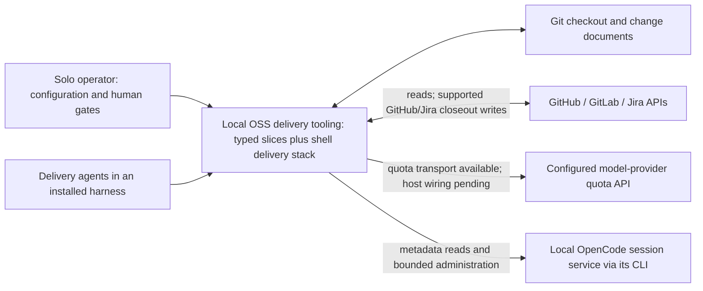
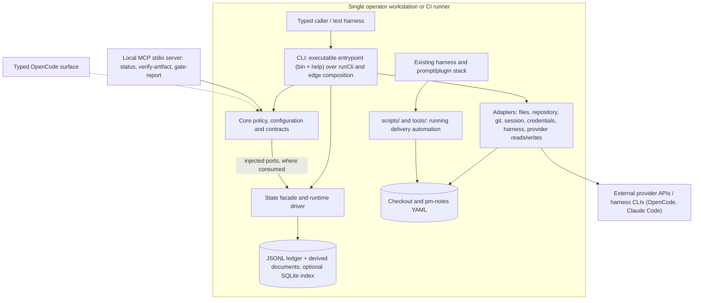

# OSS tooling architecture overview

## Review boundary and evidence baseline

**Phase 3 draft for human Gate 3.** This reconstructs legacy OSS tooling in
`packages/`, not a new implementation design. Gate 2 approval at `0b7d1ba`
carries OPEN-Q7..Q11 as deferred; it does not accept this draft or later work.
No documentation profile is present, so the engineering-repo fallback applies.

Reconciled under OPEN-Q20 against integrated `main-tools` `5330809` on
2026-11-02, including closeout PR #215 and verify-gates recovery PR #217.
Source and manifests establish
implementation; tests establish intended checks, not a fresh passing run or
pilot outcome. The approved [north star](01-north-star.md) supplies direction;
[Phase 2 coverage](../inception/analysis/phase-2-scope-and-coverage.md) supplies
the delivery reconciliation. [Tech stack](tech-stack.md) owns versions and alternatives.

## System context (C4 L1)

Local-first means local execution and local operational state. Tracker, VCS,
CI and quota reads still depend on their configured external systems. Missing
credentials, unavailable observations and capability gaps are visible states.

## Containers and current execution topology (C4 L2)

Boxes inside the workstation describe runtime responsibilities, not independent
services. The six workspace packages are libraries/build units, not six running
containers. The core-to-state arrow is an injected call, not an import permission.
No typed daemon or background scheduler is established by `packages/`.

## Component and feature map

| Component / residence | Implemented responsibility and boundary |
|---|---|
| `core/src/contracts/` | Data-only ports, normalized primitives, schemas, capability declarations and error vocabulary shared across packages. |
| `core/src/config/`, `branding/` | Pure layered resolution with provenance; pure brand identity resolution. Exported through core root and `./branding`, respectively. |
| `core/src/domain/` | PM-notes lint, change verification, declared-battery and merge-transaction evaluation, deploy-verdict evaluation, closeout transaction policy, status aggregation, queue-ready, queue scheduling (graph, leases, ranks, parks), owner-gate SLA evaluation, doctor diagnostics, session-admin policy, harness classification, capability, registry, spawn-environment, liveness, canonicalization, telemetry policy, capsule event rules and candidate promotion, merged-diff marker classification, thread-authorship policy, worktree safety, the spend read-side fold (five-class totals, phase attribution, restarts, resume amplification), the session lifecycle economics budget/resume/view/evidence folds, and the deterministic retro evidence pipeline (collection, truth checks, report/export folds). |
| `core/src/provider/` | Availability chain, quota/peak evaluation, model-profile selection and pacing policy, `data-v1` env-record validation, expiring parks and announcements through injected ports. No session spawn. |
| `core/src/state/` | Local store, ledger verification, phase transitions and rebuildable projections, the economics restart/exhaustion ledger and view fold, the spend telemetry read consumer, the retro registry consumer, and the independent evidence sidecar consumer. Runtime APIs confined to `state/driver/`. |
| `core/src/app/`, core `createRuntime` | Application tier is a type placeholder; `createRuntime` is an `export declare` signature, not a callable composition implementation. |
| `cli/bin/`, `cli/src/entrypoint.ts`, `production.ts`, `help.ts` | Executable surface: the non-installed Bun bin, working-name resolution, root/command help and version, the prompt-required composition, and fail-closed containment for an uncomposed invocation. Help and version read no state, network, git, or configuration. |
| `cli/src/index.ts`, `edge.ts`, `commands/` | In-process parser/result boundary; config acquisition and optional command registration; thin handlers plus bounded status collectors. |
| `adapters/src/github/`, `gitlab/`, `jira/` | Normalized reads plus supported GitHub/Jira closeout writes. GitLab retains declared write gaps and no work-item read. GitHub reads feed status and gate composition, and the bounded deploy-job trace read feeds `verify deploy`. |
| `adapters/src/git/` | Fixed-argv local process edge; protected-ref checks, merged-head equality, checkout/foreign-worktree safety, delete-time recheck, worktree listing/current/clean facts, no-force local worktree removal, and a bounded merged-diff read over the recorded squash landing. |
| `adapters/src/file/`, `repo/`, `legacy/` | YAML/config and pm-notes acquisition/staging, repository facts, legacy-name mapping, the append-only capsule runtime and confined memory-home writes. |
| `adapters/src/credentials/`, `provider-quota/` | Credential-reference resolution and injectable quota HTTP transport. Factories exist, but production host mounting is not established. |
| `adapters/src/session/` | OpenCode CLI-backed metadata reads, dry-run-first prune and guarded checkpoint through separate read/admin ports. |
| `adapters/src/io/` | Internal metadata codec, content policy, privacy rules and transport types; not a public package export. |
| `adapters/src/harness/` | The opencode and Claude Code delivery adapters, read-only telemetry extractors with a bounded Claude byte read and store-scoped orphan disclosure, harness-store session attribution, the review-deferral record, and the read-only SQLite session-store loader. |
| `adapters/src/host/` | The harness seam's one child-process spawn site, a pinned entry in the exact repository-wide `node:child_process` allowlist: receives the constructed environment as data and reads no ambient environment. |
| `adapters/src/azure/`, `ci/`, `registry/` | Type-only placeholders; provider clients implement some CI reads without making `./ci` runnable. |
| `mcp/src/` | Closed three-tool catalog, pure toolset seam and payload adapter, the in-package stdio JSON-RPC 2.0 protocol, the lifecycle exit owner, and the Node-hosted `./serve` composition root. The three read-only tools mirror the status, verify-change, and verify-gates engines. |
| `opencode/src/index.ts` | Type-only entry exports; no typed native-tool plugin. |
| `testkit/src/` | Dev-only envelope assertions and capability-aware conformance; real client factories over mocked transport, the harness conformance registry, scheduled live read-only tier. |

Sources: [core entry](../../packages/core/src/index.ts), [CLI edge](../../packages/cli/src/edge.ts),
[adapter exports](../../packages/adapters/package.json), [MCP entry](../../packages/mcp/src/index.ts),
[MCP serve entry](../../packages/mcp/src/serve.ts),
[OpenCode entry](../../packages/opencode/src/index.ts), [testkit](../../packages/testkit/src/index.ts).

### Shipped versus planned behavior

- `status` is a bounded, read-only nine-section attention-state digest: a
  closed finding-code registry with grouped ranked findings, tri-state
  hygiene assertions, owner-gate ages, parked conditions, a
  merge-ready-first action list, and the `typed-questions` section ranking
  open questions from the local blocker ledger; human ceiling 32 lines /
  6144 bytes; machine `data` ceiling 65536 bytes, with counts, findings, and
  truncation.
- `queue ready` is a bounded read-only tri-state ready-set with ranked resumption,
  at most eight candidates; it remains read-only and never claims ownership. The
  scheduling engine ships beside it as `queue list|plan|add|prioritize|dep|claim|release`
  and `lanes list|show`: a daemon-free one-shot queue graph with repo-exclusive
  fence-token leases and stale takeover, per-runner build-weight classes,
  producer-before-consumer deploy gating, close-first ranking, and parks that
  resume when their condition clears. No resident daemon, `dispatch`, or live
  `--watch` streaming ships with it. See [status](../spec/features/feature-status-digest.md),
  [queue-ready](../spec/features/feature-queue-ready.md), and
  [scheduling engine](../spec/features/feature-scheduling-engine.md).
- `board` is a bounded, render-once owner-gate aging grid: 24 h escalation,
  72 h default-on-expiry, declared collector unavailability, and at most eight
  ranked gates. An unwaived tracker-observed gate maps to `owner-review` and
  escalates without auto-defaulting; a gate with a recorded authorized
  `owner-gate` waiver is collected as `waiver`-kind with its recorded authorizer
  and follows the defaultable path. A rendered board exits zero while an
  unavailable collector exits two. See the
  [owner-gate SLA](../spec/features/feature-owner-gate-sla.md).
- `blockers` is the typed question channel: `list`, `answer`, and `publish` over
  append-only local state, with audience routing through a policy-as-data map,
  the layered credential guard, and a recorded `laneResume` projection. Answers
  declare `applied: false` and no session is touched; open questions rank once
  and surface on the list, the digest, and the brief. See the
  [typed blocker channel](../spec/features/feature-blockers.md).
- `doctor` is a bounded, read-only pre-flight diagnostic over `repo`, `tracker`,
  `provider`, `state`, and `ci`, in that fixed order. It performs at most two
  single-page network reads, never repairs, never fetches quota, and never runs
  the provider engine; an all-ok run exits zero with the `delivery.doctor.v1`
  report, any non-ok check exits one under `doctor.check.failed`, and a run that
  cannot complete outside per-check execution exits two. See the
  [doctor](../spec/features/feature-doctor.md).
- `verify change <ref>` classifies ledger/document completeness, not merge readiness.
  `verify gates <ref>` evaluates the config-declared battery (CI, push parity,
  squash surface, address completion, lifecycle, and any declared battery gate)
  and appends one gate-verification record. `verify deploy <ref>` reads the deploy
  job trace once and renders a verified/unknown/failed verdict. See the
  [handler](../../packages/cli/src/commands/verify.ts),
  [gate contract](../spec/features/feature-verify-gates.md), and
  [merge/verify-deploy contract](../spec/features/feature-merge-verify-deploy.md).
  CI workflow expectations and unknown/missing evidence remain explicit; a green
  observation is not authority.
- The MCP surface is one local Node-hosted stdio JSON-RPC 2.0 process owned by
  `packages/mcp`. It serves exactly three read-only, branding-projected tools —
  `status`, `verify-artifact`, and `gate-report` — and returns the same core data
  shapes and error-table field set as the CLI, with no envelope or exit-code field
  in a tool payload. Server lifecycle exits are `0` (clean stop), `1` (configuration
  error), and `2` (transport fault); tool outcomes never select an exit. The
  package declares no `bin` and no installer registration. See the
  [MCP surface](../spec/features/feature-mcp-surface.md).
- `merge <ref>` is the landing transaction: the freshness envelope over the newest
  recorded verification, one bounded post-verification probe, waiver
  authorization against the declared class policy, one rebase-refresh with no
  force path, one squash landing, and landing verification recorded as a
  `merge.transaction` record. It is the only landing producer; a re-run replays a
  recorded landing instead of landing twice. See
  [merge and verify deploy](../spec/features/feature-merge-verify-deploy.md).
- `retro collect|report [--level <name>]` is the learning-plane evidence pipeline.
  Collection folds delivered GET-only sources into an independent append-only,
  HMAC-SHA-256 keyed-chain sidecar outside the delivery state store, records the
  run in the validated retro registry, and evaluates five pipeline-truth checks.
  Reporting folds verified evidence into `{level, findings[], followThrough[],
  evidenceRefs[]}` with zero model calls. Only `change` (R1) is implemented; the
  other declared levels refuse with their owning story. A no-eligible-target
  collect is an explicit exit-0 success; export is a bounded library surface with
  no CLI verb. See the [retro evidence pipeline](../spec/features/feature-retro-pipeline.md).
- `spend [--ref <ref>] [--phase <phase>] [--amplification]` is the read-only
  learning-plane spend fold over closeout-captured `harness.telemetry` records and
  `phase.transition` history. It reports five-class token totals, calls,
  per-agent/model roll-ups, capture-time per-phase attribution, restart counts, and
  the resume-amplification block with named `restart-loop prefill re-pay` events;
  telemetry-absent is `spend.telemetry-absent` (exit 1). No harness re-query, no
  state writes, no cost aggregation. See the [spend read side](../spec/features/feature-spend.md).
- [Closeout](../spec/features/feature-closeout.md) is integrated: twelve-step
  transaction, plan by default, writes only with `--apply`, ref validation before
  reads. The steps cover the tracker, review-thread authorship policy from
  provider root-author facts, checkout,
  local worktree and branch cleanup, the detection-only merged-diff sweep with
  its four marker kinds and action tokens, retro coverage read from the delivered
  registry, session compaction,
  and the change-capsule close. The transaction reports a
  bounded `residue[]` and exits 1 through the additive `attention` class when
  judgment residue remains; human mode renders a `JUDGMENT RESIDUE` section and
  a capsule close summary. `createCloseoutComposition` in CLI edge bridges raw
  provider clients, the real git seam, `StateStorePort`, the capsule runtime, and
  resolved harness settings; `planFacts` reads issue, merged request, dependents,
  checkout, branches, worktrees, the recorded squash diff, persisted history,
  capsule pre-flight, and harness-derived session facts, and constructs the
  telemetry capture from the settings unless an injected runtime overrides it.
  This is command-specific production composition, not shared-root or
  installed-binary completion.
- The [change capsule](../spec/features/feature-capsule.md) is the change folder
  as a memory episode: append-only `events.jsonl` with a closed event/writer
  vocabulary and deterministic keys, plus one-file-per-candidate `candidates/`.
  `phase`, `commit`, and `verify gates` append their own events non-gatingly;
  closeout validates the capsule, completes a pre-contract folder, evaluates
  candidates against the capture bar and evidence link, home-writes lessons/tacit,
  records sanctioned handoffs, and closes the capsule terminally. The capsule is
  file-based and adds no state record kind or schema-version bump.
- The [harness adapter seam](../spec/features/feature-harness-adapters.md) ships
  typed `HarnessInstance`/`HarnessSession` ports, the opencode and Claude Code
  delivery adapters, the deny-by-default execution-environment descriptor, and
  read-only telemetry extraction consumed by non-gating closeout capture. The
  closeout composition constructs the capture from the resolved harness settings
  and uses the same extractors to attribute sessions for the compaction
  checkpoint; the Claude reader bounds the byte read before parsing and opencode
  discloses out-of-port orphans as store-level warnings. The GH-233 review
  F-8/F-11 items are resolved and F-9 is re-deferred with M1-S9 as owner. No
  dispatch engine ships; cross-harness dispatch parity belongs to M1-S9.
- [Session lifecycle economics](../spec/features/feature-session-lifecycle-economics.md)
  ships the adapter-sourced liveness bridge, the prefill-safe corroboration rule,
  the classified `watchdog.liveness-stalled` identity, the single restart-budget
  gate and its supervised-style and one-shot-style compositions, the additive
  `economics.restart` and `economics.budget-exhaustion` records, the per-delivery
  amplification fold, and the lane configuration branch. The scheduling engine
  and its `queue`/`lanes` surfaces ship separately (GH-237), and the read-only
  spend fold ships separately (GH-236). No resident daemon, `dispatch` command,
  or live `--watch` stream ships with any of them.
- Accepted architecture calls for one shared composition root. Today the working
  compositions are command-specific CLI edge functions. Optional registrations
  require supplied ports. Production credential/quota factories and a spawn gate
  are not mounted there; provider resolution tests do not demonstrate live spawn.

## Module governance

### Residence and dependency direction

Use declared package names/subpaths across packages, never relative escapes or
deep `src`/`dist` imports. [Manifests](../../packages/cli/package.json),
[entrypoint checks](../../scripts/checks/workspace-entrypoints.ts) and
[dependency-cruiser](../../.dependency-cruiser.cjs) jointly define permissions:

| Importer | Permitted workspace targets |
|---|---|
| core | No other production workspace package. Internal tiers follow the rules below. |
| adapters | Core `./contracts` only; not core root, `./state`, `./branding` or `./provider`. |
| CLI, MCP | Core `.`, `./contracts`, `./state`, `./branding`, `./provider`; declared adapter subpaths. |
| OpenCode | Core `.`, `./contracts`, `./state`, `./branding`; declared adapter subpaths. |
| testkit | Core `.` and `./contracts`, declared adapter subpaths, as development dependencies; no surfaces. |
| production source | Never testkit. CLI, MCP and OpenCode never import each other. |

Core rules: domain/config/branding/state may depend on contracts and their own
modules; app may depend on domain/config/contracts, not state/branding. Inspected
provider-policy sources import contracts and their own modules. The
[provider hermetic checks](../../tests/checks/provider-hermetic.test.ts) supply
narrower behavioral evidence, not a production import-allowlist guarantee.
General depcruise tier rules omit provider; complete provider-tier enforcement
is not established by these checks.

| Capability to place | Existing residence rule |
|---|---|
| Shared normalized vocabulary or port | `core/src/contracts/`, types/constants only; no provider-native payloads. |
| Deterministic domain decision | `core/src/domain/`; provider availability policy in `core/src/provider/`. |
| Schema/default/merge or name-derived value | `core/src/config/` or `core/src/branding/`, with injected facts. |
| Persistent record/projection | `core/src/state/`; actual filesystem, clock, SQLite and permissions in `state/driver/`. |
| Provider dialect/network or file/session I/O | Its declared `adapters/src/<subpath>/`; normalize before returning. |
| CLI grammar/presentation/composition | `cli/src/commands/`, `output/`, `edge.ts`; serializer only invoked by the surface entry. |
| Reusable fixtures/conformance | Testkit or `tests/`; no production dependency on testkit. |

Split on distinct reasons to change or heavy optional dependencies, not on file
count alone. A repeated provider branch in core, duplicated policy in adapters,
or surface-specific orchestration is a boundary-review trigger under ADR-0003.
These are existing decision criteria, not a new package-splitting decision.

### Internal interface contracts

| Boundary | Actual signature / shape | Failure channel |
|---|---|---|
| Edge to config | `resolveConfig(input): Result<ResolvedConfig, ConfigFailure>`; values, origins, loaded/skipped layers, warnings | Safe `kind: config` plus declared code/location, never source snippets. |
| Client to credentials | `CredentialPort.resolve(reference): CredentialResolution` | `config.credential.missing`; no diagnostic channel; material only on success. |
| Edge to provider | `createProviderEngine(deps).resolve({config, chainName?, persist?})` | Typed decision/park/announcement; state failures remain visible. |
| Status collector to GitHub | `listWorkItems(limit)`, `listDeliveryRequests(limit)`, `readPipelineRun(sha, limit?)` | `ProviderReadResult<T>`: normalized value or credential/payload failure, mapped into status availability. |
| Closeout to provider/git/state | Eight declared provider operations including `resolve-delivery-thread`; capability-qualified GitHub/Jira writes and local git cleanup | Classified provider/state/safety failure with consequence; unsupported operations remain gaps. No general comments, remote branch cleanup or merge execution inferred. |
| Merge transaction to provider/git/state | One verification read, one work-item read, one check-run page and one request-detail read per invocation; the declared mutation union carries one rebase-refresh, one squash landing, and post-landing cleanup | Classified `merge.*` or state identity with exit projection; no force variant exists and the merge command is the only landing producer. |
| Consumer to state | `read({requiredKeys})`, `append(handle, request)`, `replaceDocument(handle, request)` | `StateResult<T>`; verified-empty differs from torn/missing required keys. Writes require acquired fence handle. |
| Session caller to adapter | `SessionStorePort` reads; `SessionAdminPort` prune/reboot with explicit `apply` | Classified `db.*` errors; metadata-only output, no transcript or raw command output. |
| Handler to CLI | `{data}` or `{error}`; `runCli(argv, streams, deps): Promise<number>` | Declared kind/code to error table; malformed/unclassifiable values become `fallback.internal`. |

Contract homes: [config](../../packages/core/src/config/resolver.ts),
[credentials](../../packages/core/src/contracts/credentials.ts), [provider](../../packages/core/src/provider/engine.ts),
[state](../../packages/core/src/contracts/state.ts), [session](../../packages/core/src/contracts/session.ts),
[provider client](../../packages/adapters/src/github/client.ts), [CLI](../../packages/cli/src/index.ts).

## Data flow and trust boundaries

1. Resolve brand identity before discovery. Acquire file/repository/environment
   facts at the edge. Configuration precedence, low to high: defaults, system,
   user-global, project-committed, project-local, environment, CLI. A selected
   config file replaces the committed slot, not an eighth layer.
2. Parse and validate each layer, merge maps recursively, replace lists, apply
   explicit resets and validate the final tree. Preserve origins; reject unknown
   keys, forbidden secrets/paths and interpolation. CI skips workstation layers
   unless independently enabled. The ordinary shipped catalog currently owns
   the provider branch, not a comprehensive tracker/CI/repository config model.
3. CLI composition supplies ports, state, time and transport to implemented
   engines/collectors. GitHub status addressing comes from checkout `origin`.
   Pure rules consume normalized facts; unavailable fields remain unknown.
4. Provider resolution uses credential references for quota reads and persists
   parks/announcements through state when requested. Phase writes append ledger
   transitions and replace derived projections; verify only reads them.
5. The state facade verifies JSONL framing/sequence/checksum before returning
   requested values. Both driver kinds use that ledger as truth. SQLite is an
   optional disposable index, not a replacement database or a scaling guarantee.
   Closeout records verified `closeout.operation` history with deterministic
   operation identities and fenced appends. First terminal outcomes are reused;
   failed outcomes may retry. This is a persistent outcome/replay substrate, not
   a separately invented write-ahead-intent protocol. The retro registry is a
   validated state boundary with three additive kinds; the evidence sidecar is a
   separate collector-fenced, keyed-chain artifact family outside the store, so
   state salvage cannot mask evidence tampering. The change capsule is a third
   local artifact family inside the change folder: append-only `events.jsonl`
   plus `candidates/`, with its own framing, lock, dedup, and terminal close. It
   is not a state record kind and does not enter the store's salvage or index
   rebuild. Harness telemetry stays in the state log and is never copied into the
   capsule; capsule events never enter the telemetry family. See
   [ledger](../../packages/core/src/state/closeout.ts),
   [engine](../../packages/core/src/domain/closeout.ts),
   [capsule](../../packages/adapters/src/file/capsule.ts), and
   [retro](../../packages/core/src/domain/retro.ts). Real-local git/store plus
   mocked-provider integration tests exist; they were inspected, not rerun here.
6. CLI handlers return data/errors without writing streams. The surface owns
   classification, redaction and one JSON envelope under `--json`. Exactly one of
   `data`/`error` appears with schema version, run ID, timing and exit code.
   Only CLI projects success/user-validation/platform-provider/attention to
   0/1/2/1; `attention` is a data-bearing success outcome with residue, never an
   error envelope.
   Errors preserve category, retryability, consequence (`landed`, `not_landed`,
   `unknown`) and remediation. Raw thrown messages/stacks are not copied.

Secrets resolve through the credential port. The
[secret-read guard](../../scripts/checks/secret-read-boundary.ts) admits three
specific non-credential environment readers for configuration/identity, not
general secret access. CLI redaction covers registered values and depends on
correct edge registration. [Privacy checks](../../scripts/checks/privacy-literals.ts)
scan git-tracked and non-ignored untracked working-tree files, not history.
The [metadata codec policy](../../packages/adapters/src/io/envelope-content-policy.ts)
checks exact serialized metadata before emission using shared rules and injected
hashed entries; it is not a universal sanitizer for all content or state payloads.
The current hashed-entry classes are empty and reported as vacuous; generic
rules passing does not establish project-specific literal coverage.

## Deployment, integrations and decision status

| Unit / dependency | Current topology, ownership and criticality |
|---|---|
| Standalone CLI target | Local Bun-targeted design; the implemented runner is the in-process `runCli` surface behind an executable entrypoint. The CLI manifest declares one non-installed `bin` (`delivery-os`) and a `main` composition entry; the bin is absent from the installer, so an installed executable/install path is not established by these modules. |
| Harness adapter seam | The typed `HarnessInstance`/`HarnessSession` ports with the opencode and Claude Code delivery adapters, the deny-by-default execution-environment descriptor, read-only telemetry extraction with a bounded Claude byte read and store-scoped orphan disclosure, harness-store session attribution, and non-gating closeout capture constructed from the resolved harness settings. See [feature-harness-adapters.md](../spec/features/feature-harness-adapters.md). |
| Change documents and capsule | Local operator-owned change folders. Each folder may carry the append-only capsule `events.jsonl` and `candidates/`; closeout validates and closes it and home-writes accepted lessons/tacit to `.ai/memory/`. See [feature-capsule.md](../spec/features/feature-capsule.md). |
| Existing harness/prompt stack | Locally installed canonical `.opencode/` definitions, generated Claude Code plugin and shell automation. Independent of the empty typed integration package. See [plugin build](../../scripts/build-claude-plugin.sh). |
| State and change documents | Local operator-owned files; only local store level implemented. JSONL forever-retention direction; project/global levels are declared seams, not shared stores. |
| OpenCode CLI | External local executable owned by its upstream; required for implemented session adapter operations. Session DB is not the tooling state ledger. |
| GitHub / GitLab / Jira | Upstream-owned APIs; high criticality for relevant observations. Current status composition specifically uses GitHub, not automatic multi-provider selection. |
| Configured quota API | Upstream-owned, high criticality for quota-dependent availability. Injected engine paths classify indeterminate availability explicitly; production host mounting/live behavior remain unverified. |

[ADR-0003](../decisions/ADR-0003-oss-monorepo-structure.md) is Accepted.
[ADR-0005](../decisions/ADR-0005-runtime-confinement-provider-client-subpaths.md),
[ADR-0007](../decisions/ADR-0007-provider-engine-v1-placement-fail-loud-parks-cost-policy.md),
[TDR-0004](../decisions/TDR-0004-state-storage-engine.md),
[TDR-0005](../decisions/TDR-0005-delivery-result-enum-and-cli-exit-taxonomy.md),
[TDR-0006](../decisions/TDR-0006-privacy-and-no-cloud-guard-mechanics.md),
[TDR-0009](../decisions/TDR-0009-retro-evidence-sidecar-keyed-chain-construction.md) and
[ADR-0010](../decisions/ADR-0010-session-admin-port-mutating-contract.md) remain Proposed
despite implemented mechanics. Existing harness/release/naming records remain in
the [decision register](../decisions/00-register.md); their separate audit owns
ratification. This overview creates no decisions and does not infer acceptance.

## Confidence, constraints and architecture pre-mortem

| Area | Confidence and uncertainty flag |
|---|---|
| Exports, import permissions, handler grammar | High: inspected source/manifests and boundary checks. Allowed import is not proof of a runtime implementation. |
| Local state mechanics | High for code reconstruction; medium for operational durability/performance. Real Windows ACL evidence remains outstanding; portability is not a macOS/Windows test matrix. |
| Production composition and cross-surface parity | High confidence in identified absences; low confidence in end-to-end readiness. Shared root and binary mounting remain unproven; the MCP server executes under Node in the portability smoke, while typed host-plugin execution remains unproven. |
| Provider/live mutation and milestone outcomes | High for inspected supported GitHub/Jira write mechanics and mock conformance; low for live outcomes. Live conformance remains read-only, not live-write parity or pilot evidence. |

**Pre-mortem, hypothetical:** growing history makes every verified read and
indexed comparison expensive; lock contention multiplies during parallel agent
work. Callers mistake a complete ledger or truncated observation for permission
to merge. Surface-specific compositions drift before shared wiring exists, and
mock conformance is misread as write parity. The operator resumes manual probing.

Proposed validation, not completed work: benchmark growing ledgers and contention;
replay interrupted writes and unknown external outcomes; exercise caller-visible
truncation/unknowns; require artifact-backed per-engine dual-run evidence before
authority transfer. See [RSK-002/003/004/009](../inception/analysis/risks.md#register)
and the four-risk validation table in [tech stack](tech-stack.md#four-risk-check).
Shell remains authoritative until approved per-engine parity/cutover evidence.

Draft checks: relative source links resolve and frontmatter parses. The privacy
working-tree scan reports zero violations with the vacuous classes noted above.
Branding membership remediation and fresh mechanical results are recorded in the
Phase 6 report; no fresh runtime/pilot result is claimed by this reconstruction.
