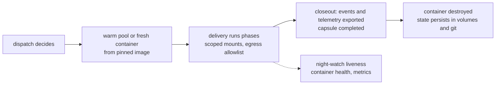

---
# Copyright (c) 2025-2026 Juliusz Ćwiąkalski (https://www.cwiakalski.com | https://www.linkedin.com/in/juliusz-cwiakalski/ | https://x.com/cwiakalski)
# Apache-2.0 License - see LICENSE file for full terms
source: https://github.com/juliusz-cwiakalski/agentic-delivery-os/blob/main-tools/doc/planning/concepts/containerized-delivery.md
---
# Concept: containerized delivery

Status: Draft (2026-10-27, from owner notes + local PoC blueprint; local
refinement in progress, not committed). Every delivery runs inside a
container with pinned dependencies and minimal mounted context.
Companion: [parallel-delivery.md](parallel-delivery.md) (topology and
scheduling), [inter-agent-communication.md](inter-agent-communication.md),
the runtime enforcement section of
[software-delivery-autonomy.md](software-delivery-autonomy.md).

## Why containers

1. **Reproducibility**: the toolchain (harness version, language
   runtimes, gate tooling) is pinned per image; a delivery that was
   green is explainable months later. Model drift is tracked by
   evidence fingerprints; toolchain drift is prevented by the image.
2. **Isolation as the enforcement substrate**: the AutonomyContract's
   envelope needs a physical boundary - scoped mounts, egress policy,
   resource caps are container properties, not agent promises.
3. **Blast radius**: a delivery that damages its environment damages a
   disposable container, not the host workspace.
4. **Parallelism substrate**: N concurrent deliveries do not need N
   host environments or dependency-diagnosis sessions (see
   parallel-delivery.md).
5. **Observability**: container metrics and logs are first-class
   delivery telemetry.
6. **Portability**: the same image runs on a workstation, a server, or
   CI without environment archaeology.

## The delivery container

- **Short-lived, one per change delivery (per repo involved)**: created
  at dispatch, destroyed at closeout. This is the chosen default
  (owner decision, 2026-10-27): per-change containers give the
  cleanest resource control and monitoring - CPU, memory, disk, and
  network attribution maps one-to-one to a delivery, and nothing
  accumulates between deliveries. A change spanning repos gets one
  container mounting every repo it needs; the alternative (a container
  per repo within one change) stays an experiment variable. Longer-
  lived topologies (shared per lane, long-lived per whole project,
  tenant isolation for server mode) are **out of scope for now** and
  remain future options to experiment with during delivery - see the
  open questions.
- **Minimal context mounts, nothing more**: the change's repo
  worktree(s) (a change spanning repos mounts all of them - the
  container belongs to the change, not to a repo), the project-scoped
  harness state, ADOS config, and the delivery state directory. The
  harness session database is host state bind-mounted per project
  (NOT copied per container): all deliveries in a project share one
  session store, so telemetry and session history stay coherent and
  the closeout extractor reads one place. Folder structure carries the
  workspace and lane identity (see parallel-delivery.md).
- **Identity mirrors the host**: the container user matches the host
  user's name, UID, and GID, so file ownership is correct on both
  sides and absolute paths (including the harness DB keyed by git
  root) resolve identically inside and outside. This is a proven
  blueprint pattern (non-root execution via a drop-privileges helper;
  ownership fixups only for container-created intermediates, never
  recursive chowns over mounted host state).
- **Egress and network**: default-deny with an allowlist per contract
  (registry, tracker, provider endpoints); no docker socket mount by
  default; network policy is part of the envelope, enforced at the
  container, not trusted to the agent. The strongest profile - a bare
  container, a single mediated egress proxy, canary traps, and
  contact attribution for the agent that touches the open internet -
  is specified in
  [external-research-isolation.md](external-research-isolation.md).
- **Disposable by design**: containers are never repaired in place -
  a failed delivery restarts into a fresh container from the same
  image; durable state lives in the mounted volumes and git, never
  inside the container filesystem.

## Image strategy

Layered for cache stability, most-stable first (proven pattern from
the PoC): base OS (glibc-native for tool compatibility) -> system
packages -> language runtimes and package runners -> project gate
tooling -> the harness, pinned and installed last so version bumps
rebuild only the final layer. Version resolution with fallback chain
(explicit pin -> registry latest -> last-used file -> known-good
fallback), one image tag per version, autoupdate disabled inside the
container - upgrades are deliberate image rebuilds, which is also an
evidence-invalidating event per the AutonomyContract.

Project images declare a tool profile (what the project's gates need:
linters, test runners, IaC validators) in configuration; ADOS
generates the Dockerfile so delivery images are managed artifacts,
not hand-maintained snowflakes. The local PoC stays private (it
contains private project context); only the structural patterns were
carried over, and the implementation builds its own files.

## Nested containers and heavier isolation

Deliveries whose gates build or run containers (integration tests,
testcontainers-style suites) need nested virtualization. Options, in
rising isolation cost: mounting the host docker socket into the
delivery container (simple, unsafe - the socket is root-equivalent,
forbidden by default), rootless nested runtimes (sysbox-class),
sandboxed runtimes (gVisor-class), and microVMs (Firecracker/Kata-
class, strongest isolation, slower starts, research needed for the
local-first constraint). Decision deferred to implementation research
(open question below); the envelope must declare whether a change's
gates require nested containers, because that changes where it may
run.

## Lifecycle and monitoring

- Container metrics (CPU, memory, disk, network) and container logs
  are captured as delivery telemetry into the event log alongside
  tokens and gate outcomes (telemetry-and-events concept): cost
  attribution, anomaly detection (runaway loops), and capacity
  planning all consume the same stream.
- Liveness supervision extends to container health: a wedged container
  is a delivery state, with the same escalation ladder (stale ->
  intervention -> restart into fresh container).
- A warm pool of pre-started containers (image already loaded,
  mounts prepared) absorbs cold-start cost for per-change isolation.

## Platform support: Windows, Linux, macOS

Containerized delivery must work on all three developer platforms. This
is a requirement, not a stretch goal, and it constrains the design:

- **Runtime**: a container engine available everywhere (Docker or a
  compatible runtime; on Windows via WSL2, on macOS via the available
  virtualization runtimes). The engine is configuration, not
  assumption - the same delivery definition runs unchanged.
- **Bind-mount performance**: host-mounted worktrees and state behave
  differently per platform (native on Linux, translated I/O on the
  other two). Heavy I/O work stays inside the container filesystem
  (builds, caches, dependency stores are container-local volumes, not
  bind mounts); only the worktree, config, and state dirs cross the
  boundary.
- **Identity mapping**: the UID/GID mirroring trick is Linux-native;
  on Windows and macOS the ownership model differs (and the userland
  path layout differs). The container keeps a stable internal layout
  and the launcher translates host paths into it, instead of assuming
  the host layout equals the container layout. The Linux fast path
  may mirror; the portable path translates.
- **Path and line-ending hygiene**: CRLF/LF normalization and
  case-sensitivity differences are part of the image and mount
  contract (git configuration travels with the container, not the
  host).
- **Test matrix**: the conformance suite runs the same delivery on
  all three platforms - platform drift is a CI finding, not a user
  bug report (adapter-conformance concept).

## Open questions

1. Nested-container technology choice: socket mount is out; pick
   rootless nesting vs sandboxed runtime vs microVM after a research
   spike (constraint: must work on a single local workstation first -
   and ideally on all three platforms, which may rule out the heavier
   microVM options for the portable profile).
2. **N harness instances vs one instance with N sessions**: with
   short-lived per-change containers, each delivery runs its own
   harness instance. One instance serving multiple concurrent coding
   sessions would share more state and warm caches - but
   instance-per-change is isolated, attributable, and simple. The
   trade-off is harness-specific (different harnesses have different
   multi-session characteristics and per-instance overheads: opencode,
   Claude Code, pi.dev) - experiment during delivery, per
   harness-adapter, before treating one shape as universal.
3. Are there deliveries that should NOT run containerized (host-only
   tooling, hardware access), and how do we mark them in the envelope?
4. Longer-lived container mixtures (per-lane shared services, one
   long-lived container per whole project, server-mode tenant
   isolation): out of scope now; revisit through experiments once the
   per-change default is proven in real deliveries.
