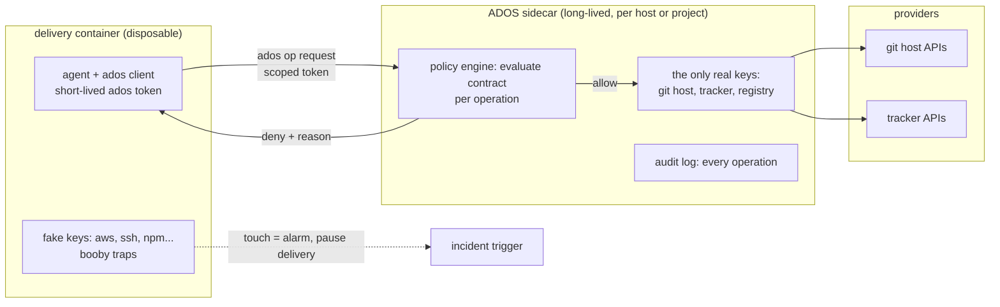

---
# Copyright (c) 2025-2026 Juliusz Ćwiąkalski (https://www.cwiakalski.com | https://www.linkedin.com/in/juliusz-cwiakalski/ | https://x.com/cwiakalski)
# Apache-2.0 License - see LICENSE file for full terms
source: https://github.com/juliusz-cwiakalski/agentic-delivery-os/blob/main-tools/doc/planning/concepts/credential-sidecar.md
---
# Concept: credential sidecar (zero-key delivery)

Status: Draft (2026-10-27, from owner notes; parked concept: designed,
not scheduled). Delivery containers hold **zero real
credentials**. Every external operation (git push, tracker, registries,
releases) goes through the ADOS sidecar service - the sole holder of
keys - using short-lived ADOS tokens that are worthless if leaked.
Companions: [containerized-delivery.md](containerized-delivery.md),
[external-research-isolation.md](external-research-isolation.md)
(the traps pattern), the runtime enforcement section of
[software-delivery-autonomy.md](software-delivery-autonomy.md)
(which this concept makes physical), [policy-as-code.md](
policy-as-code.md).

## Why

Injected code wants credentials. A key sitting in a delivery
container's environment or on its disk is the jackpot: one
`env` dump and the attacker owns the GitHub org. Removing the jackpot
changes the economics of every prompt-injection success from
"game over" to "noisy fumbling in an empty room".

## Architecture

- **The sidecar** is a small long-lived service (its own container),
  the only component holding real provider credentials. It exposes
  provider operations as a uniform surface the ADOS tooling consumes -
  naturally as an MCP proxy, so harness agents see one tool contract
  per provider regardless of the underlying API, and keys never enter
  the delivery container's environment.
- **Delivery agents authenticate only to the sidecar**: a short-lived
  access token plus a refresh token, pre-authenticated, bound to the
  agent, change, and action family, issued by ADOS and hidden inside
  the tooling (agents do not handle tokens; the ados client does).
- **Every operation is policy-checked at the sidecar**: the
  AutonomyContract is evaluated per request (envelope, rights,
  budget), executed with the real credential, postcondition-checked,
  and audit-logged with the policy decision id. This is exactly the
  runtime enforcement sequence from software-delivery-autonomy.md -
  the sidecar is that sequence made into a component. Operations that
  do not exist for delivery agents (modify policy, change verifiers)
  simply are not exposed.

## CLI shims: transparent proxying (additional mode)

The MCP surface is the native interface; **CLI shims are the
compatibility layer** that makes the sidecar invisible. Inside the
delivery container, PATH-shadowing proxy executables carry the real
tool names (`gh`, `glab`, ...). The agent runs `gh pr merge 123` exactly
as it always would; the shim packages the invocation, forwards it to
the sidecar, and the sidecar - holding the real credentials -
executes it and streams stdout, stderr, and the exit code back.

- **Transparency requirement**: the sidecar mounts the same repos at
  the same paths as the delivery container, so commands that touch
  local context (current directory, branch state, file arguments)
  resolve identically. From the delivery agent's perspective, the
  command ran locally; the execution location is invisible.
- **Selective interception**: shims need not wrap whole tools. For
  tools that are local-safe except for authenticated subcommands
  (git: everything but push/fetch is local), the shim intercepts only
  the credential-requiring paths and executes the rest in place - or
  answers them via a credential-helper hook that asks the sidecar.
- **Configurable policy**: which tools are shimmed versus considered
  safe for direct execution with stdio pass-through is a policy list
  (per contract or per project): deterministic, credential-free tools
  run natively in the delivery container; anything touching a
  provider goes through the shim.
- **The command line is an injection surface**: forwarded argv is
  untrusted input to the sidecar. The sidecar validates the
  invocation against the envelope (allowlisted subcommands per
  contract), executes argv-array style - never string interpolation
  through a shell - drops environment passthrough (there are no real
  tokens to pass anyway; fake env can double as a trap), caps payload
  sizes, and audits the full argv with the policy decision.
- **What it buys**: zero-change agent experience (existing skills and
  muscle memory work unmodified, on any harness), keys never leave
  the sidecar, and every provider call lands at the natural audit
  point without the agent opting into anything.

### The CLI firewall: per-subcommand grants

The same mechanism is a **command-level firewall**: the contract's
authority rights map directly onto the CLI surface. A contract with
`may_merge: false` admits `gh pr view` and `gh pr checks` but denies
`gh pr merge` at the sidecar - the shim accepts everything locally,
the policy decides remotely. Whole subcommand groups can be blocked
the same way (no release commands, no admin commands).

- **Escape hatches blocked by default**: generic raw-API subcommands
  (`gh api`, `glab api`, anything that takes an arbitrary endpoint and
  verb) bypass subcommand semantics entirely, so they defeat a naive
  allowlist. Default posture: blocked outright; if ever needed, each
  raw call is unwrapped and evaluated against the envelope endpoint
  by endpoint, verb by verb.
- **No interface shopping**: the same envelope drives the MCP surface
  and the CLI shims. A merge blocked via MCP is blocked via CLI (and
  via git credential helper) - policy cannot be circumvented by
  choosing the weaker interface.
- **Denials are first-class events**: a CLI firewall denial carries
  the policy decision id and reason codes, exactly like any policy
  denial. Repeated denials from one agent are a signal (the agent is
  working outside its envelope - mis-scoped contract, misunderstood
  task, or something worse) and surface in the audit stream the retro
  and incident tracks already consume.

## Why a leaked token is nearly worthless

The token's audience is the sidecar on the local delivery network -
useless from outside. Even presented to the sidecar, it grants only
what its contract already allowed, expires in minutes, is
rate-capped, attributable, and revocable instantly (owner veto and
demotion revoke tokens; orphan sessions cannot outlive their token -
the orphan-session anti-pattern dies here). The sidecar itself has
egress only to the allowlisted provider APIs; it is not a general
proxy and never forwards arbitrary traffic (the external researcher's
internet window is a separate, separately-policed path - see
external-research-isolation.md).

## Booby traps in delivery containers

Delivery containers are seeded with realistic fake credentials (cloud
keys, SSH keys, registry tokens) in standard locations. Legitimate
work - all of it routed through the sidecar - never touches them. A
read of a fake key file or a scan across credential locations trips
the trap: alarm, delivery paused, container frozen as evidence,
incident retro triggered. Sensitivity tuning matters: traps must sit
where only credential-hunting would look, or false pauses will erode
trust in the mechanism - false positives are a design bug, not an
acceptable cost.

## Adoption path

- Bash era (today): keys live in the coordinator environment; per-op
  policy checks are the scripts. The sidecar arrives with the CLI.
- CLI era: sidecar per host (or per project), delivery containers
  zero-key, traps seeded, token revocation wired to demotion and
  veto.
- Exceptions: anything that genuinely needs a direct credential
  (rare; e.g. a tool that must authenticate itself) is an
  envelope-declared elevation, reviewed like any other grant.

## Compatibility with the current build

What the scheduled stories must keep open so the sidecar can be adopted
without redesign:

- All credential reads flow through **one credential-resolution port**
  in core, env-backed today; adapters (tracker, VCS, CI) and the
  provider engine never read secrets directly (M0-S12, M0-S13). The
  sidecar becomes the port's second implementation.
- The MCP surface keeps authentication at **one transport boundary**
  so the sidecar can front it (M1-S7, M3-S2).
- Agent prompts and skills never assume key possession; they already
  operate through primitives and tools (agent-primitive-surface.md),
  which is the requirement that makes zero-key delivery possible.

## Open questions

1. Token shape and rotation cadence (per delivery vs per session vs
   per N minutes) and the revocation fan-out latency budget.
2. Sidecar scope: per host shared across projects versus per project
   (isolation versus operational overhead).
3. Offline and degraded mode: sidecar unreachable means no external
   operations - align with fail-closed (acceptable) but define what
   local work may continue.
4. Which provider operations ship first (git push, PR/MR, tracker
   transition, release upload) and their MCP surface design.
