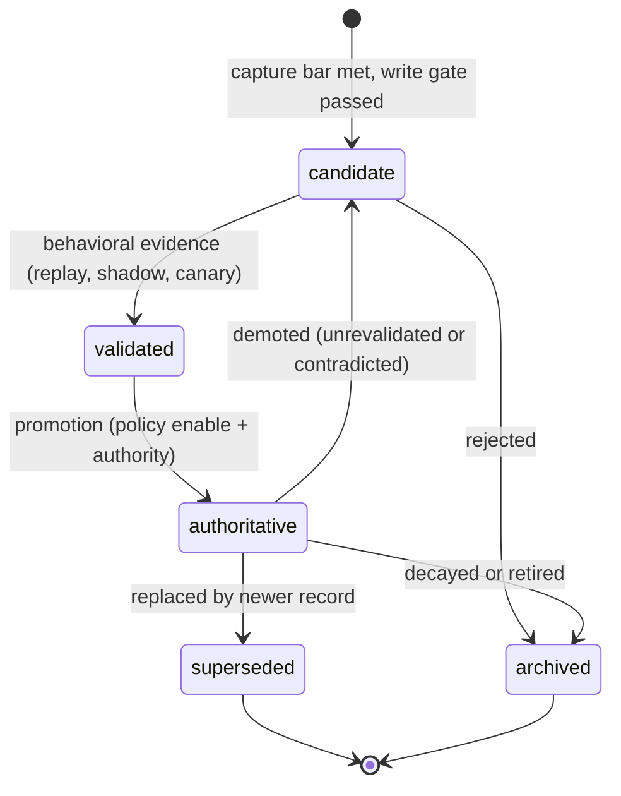

---
# Copyright (c) 2025-2026 Juliusz Ćwiąkalski (https://www.cwiakalski.com | https://www.linkedin.com/in/juliusz-cwiakalski/ | https://x.com/cwiakalski)
# Apache-2.0 License - see LICENSE file for full terms
source: https://github.com/juliusz-cwiakalski/agentic-delivery-os/blob/main-tools/doc/planning/concepts/memory-architecture.md
---
# Concept: agent memory - architecture

Status: Draft (2026-10-26); partially implemented (2026-11-15). Structure of the
ADOS memory model: layers, layout, records, trust, retrieval, tooling. The
canonical layout, the published record schema, and lint-in-gates are implemented
as a repository invariant; the `ados memory` command family, memory and
archive index generation, the retrieval cache, and the compiler remain
unimplemented. Start with
[memory-overview.md](memory-overview.md) for the human summary.

## Layer model

Canonical memory is the filesystem plus git. Everything else (indexes,
caches, embeddings) is a regenerable projection of it, never the source
of truth.

| Layer | Contents | Persistence | Loaded |
|---|---|---|---|
| Kernel | AGENTS.md: hard facts, routing, invariants | Committed | Always |
| Index | `.ai/memory/README.md`: one two-column row per covered path, with a read-when hint | Committed | Always (capped) |
| Records | Lessons, tacit fragments, preferences, guilds: one typed record per file | Committed | Just-in-time |
| Per-agent memory | `agents/<agent>/README.md` plus optional topic files: free text, no record findings | Committed | Own entry point always; topics on demand |
| High-authority homes | Spec, decisions, change capsules, instructions | Committed | On demand |
| Session state | Working state, in-flight queues, scratch | Local (gitignored) | Session only |
| Archive | Archived capsules, superseded records, raw trajectories | Committed (history) | Never by default |
| Derived layer | Retrieval index (FTS, optional embeddings, graph) | Cache (gitignored) | Tooling only, regenerable |

The derived layer exists for retrieval speed and ranking only. It can be
deleted and rebuilt from canonical records at any time; nothing
authoritative ever lives only there.

## Project layout

Status: the tree, the record schema, and the lint are delivered; memory and
archive index generation, the derived retrieval cache, and a fleet quarantine
area are staged in the increment plan and are not implemented, so a `staged`
mark in the sketch is a planned projection, never shipped behaviour.

What an ADOS-driven project looks like when the memory model is adopted.
Existing homes are kept; the memory tree is the addition.

```text
AGENTS.md                      # kernel: hard facts + routing + invariants
.ai/
  agent/                       # committed agent instructions (existing)
  memory/                      # committed durable memory
    README.md                  # index: two-column row per covered path + read-when
    lessons/                   # one typed record per file
    tacit/                     # one typed record per file; advisory, low authority
    preferences/               # one typed record per file; owner/team preferences
    guilds/<guild>/README.md   # guild entry point; typed guild records beside it
    agents/<agent>/README.md   # per-agent free-text entry point; topic files beside it
    retro/INDEX.md             # append-maintained archive index; notes under retro/<year>/
  local/                       # gitignored ephemeral state (existing)
    <agent>/...                # session scratch only
  cache/                       # STAGED: gitignored regenerable retrieval cache; not implemented
doc/
  spec/**                      # facts (existing)
  decisions/**                 # decision records (existing)
  changes/<ref>/**             # change capsules (existing, completed below)
```

External content has no area in this tree: `scope: fleet` is candidate-only
with no record home, and the quarantine area is deferred rather than placed at
another path.

### Change capsule completion

The change folder is the episode capsule. ADOS already stores spec,
plan, test plan, and PM notes there. The memory model completes it with:

```text
doc/changes/<month>/<date>--<ref>--<slug>/
  ...existing artifacts...
  events.jsonl                 # append-only mechanical event log
  candidates/                  # memory promotion candidates from this change
```

- `events.jsonl` aligns with the telemetry-and-events concept: phase
  transitions, gate outcomes, review verdicts, failures - the evidence
  stream that attribute and verify steps read.
- PM notes remain the mechanical state (phases, tasks); no duplicate
  state file is introduced.
- On merge, the closeout ceremony (see memory-lifecycle.md) processes
  candidates, promotes accepted ones, and the capsule becomes the
  archived episode.

## Record model

One logical record = one file. This eliminates merge conflicts between
concurrent agents (they create new files, never fight over one
memory.md) and makes every record independently reviewable in a PR.

Minimal frontmatter for lessons and tacit fragments:

```yaml
id: lesson-2026-017
kind: lesson            # lesson | tacit_fragment | preference
scope: repo             # repo | component | change
statement: >-
  Online schema migrations must separate expand, backfill, and contract
  phases.
source: review_verdict  # review_verdict | ci_verdict | human_correction | merged_pr
evidence: "review-verdict: PR #1934"
trust: T3               # T0 | T1 | T2 | T3 | T4 | T5
confidence: 0.9
created: "2026-10-22"   # the single validity start
created_by: reviewer-agent
supersedes: []          # record ids this one replaces
status: candidate       # candidate | validated | authoritative | superseded | archived
applies_when: "change touches schema migrations"
evaluation:             # marks a behaviour-changing lesson
  control_pass_rate: 0.72
  treatment_pass_rate: 0.96
  safety_regression: 0.0
revalidate_after: "2027-01-22"
```

The schema is published in `.ai/memory/README.md`. `valid_from` is renamed to
`created`, the single validity start. The concept's `source: {type, ref}` is
narrowed to the scalar channel, and its `ref` half is carried by the one shaped
`evidence` link; an evidence list is rejected by design, with further evidence
cited in the body. `rationale` is not a frontmatter key because the body owns
it. Trust is written as a `T0`-`T5` token, not prose. `applies_when` is an
optional scalar predicate. `fleet` is not a record scope: it is candidate-only
and has no implemented home. `confidence` and `evaluation` stay accepted
optional keys.

Per-agent memory stays free text with dated capture lines. Preference records
are typed records with `source: human_correction`.

### Record lifecycle



The validated state applies to behavior-changing lessons (procedural,
skill, heuristic classes): tested SWE skills showed no gain in 39 of 49
cases with some regressions, so past-event evidence alone is not
sufficient - a trusted lesson needs treatment evidence that using it
changes future behavior in the intended direction. Facts and decisions
verify directly against reality and skip the validated state.

Six distinct states, deliberately not collapsed: not retrieved,
superseded, and archived are three different things. Supersession keeps
the old record readable for audit ("why did we stop doing X").

## Trust levels

The source of a memory is part of its semantics. Retrieval ranking and
promotion rules consume the trust field.

| Level | Source | May become authoritative? |
|---|---|---|
| T5 | Signed org policy, verified human approval | Yes |
| T4 | CI, tests, merged canonical artifact | Yes |
| T3 | Agent conclusion linked to an external verdict | Yes, after review |
| T2 | User conversation, internal observation | Candidate only |
| T1 | External content: web, ticket bodies, emails | No - candidate only, never authoritative |
| T0 | Unvalidated tool output | No |

External content (T0-T1) never enters durable memory directly. It stays a
candidate in the owning change capsule's `candidates/` directory at T1, never
becomes a record, and requires a human or high-trust verification step before
promotion; a dedicated quarantine area is not implemented. This is the
defense against memory poisoning: a one-shot prompt injection must not become
persistent agent behavior.

## Write gate

Every durable write passes a fixed checklist, enforced by tooling where
possible (lint, ceremony) and by convention everywhere else:

1. Schema: id, kind, scope, date, author present.
2. Source and evidence linked (verdict, PR, test, correction).
3. Trust level assigned; external content stays candidate-only.
4. Duplicate check against existing records.
5. Contradiction check; if it contradicts, it must supersede explicitly.
6. Default-deny: not derivable from the repo in one command.
7. No secrets, no credentials, no private identifiers.
8. Review/expiry date where the type needs one; revalidation windows are
   mandatory for behavior-changing lessons.
9. Promotion authority: who confirms candidate to authoritative.
10. For behavior-changing classes: validation evidence (replay, shadow,
    or canary result) - write trust is not empirical validity, and a
    T5-authorized writer can still author a false lesson.

## Retrieval and budgets

Retrieval is multi-stage and budget-first:

1. Hard scoping: active ticket, repo, component, role.
2. Direct references: known ids, ADR numbers, commands.
3. Lexical search over the index and records (FTS).
4. Semantic search (optional, only where lexical proves insufficient).
5. Graph expansion along supersedes and evidence links.
6. Policy-aware ranking: relevance x scope match x validity x trust x
   outcome evidence, minus staleness and contradiction penalties.
7. Context budgeting: expose the minimal sufficient set.

Published budgets (enforced by lint, tuned per project):

| Tier | Budget |
|---|---|
| AGENTS.md kernel | ~200 lines |
| Memory index | ~200 lines / 25 KB |
| Per-agent entry point | ~150 lines |
| Single topic file | As needed, index points at it |
| Raw episodes, archive | 0 tokens by default |

Recency is never a global multiplier: a valid two-year-old decision
outranks yesterday's speculation.

## Tooling and story mapping

The implemented memory lint is the quality-gate repository invariant
`bun run scripts/checks/memory-lint.ts`, not an `ados memory` subcommand. The
command family below is the design target and is not implemented.

Command family (`ados memory`, mirroring the report's memoryctl):

| Command | Job |
|---|---|
| `ados memory lint` | Schema, dating, provenance, dangling references, budget violations, derivable-content heuristics |
| `ados memory candidates` | List change-capsule candidates with trust and evidence |
| `ados memory promote <id>` | Apply the promotion authority step, route to home |
| `ados memory supersede <old> <new>` | Link and close validity windows |
| `ados memory conflicts` | Contradiction candidates needing scope or supersession |
| `ados memory stale` | Dangling refs, expired review dates, dead links |
| `ados memory doctor` | The full audit: lint + index coverage + budgets |
| `ados memory compile --target <harness>` | Project canonical memory into AGENTS.md / CLAUDE.md / rules / skills |

The compiler is the memory-side counterpart of the harness-adapters
concept: canonical memory is harness-agnostic; each harness adapter
consumes the projection made for it.

Increment plan (mirrors the research recommendation: start with
governance, not infrastructure):

1. Conventions + capsule completion + promotion in closeout (no new
   infra) — delivered.
2. Lint in quality gates + layout enforcement — delivered as one repository
   invariant over the canonical layout and record schema.
3. Index generation for the memory index and the retro archive index +
   lexical retrieval cache.
4. `ados memory` command family.
5. Compiler to harness surfaces.
6. Later, evidence-gated: influence tracing and counterfactual
   evaluation of candidates; temporal/graph projections.

Backlog stories: M1-S12 (capsule completion + closeout promotion),
M2-S8 (records + lint in gates, delivered), M2-S9 (memory conventions in
bootstrap templates, delivered), M3-S8 (`ados memory` family), M3-S9 (memory
compiler).
Trace and eval remain post-M4 candidates until telemetry justifies them.

## Multi-agent rules

The visibility classes (shared, guild, squad, private, personal), the
per-agent memory map, and autonomous-mode promotion authority are
specified in
[memory-autonomy-and-visibility.md](memory-autonomy-and-visibility.md).

- **Shared memory holds facts and artifacts; private memory holds
  interpretations and working trajectories.** A reviewer receives spec,
  diff, decisions, and constraints - never the coder's scratchpad or
  self-justification. Independence is a memory policy, not a
  personality.
- Write your own memory; read everyone's. Cross-agent proposals go
  through the owning change capsule's `candidates/` directory and the
  curator (coordinator/CEO role), never directly into another agent's
  memory.
- One record per file plus append-only event streams eliminate the
  concurrent-write class: agents create new files rather than edit
  shared long markdown.

## Security summary

- Memory is data, never instructions: retrieved memory is delimited and
  cannot override system rules or policy.
- Trust levels per write channel; external content stays candidate-only
  and never becomes authoritative.
- No secrets in any tier; the lint checks for credential patterns.
- Provenance is mandatory; a record whose evidence link dies is flagged
  stale by the doctor.
- Skills are memory and supply chain: namespaced, owned, versioned,
  activation-scoped, replay-tested before reuse.
