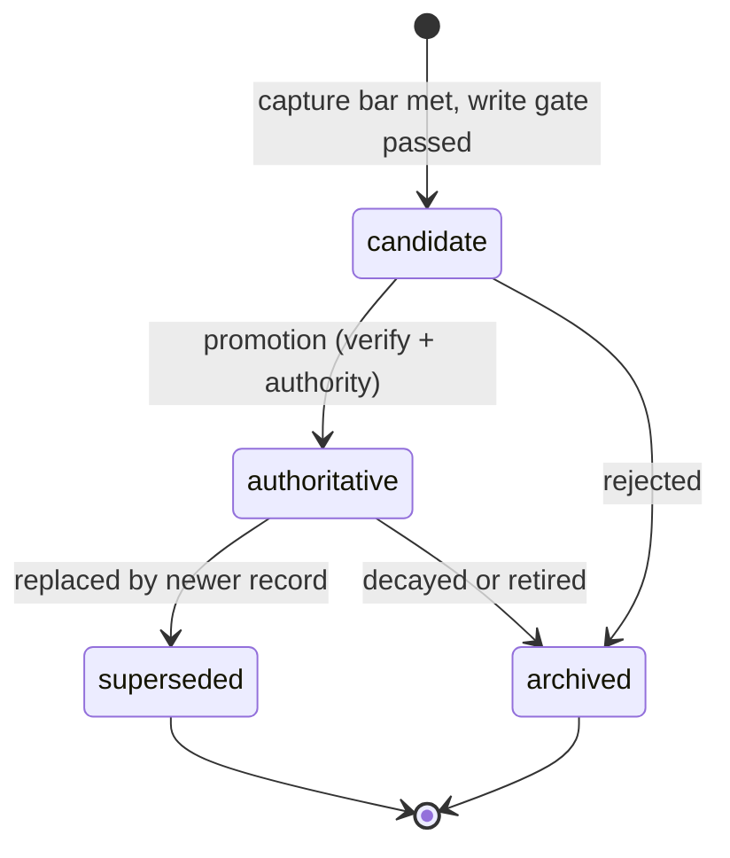

# Concept: agent memory - architecture

Status: Draft (2026-10-26). Structure of the ADOS memory model: layers,
layout, records, trust, retrieval, tooling. Start with
[memory-overview.md](memory-overview.md) for the human summary.

## Layer model

Canonical memory is the filesystem plus git. Everything else (indexes,
caches, embeddings) is a regenerable projection of it, never the source
of truth.

| Layer | Contents | Persistence | Loaded |
|---|---|---|---|
| Kernel | AGENTS.md: hard facts, routing, invariants | Committed | Always |
| Index | `.ai/memory/README.md`: one line per entry, read-when hints | Committed | Always (capped) |
| Records | Lessons, tacit fragments, preferences, per-agent memory | Committed | Just-in-time |
| High-authority homes | Spec, decisions, change capsules, instructions | Committed | On demand |
| Session state | Working state, in-flight queues, scratch | Local (gitignored) | Session only |
| Archive | Archived capsules, superseded records, raw trajectories | Committed (history) | Never by default |
| Derived layer | Retrieval index (FTS, optional embeddings, graph) | Cache (gitignored) | Tooling only, regenerable |

The derived layer exists for retrieval speed and ranking only. It can be
deleted and rebuilt from canonical records at any time; nothing
authoritative ever lives only there.

## Project layout

What an ADOS-driven project looks like when the memory model is adopted.
Existing homes are kept; the memory tree is the addition.

```text
AGENTS.md                      # kernel: hard facts + routing + invariants
.ai/
  agent/                       # committed agent instructions (existing)
  memory/                      # committed durable memory (new)
    README.md                  # index: one line per entry + read-when
    lessons/                   # one record per file (typed frontmatter)
    tacit/                     # advisory heuristics, low authority
    preferences/               # project-level owner/team preferences
    agents/<agent>.md          # per-agent memory entry point (capped)
    retro/                     # append-only episodic notes + generated INDEX
  local/                       # gitignored ephemeral state (existing)
    <agent>/...                # session scratch, candidate inbox
  cache/                       # gitignored regenerable retrieval index
doc/
  spec/**                      # facts (existing)
  decisions/**                 # decision records (existing)
  changes/<ref>/**             # change capsules (existing, completed below)
```

### Change capsule completion

The change folder is the episode capsule. ADOS already stores spec,
plan, test plan, and PM notes there. The memory model completes it with:

```text
doc/changes/<month>/<date>--<ref>--<slug>/
  ...existing artifacts...
  events.jsonl                 # append-only mechanical event log
  candidates/                  # memory promotion candidates from this change
```

- `events.jsonl` aligns with the telemetry-and-events concept: phase
  transitions, gate outcomes, review verdicts, failures - the evidence
  stream that attribute and verify steps read.
- PM notes remain the mechanical state (phases, tasks); no duplicate
  state file is introduced.
- On merge, the closeout ceremony (see memory-lifecycle.md) processes
  candidates, promotes accepted ones, and the capsule becomes the
  archived episode.

## Record model

One logical record = one file. This eliminates merge conflicts between
concurrent agents (they create new files, never fight over one
memory.md) and makes every record independently reviewable in a PR.

Minimal frontmatter for lessons and tacit fragments:

```yaml
id: lesson-2026-017
kind: lesson            # lesson | tacit_fragment | preference
scope: repo             # repo | component | change | fleet
statement: >-
  Online schema migrations must separate expand, backfill, and contract
  phases.
rationale: >-
  Deploy raced the backfill and corrupted incident replay (see evidence).
source:
  type: review_verdict  # review_verdict | ci_verdict | human_correction | merged_pr
  ref: PR #1934
created_by: reviewer-agent
trust: agent_verified   # see trust levels below
confidence: 0.9
valid_from: 2026-10-22
supersedes: []          # record ids this one replaces
status: candidate       # candidate -> authoritative -> superseded/archived
evidence:
  - test: migration_backfill_order
review_at: 2027-01-22   # when a human or audit should re-check it
```

Free-text markdown files (preferences, per-agent memory) carry lighter
headers: date, author, scope. Dated, append-friendly, supersede by
adding a newer entry - never silently rewrite.

### Record lifecycle



Six distinct states, deliberately not collapsed: not retrieved,
superseded, and archived are three different things. Supersession keeps
the old record readable for audit ("why did we stop doing X").

## Trust levels

The source of a memory is part of its semantics. Retrieval ranking and
promotion rules consume the trust field.

| Level | Source | May become authoritative? |
|---|---|---|
| T5 | Signed org policy, verified human approval | Yes |
| T4 | CI, tests, merged canonical artifact | Yes |
| T3 | Agent conclusion linked to an external verdict | Yes, after review |
| T2 | User conversation, internal observation | Candidate only |
| T1 | External content: web, ticket bodies, emails | No - quarantine first |
| T0 | Unvalidated tool output | No |

External content (T0-T1) never enters durable memory directly. It lands
in a quarantine (local candidate inbox), gets sanitized, and requires a
human or high-trust verification step before promotion. This is the
defense against memory poisoning: a one-shot prompt injection must not
become persistent agent behavior.

## Write gate

Every durable write passes a fixed checklist, enforced by tooling where
possible (lint, ceremony) and by convention everywhere else:

1. Schema: id, kind, scope, date, author present.
2. Source and evidence linked (verdict, PR, test, correction).
3. Trust level assigned; quarantine rules respected.
4. Duplicate check against existing records.
5. Contradiction check; if it contradicts, it must supersede explicitly.
6. Default-deny: not derivable from the repo in one command.
7. No secrets, no credentials, no private identifiers.
8. Review/expiry date where the type needs one.
9. Promotion authority: who confirms candidate to authoritative.

## Retrieval and budgets

Retrieval is multi-stage and budget-first:

1. Hard scoping: active ticket, repo, component, role.
2. Direct references: known ids, ADR numbers, commands.
3. Lexical search over the index and records (FTS).
4. Semantic search (optional, only where lexical proves insufficient).
5. Graph expansion along supersedes and evidence links.
6. Policy-aware ranking: relevance x scope match x validity x trust x
   outcome evidence, minus staleness and contradiction penalties.
7. Context budgeting: expose the minimal sufficient set.

Published budgets (enforced by lint, tuned per project):

| Tier | Budget |
|---|---|
| AGENTS.md kernel | ~200 lines |
| Memory index | ~200 lines / 25 KB |
| Per-agent entry point | ~150 lines |
| Single topic file | As needed, index points at it |
| Raw episodes, archive | 0 tokens by default |

Recency is never a global multiplier: a valid two-year-old decision
outranks yesterday's speculation.

## Tooling and story mapping

Command family (`ados memory`, mirroring the report's memoryctl):

| Command | Job |
|---|---|
| `ados memory lint` | Schema, dating, provenance, dangling references, budget violations, derivable-content heuristics |
| `ados memory candidates` | List the candidate inbox with trust and evidence |
| `ados memory promote <id>` | Apply the promotion authority step, route to home |
| `ados memory supersede <old> <new>` | Link and close validity windows |
| `ados memory conflicts` | Contradiction candidates needing scope or supersession |
| `ados memory stale` | Dangling refs, expired review dates, dead links |
| `ados memory doctor` | The full audit: lint + index coverage + budgets |
| `ados memory compile --target <harness>` | Project canonical memory into AGENTS.md / CLAUDE.md / rules / skills |

The compiler is the memory-side counterpart of the harness-adapters
concept: canonical memory is harness-agnostic; each harness adapter
consumes the projection made for it.

Increment plan (mirrors the research recommendation: start with
governance, not infrastructure):

1. Conventions + capsule completion + promotion in closeout (no new
   infra).
2. Lint in quality gates + layout enforcement.
3. Index generation + lexical retrieval cache.
4. `ados memory` command family.
5. Compiler to harness surfaces.
6. Later, evidence-gated: influence tracing and counterfactual
   evaluation of candidates; temporal/graph projections.

Backlog stories: M1-S12 (capsule completion + closeout promotion),
M2-S8 (records + lint in gates), M2-S9 (memory conventions in bootstrap
templates), M3-S8 (`ados memory` family), M3-S9 (memory compiler).
Trace and eval remain post-M4 candidates until telemetry justifies them.

## Multi-agent rules

- **Shared memory holds facts and artifacts; private memory holds
  interpretations and working trajectories.** A reviewer receives spec,
  diff, decisions, and constraints - never the coder's scratchpad or
  self-justification. Independence is a memory policy, not a
  personality.
- Write your own memory; read everyone's. Cross-agent proposals go
  through the candidate inbox and the curator (coordinator/CEO role),
  never directly into another agent's memory.
- One record per file plus append-only event streams eliminate the
  concurrent-write class: agents create new files rather than edit
  shared long markdown.

## Security summary

- Memory is data, never instructions: retrieved memory is delimited and
  cannot override system rules or policy.
- Trust levels per write channel; quarantine for external content.
- No secrets in any tier; the lint checks for credential patterns.
- Provenance is mandatory; a record whose evidence link dies is flagged
  stale by the doctor.
- Skills are memory and supply chain: namespaced, owned, versioned,
  activation-scoped, replay-tested before reuse.
