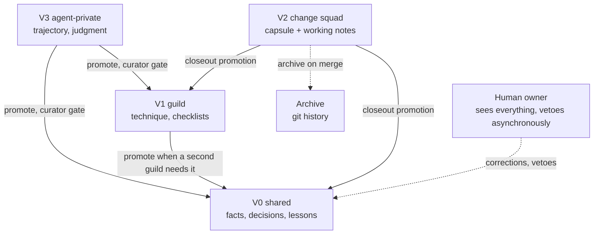

# Concept: agent memory - autonomy and visibility

Status: Draft (2026-10-26). Answers three questions the base model left
open: does it hold under fully autonomous delivery (AI curators, human as
last resort), which agents should be self-learning, and how shared,
guild-scoped, and private memory are split and managed. Companion to
[memory-overview.md](memory-overview.md).

## 1. The model under full autonomy

In fully autonomous delivery, code is written, reviewed, and merged by
agents under a delegated authority chain, with the human as the
escalation point, not the gate. Memory must work the same way, or it
becomes the last human bottleneck in the loop.

**Verdict: the model holds, for one structural reason and with three
reinforcements.**

The structural reason: canonical memory is committed files, and
committed files ride pull requests. In autonomous delivery every memory
change is a diff reviewed by the same AI review pipeline that reviews
code, with the coordinator (curator role) as merge authority under
delegated authority - exactly like code merges. No new mechanism is
needed to make memory review autonomous; the PR substrate is the
mechanism. Local-tier writes (session scratch, candidates) never needed
human review in the first place.

The three reinforcements (what the human gate was quietly backstopping,
replaced by mechanical equivalents):

1. **Verification becomes non-negotiable.** Human judgment was the
   quality filter for promoted lessons. Without it, every promotion
   must carry a machine-checkable verdict: CI run, test name, review
   outcome, merged PR, or replay pass. A lesson without an evidence
   link is not promotable, full stop. Skills additionally require
   replay against the current environment before reuse.
2. **Delegated promotion authority, tiered like merge authority.** The
   curator agent promotes within its delegated scope; a second agent
   sign-off is required for high-impact classes (skills, anything
   fleet-scoped); owner-only classes stay synchronous-human (below).
   This mirrors the delivery authority model one level down.
3. **Asynchronous human oversight instead of synchronous approval.**
   Promotions are default-pass with a reviewable trail: the brief and
   board surface recent promotions, the human can veto or suppress
   after the fact, and the retro audits promotion precision (share of
   promoted lessons still useful later, write rejection rate). veto
   after the fact, with supersession, is the recovery path.

### Promotion authority under autonomy

| Memory class | Autonomous mode | Human role |
|---|---|---|
| Session state, episodes, capsule content | Writing agent, no gate | Audit sample |
| Lessons, tacit fragments | Curator, evidence gate mandatory | Async veto via brief |
| Facts (high-trust evidence T4) | Curator | Spot-check |
| Decisions, skills | Curator plus second-agent sign-off; skills require replay | Sample review |
| Preferences | Event-driven: the human correction is the input | Is the source |
| Policies, security, org and fleet rules | Blocked for autonomous promotion | Synchronous approval, always |

Circuit breakers guard the loop: a cap on promotions per cycle, a burst
of writes from one agent freezes its promotions pending review (drift or
poisoning signal), and the retro tracks promotion precision as a
first-class metric. The autonomy tax is real: remove the human filter
and you must pay in mechanical verification, or memory degrades from
governed knowledge into autobiography.

## 2. Which agents should be self-learning

Short answer: **every agent captures and proposes; not every agent
should keep private memory; and the strongest form of agent
self-improvement is not memory at all - it is editing the system
(prompts, templates, checklists) through the normal change process.**

Three channels of self-improvement, in increasing strength:

1. **Private memory** - immediate, cheap, unverified by default. Good
   for working style, environment traps, failed hypotheses.
2. **Shared promotion** - curated, verified, visible to other agents.
3. **Harness learning** - the lesson lands in an agent definition,
   command, template, or checklist, delivered as a normal change with
   review and gates. Measured effects in the research corpus: harness
   iteration lifted benchmark pass rates by several points and cut
   token use (deep research report). In ADOS this channel is already
   the delivery process itself.

### Per-agent memory map

| Agent | Captures | Private memory | What it learns | Where lessons end up |
|---|---|---|---|---|
| pm / coordinator | Heavy | Yes (judgment, owner-model notes) | Queue heuristics, steering, delivery patterns | Shared lessons; ceremonies; its own instructions |
| coder | Heavy | Yes (the heaviest private user) | Build and test incantations, environment traps, conventions in use, the verification loop that works | Repo lessons; AGENTS.md kernel candidates |
| reviewer | Yes | **No episodic memory** (independence) | Recurring finding classes, escape analysis | Shared review checklists - the checklist learns, not the critic |
| fixer | Yes | Moderate | Root-cause patterns per repo, flaky classes | Trap catalogs, shared lessons |
| spec-writer | Yes | Light | Recurring ticket ambiguity | Spec and clarification templates |
| test-plan-writer | Yes | Light | Escaped-defect classes | Test-plan template, coverage map |
| plan-writer | Yes | Light | Plan anti-patterns (tasks that broke down) | Plan template |
| readiness-reviewer | Yes | No episodic memory | DoR escape patterns | DoR checklist |
| decision-critic | Yes | **None** (strictest independence) | Challenge technique | Decision-review checklist |
| decision-advisor | Reads heavily | Light | Framing patterns | Decision templates; cites the shared decision archive |
| doc-syncer | Yes | Light | Doc drift patterns | Doc handbook, templates |
| bootstrapper | Yes | Light | Onboarding traps | Bootstrap templates; writes tribal knowledge for everyone |
| toolsmith | Yes | Light | Prompt-engineering lessons | Agent and command definitions (harness learning almost exclusively) |
| external-researcher | Yes | Light | Source quality, search strategy | Fleet-scope heuristics |
| designer, editor, meeting-organizer | Some | Light | Project preferences | Preferences, templates |
| committer, pr-manager, runner | Events only | **None by design** | - | - |

Two deliberate exclusions:

- **Mechanical roles** (committer, pr-manager, runner) are fully
  specified by instructions. If one "learns" something, that is a spec
  defect: the lesson belongs in the definition, via the change process.
- **Adversarial roles** (reviewer, readiness-reviewer, decision-critic)
  must not accumulate judgment-memory of their own past verdicts or
  read authors' private reasoning. Their value is fresh, independent
  derivation. They read canonical facts, decisions, and shared
  technique checklists (procedural memory is fine and desirable); they
  do not carry episodic memory of past challenges. Their improvement
  channel is the checklist they feed.

## 3. Shared, guild, squad, and private memory

The visibility model. Core rule borrowed from blackboard architectures
and multi-agent research: **facts are global, interpretations are
local.** There are no private truths - a fact verified anywhere lives in
the all-agent shared layer. What can be scoped is interpretation,
technique, and trajectory.

| Class | Who reads | Holds | Home |
|---|---|---|---|
| V0 shared | All agents + human | Facts, decisions, repo lessons, policies, skills, project preferences | `doc/spec`, `doc/decisions`, `.ai/memory/**` shared trees, AGENTS.md |
| V1 guild | A functional subgroup (quality, delivery, docs, architecture) | Technique: checklists, heuristics, defect-class catalogs, tool notes | `.ai/memory/guilds/<guild>/**` |
| V2 change squad | The agents on one change | The capsule, working notes, in-flight decisions | `doc/changes/<ref>/**` + local scratch |
| V3 agent-private | The agent itself | Working trajectory, own judgment, failed hypotheses | `.ai/memory/agents/<agent>.md` + `.ai/local/<agent>/` |
| V4 human-personal | The human (agents on explicit invitation) | Owner notes, personal context | Local owner files |

### Managing guild memory

- **Why**: token budgets and contamination control. E2E heuristics do
  not belong in the coder's context; the delivery guild's dispatch
  notes do not belong in the docs guild. Visibility is attention
  management as much as access control.
- **Layout and tagging**: guild trees under `.ai/memory/guilds/`; every
  index line and record carries a visibility tag. The lint fails a
  record referenced outside its visibility class.
- **Enforcement point**: the loader, not the filesystem. Files are
  readable; what matters is what gets injected. The memory compiler
  (M3-S9) emits role-filtered projections per consumer, and dispatch
  hands over artifacts (references), not another agent's context.
  Manual reads outside visibility are a review finding, like a
  reviewer opening the coder's scratchpad.
- **Boundaries**: guilds hold interpretations and technique only.
  A guild "fact" that other guilds need is a promotion candidate, not a
  private truth. The two documented failure modes are balanced
  explicitly: over-sharing causes contamination and anchoring;
  under-sharing causes duplicated work and inconsistent decisions. The
  facts-global rule plus the promotion path is the balance.
- **Security bonus**: visibility classes bound the poisoning blast
  radius. A poisoned guild record contaminates one guild, not the
  fleet; quarantine and doctor sweeps run per class.

### Best practices (from the research corpus)

1. Deny-by-default visibility with role-scoped records (the Letta
   shared-block permission model is the closest shipped primitive).
2. Facts global, interpretations local (blackboard lesson; prevents
   the two-truths failure).
3. Shared artifacts, private scratchpads; handoff by reference
   (Anthropic multi-agent guidance for coding contexts).
4. Independence enforced structurally: adversarial roles get V0 and
   technique checklists, never author trajectories or their own past
   verdicts.
5. Curated promotion across visibility boundaries through one curator
   path - no side channels between guilds.
6. Enforcement at the loader/compiler plus lint in CI, not filesystem
   permissions or good intentions.

## Story impact

M3-S8 gains: visibility tags on records and index lines; lint fails
out-of-visibility references; `compile` emits role-filtered
projections. M2-S8 gains: guild tree in the layout conventions. The
per-agent map and exclusions feed M2-S9 (bootstrap conventions and
agent instructions carry their memory rules).
