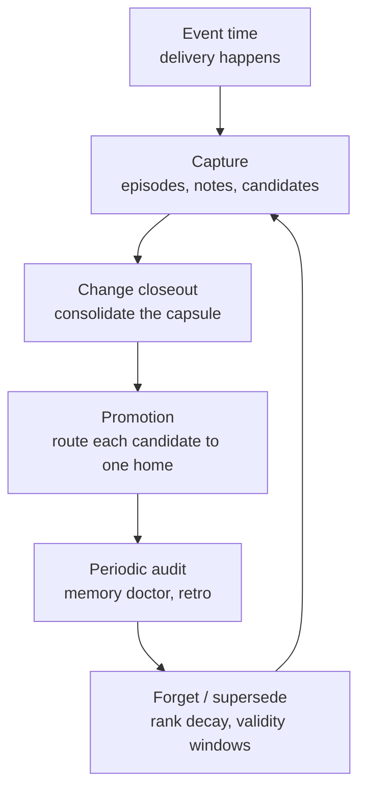

# Concept: agent memory - lifecycle and processes

Status: Draft (2026-10-26). The processes that make memory trustworthy:
capture, consolidation, promotion, supersession, forgetting, audits,
compaction, and where each wires into the ADOS change lifecycle.
Start with [memory-overview.md](memory-overview.md) for the summary.

## Process map



## 1. Capture (event time)

Capture happens when things happen, not in wrap-ups. Hot path writes are
minimal: session checkpoint, explicit human correction, critical event,
evidence link. Everything else waits for the background step.

Rules:

- Write the dated note at the event.
- The capture bar gates durable candidates (see overview). Verdict-
  linked events (CI, review, merge) qualify; model opinions do not.
- Session scratch stays in `.ai/local/<agent>/`; only candidates that
  pass the bar move toward committed memory.

## 2. Consolidation (change closeout)

When a change merges, the closeout ceremony processes its capsule. ADOS
already has closeout captures; this is the memory step inside it:

1. Validate capsule completeness (artifacts, events, PM notes phases).
2. Identify candidates: facts, lessons, skill candidates, tacit
   fragments observed in the change.
3. Dedup against existing project memory.
4. Link evidence and verdict for each candidate.
5. Replay or verify where possible (a lesson claiming "X works" cites
   the test that proves it).
6. Promote accepted items to exactly one home.
7. Archive the capsule; rebuild the index.
8. Emit telemetry (memory writes are events in the event log).

The retro ceremony covers the same loop at project timescale, plus the
meta step: the procedure itself learns (which capture rules produced
value, which produced noise).

## 3. Promotion (one canonical home)

Promotion routes each accepted item to exactly one existing home. No
new parallel registers; the routing table is closed:

| Candidate | Home |
|---|---|
| Verified fact about the system | `doc/spec/**` |
| Decision with rationale | `doc/decisions/**` |
| Operational lesson | `.ai/memory/lessons/` |
| Judgment, weak signal, reversal condition | `.ai/memory/tacit/` |
| Owner or team preference | `.ai/memory/preferences/` |
| Repeated successful workflow | Command, skill, or playbook |
| Hard norm | AGENTS.md kernel or policy-as-code |
| Cross-repo practice | Fleet layer (global config), owner-approved |

Promotion is rare and evidence-gated: a single occurrence is an episode;
a repeated or externally verified occurrence becomes a lesson; a stable,
executable lesson becomes a skill; cross-repo value plus owner approval
makes it fleet practice. Skipping levels is the definition of premature
promotion.

Under fully autonomous delivery the same matrix runs with delegated
authority: the curator agent promotes with mandatory machine-checkable
evidence, second-agent sign-off on high-impact classes, asynchronous
human veto instead of synchronous approval, and owner-only classes
(policies, security, org and fleet rules) still gated on the human.
Detail and circuit breakers: 
[memory-autonomy-and-visibility.md](memory-autonomy-and-visibility.md).

The human approval matrix by memory class:

| Class | Agent writes | Agent may promote | Human approval |
|---|---|---|---|
| Session state, episodes | Yes | Yes | No |
| Preferences | After explicit correction | Usually | Optional |
| Lessons, tacit fragments | Yes, as candidates | After verification | Reviewer or curator |
| Facts | Yes, with high-trust evidence | Often | Curator spot-check |
| Decisions, skills | Proposals only | After replay, low-risk scope | Recommended |
| Policies, security, org rules | Proposals only | Never | Always |

## 4. Supersession (never delete truth)

When reality changes, the old record is closed, not erased:

```yaml
id: fact-auth-017
status: superseded
valid_from: 2026-01-12
invalid_from: 2026-09-07
superseded_by: fact-auth-031
```

- Decisions are immutable history; a new ADR supersedes an old one by
  link.
- The index drops superseded entries; the records stay for audit.
- Contradictions found by the doctor or the conflicts command must end
  in explicit supersession or scope separation, never coexistence by
  inertia.

## 5. Forgetting (per type, not one TTL)

| Type | Rule |
|---|---|
| Fact | No decay; supersede when reality changes |
| Decision | Immutable; supersede only |
| Episode | Rank decay; archive after a window; keep the evidence pointer |
| Lesson | Confidence decays when unused; reinforced by verified use; demoted on contradiction |
| Tacit fragment | Faster decay; requires examples; never hard-enforced |
| Skill | No time decay while replay passes; retires when environment or tests fail |
| Policy | No autonomous decay; human-controlled validity only |

Forgetting distinguishes: not retrieved (still there), suppressed
(hidden by policy), deprecated (flagged), superseded (replaced),
archived (out of active layers), deleted (rare, audited, and never the
default).

## 6. Audits

- **Per closeout**: candidate quality check inside the ceremony.
- **Periodic (monthly or per retro cycle)**: `memory doctor` - schema
  lint, index coverage (every record indexed, every index line backed by
  a record), budget enforcement, dangling references, expired review
  dates, contradiction candidates, derivable-content heuristics.
- **Telemetry-driven**: memory miss rate (failures where the right
  memory existed but was not retrieved) and stale influence rate
  (actions worsened by outdated memory) are the two signals worth
  tracking once the event log carries retrieval events.

## 7. Compaction contract

Compaction is not a memory write path. Before a session compacts:

- Checkpoint working state (session files, PM notes).
- Flush the event log.
- Record unresolved questions and the last verified commit.

After compaction, bootstrap in order: task manifest / change state,
kernel (AGENTS.md), memory index, just-in-time records, relevant
candidates. Durable lessons are formed at phase boundaries by the
background process, never mid-flight by compaction itself.

## 8. Retrospectives are the engine

Every memory process above (capture quality checks, consolidation,
promotion, audits, meta-learning) is executed by the retrospective
subsystem at its levels and triggers: see
[retrospectives.md](retrospectives.md). The retro is the promotion
engine, not a parallel system.

## 9. Human-agent shared memory

Humans and agents share the same homes with class-dependent ownership
(see the approval matrix above). Two hard rules:

- Humans own preferences, policies, and the promotion authority for
  decision-class items.
- Shared files (preferences, playbook) declare their writer in the
  header; agents never edit the owner's personal notes.

## What "adopted" looks like

A project has the memory model adopted when: the layout exists, the
closeout ceremony promotes candidates, the index is generated and
covered, lint runs in the gates, the doctor runs on the audit cadence,
and the retro tracks capture quality. Before the CLI exists, all of
this runs on conventions and the ceremony runner; the tooling then
mechanizes the same steps without changing them.
