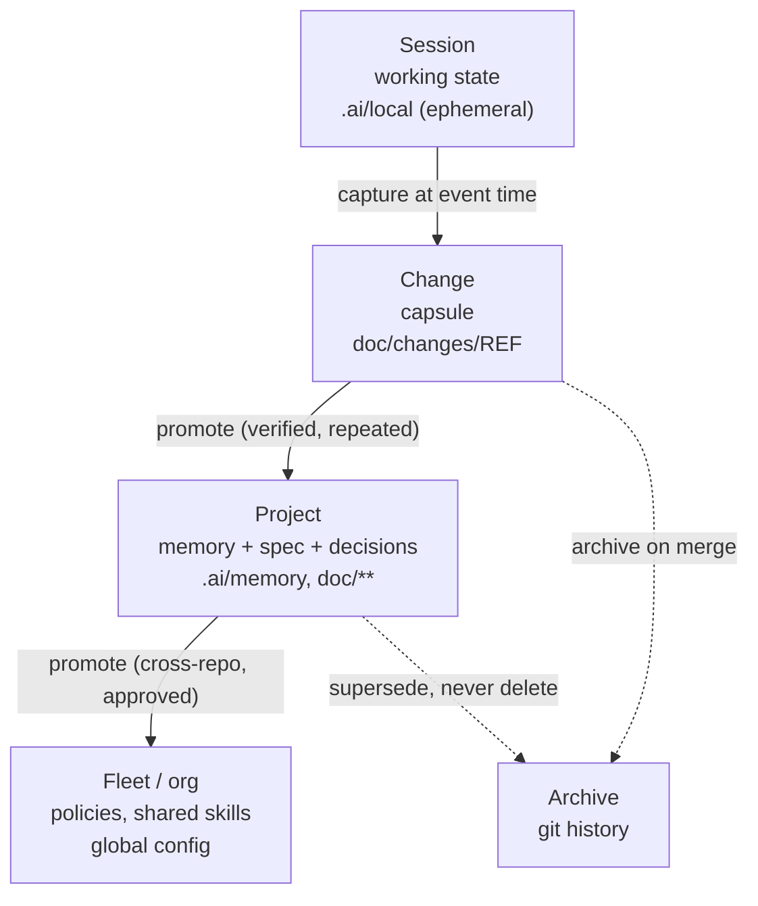
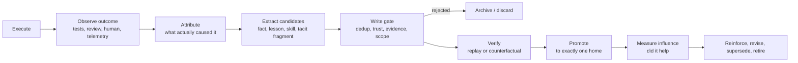
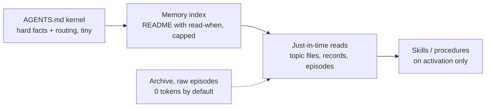

# Concept: agent memory - overview

Status: Draft (2026-10-26). The human-friendly summary of the ADOS memory
model. Depth: [memory-architecture.md](memory-architecture.md) (structure),
[memory-lifecycle.md](memory-lifecycle.md) (processes),
[memory-practices.md](memory-practices.md) (rules to adopt today).
Grounded in the 2026-10 memory research corpus (three internal workspace
designs, external research, deep research report).

## Why memory, why now

ADOS agents work in sessions that end and get compacted. Without memory,
every session starts from zero and repeats the same discoveries and the
same mistakes. With memory, the system gets better across tickets: known
failure modes are avoided, conventions are respected without re-reading
everything, and hard-won judgment accumulates.

The evidence is consistent across research and every major coding agent
product: for repo-based agents, plain files in git plus an index beat
databases and vector stores as the canonical layer. The hard problem is
not storage. It is the **write policy**: what deserves to be remembered,
who verifies it, how it is superseded, and how it stays small enough to
load.

The master invariant (everything else follows from it):

> **An agent is not the owner of memory. An agent is one of several
> producers of proposals into a governed memory system whose truth,
> scope, trust, and promotion are controlled by the harness, the
> process, and the human.**

## The nine memory types

Different memories need different rules of truth and forgetting. ADOS
uses nine content types. The table is the mental model; the right column
shows where each type already lives, or will live, in an ADOS-driven
project.

| Type | What it holds | Example | Home in an ADOS project | Forgetting rule |
|---|---|---|---|---|
| Working state | Current plan, next step, blockers | "schema done, tests remain" | `.ai/local/**` session state, `chg-<ref>-pm-notes.yaml` | Ephemeral by design |
| Episode | One trajectory and its outcome | The ticket, the attempts, the review verdict | `doc/changes/<ref>/**` (the change capsule) | Rank decay; archive on merge |
| Fact | Verified, durable knowledge | "The auth gateway owns tenant IDs" | `doc/spec/**` | Supersede when reality changes |
| Decision | Choice plus alternatives and rationale | ADR: why not Kafka | `doc/decisions/**` | Immutable; supersede, never rewrite |
| Preference | Owner or team preferences | PR format, review style | `.ai/memory/preferences/**` | Replace when the person changes it |
| Procedure / skill | Executable know-how | "How to deploy a schema migration" | Commands, agent prompts, skills | Retire when replay fails |
| Tacit fragment | Judgment, weak signals, reversal conditions | "Flaky only in CI: check clock assumptions first" | `.ai/memory/tacit/**` (advisory, never enforced blindly) | Fast confidence decay; needs examples |
| Policy | Hard norm | "No deploy without approval" | AGENTS.md kernel, policy-as-code | Human-controlled validity only |
| Archive | Raw history | Old transcripts, logs, superseded records | Git history, archived capsules | Retention windows; never loaded |

Two boundaries keep this honest:

- **Tacit knowledge** that cannot be written as a checkable rule (taste,
  smell of a diff) stays in prompts, skills, and tests - not in memory
  records. Memory stores the part that can be articulated: the signal,
  the judgment, the conditions that would reverse it.
- **Anything derivable from the code or git in one command is not
  memory.** Memory stores what the repo cannot tell you: why, when it
  breaks, what the owner prefers, what failed last time.

## The four scopes

Each scope answers a different question: session = "what am I doing",
change = "what happened on this ticket", project = "what is true and how
we work here", fleet = "what is true and how we work everywhere".
Promotion is rare and upward; nothing durable stays only at the bottom,
and nothing speculative jumps straight to the top.

## The learning loop

Self-learning is not "the agent appends what it thinks it learned". It
is a loop anchored in observable outcomes:

The capture bar (when a candidate may be created at all):

- The same mistake happens twice, or review catches what the agent
  should have known.
- A human corrects the agent, or repeats a correction from an earlier
  session.
- A verified outcome arrives: CI verdict, review verdict, merged PR.
- A workflow succeeds repeatedly and could become a skill.

Explicitly not enough: the agent feeling that something "seems
important". Model opinions are scratch, not memory.

## What loads when

Memory that is always loaded is paid for on every session, so loading is
budgeted and layered:

- The kernel (AGENTS.md) stays small: hard, frequently needed facts and
  routing to the rest. Procedures live in commands and skills, not in
  the kernel.
- The index is the only always-read memory file, capped in size, one
  line per entry with a "read when" hint.
- Everything else is read on demand, when the task touches that area.

## What this adds to ADOS

Today ADOS already has the high-authority homes: spec (facts), decisions
(ADRs), change folders (episodes), agent instructions, local ephemeral
state. The memory model adds the missing experiential layer and its
governance:

1. A **lessons and tacit-fragments layer** (`.ai/memory/**`) with typed
   records, provenance, and supersession.
2. **Per-agent memory** conventions: write your own, read everyone's,
   capped entry points.
3. **Change capsule completion**: mechanical state, append-only events,
   and promotion candidates inside every change folder.
4. The **promotion process** (capture bar, one canonical home, verify
   before promote) wired into change closeout and the retro ceremony.
5. **Enforcement tooling**: memory lint in quality gates, the memory
   doctor audit, and a memory compiler that projects canonical memory
   into each harness's native formats (AGENTS.md, CLAUDE.md, rules,
   skills) - aligned with the harness-adapters concept.
6. **Security model**: trust levels per write channel; external content
   never becomes authoritative memory without quarantine and review.

## Adoption in two tracks

- **Practices now** (no tooling required): any ADOS-driven project can
  adopt the layout, the capture bar, and the promotion rules today. See
  [memory-practices.md](memory-practices.md).
- **Tooling by milestone**: lint and layout land with the quality gates,
  the `ados memory` command family and the compiler with the surfaces
  milestone. See the story list in
  [memory-architecture.md](memory-architecture.md).
