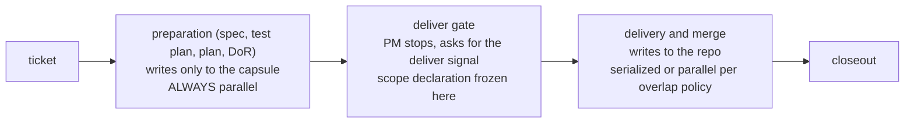

---
# Copyright (c) 2025-2026 Juliusz Ćwiąkalski (https://www.cwiakalski.com | https://www.linkedin.com/in/juliusz-cwiakalski/ | https://x.com/cwiakalski)
# Apache-2.0 License - see LICENSE file for full terms
source: https://github.com/juliusz-cwiakalski/agentic-delivery-os/blob/main-tools/doc/planning/concepts/parallel-delivery.md
---
# Concept: parallel delivery

Status: Draft (2026-10-27, from owner notes; local refinement in
progress, not committed). How multiple deliveries run concurrently:
the conflict model, the lane abstraction, and the container topology.
Owner decision (2026-10-27): **single-flight per repo remains the
default policy** for ADOS and the pilot deployment; the architecture
and design MUST support N deliveries per repo in separate working
trees without redesign - parallel-in-repo is a deliberate policy mode
(speed over token cost), not an initial one. Companions:
[containerized-delivery.md](containerized-delivery.md)
(the substrate), [software-delivery-autonomy.md](
software-delivery-autonomy.md) (portfolio caps, budgets),
[inter-agent-communication.md](inter-agent-communication.md)
(coordination), the registry queue and lanes commands, M2-S1 lane
planning.

## Baseline: single-flight per repo, and why

Today one delivery runs per repo at a time (the ownership lock): no
merge races, no PM-notes conflicts, one branch per change, coherent
review. That stays the default. Parallel delivery is designed now so
it can be enabled later per project as a policy dial - never by
accident, and never requiring architectural rework.

## The mechanism for N-per-repo: one worktree per delivery

The enabling design: every delivery in a repo gets its own **git
worktree and branch** (never a shared checkout). The workspace folder
structure carries the identity (repo / lane / change / worktree), so N
concurrent deliveries in one repo have isolated working trees, no
uncommitted-state interference, and independent gate runs. The
ownership lock then becomes a policy decision per repo (serialized
queue vs parallel dispatch of disjoint work), not a structural
constraint.

## The relaxation ladder (designed; levels 2-3 off by default)

1. **Cross-repo parallelism** - always safe: separate repos, separate
   locks. Already the model for multi-repo fleets; the only rules are
   producers-before-consumers ordering and portfolio caps.
2. **Per-repo, disjoint scope** - parallel changes in one repo whose
   exclusive scopes do not overlap (docs vs code, separate modules,
   separate services in a workspace). Off by default; enabled per
   project when speed matters more than token cost.
3. **Per-repo, shared scope** - overlapping or tightly coupled
   changes: serialized by default; parallel only with explicit merge
   arbitration, which costs more than it saves in almost all cases.

In speed mode (2-3 enabled), **merge conflicts are an accepted cost
and the agents own their resolution**: the later branch rebases onto
the merged state, resolves what it can, and escalates to the
coordinator only when the conflict is semantic (both changes altered
the same intent) rather than textual. Wasted tokens on conflict work
are the explicit trade for wall-clock speed.

## Conflict classification and the exclusive-scope declaration

Before dispatch, the coordinator classifies each ticket's expected
scope (from the ticket, the spec, historical hot files):

| Class | Meaning | Dispatch decision |
|---|---|---|
| cross-repo-safe | touches only its own repo | parallel anywhere |
| path-disjoint | same repo, exclusive scope does not overlap another in-flight change | parallel within the repo |
| same-area | overlapping exclusive scope or hot files | queue serially behind the in-flight change |

## Exclusive scope: strategies for deciding overlap

The mechanism is the **exclusive-scope declaration**: each change
declares what it claims (paths, modules, areas); two changes may run
in parallel in one repo only when their declarations are disjoint.
How the declaration is produced and checked is a **strategy**, and the
strategy is policy - configurable per project, and selectable by the
coordinator over time based on retro evidence:

1. **Declared areas** (deterministic, cheap, coarse): each repo
   declares its area taxonomy (top-level features, architecture, CI,
   docs, ...); the change spec lists the areas it affects; the queue
   grants parallelism automatically when area sets are disjoint.
   Costs: taxonomy upkeep, and coarse areas over-serialize
   (architecture touches everything).
2. **Direct scope comparison** (flexible, judgment-based): the
   coordinator reads the scope of two tickets and decides - low or no
   overlap, parallelizable; high overlap, serialize. No taxonomy to
   maintain; costs judgment (mispredictions become merge conflicts -
   which the retro then measures) and tokens.
3. **Structured plan locations** (precise, machine-computable): the
   delivery plan becomes a machine-readable document in which each
   phase lists the exact locations it will modify - folders, packages,
   classes, files. The scheduler computes overlap and conflict levels
   mechanically from location sets, before any code exists. This
   requires enriching the change lifecycle (plans gain a structured,
   machine-readable section), but converts overlap detection from a
   prediction into a computation. Cost: heavier planning phase; the
   plan must be kept honest as phases land (drift between planned and
   actual locations is itself retro evidence).
4. **Hybrid** (default candidate): locations from structured plans as
   the primary signal, areas as fallback hints, the coordinator's
   judgment for edge cases - the declaration recorded either way so
   misprediction rates accumulate per strategy.

Whichever strategy runs, the declaration is visible on the board, is
written when the plan exists (predicted scope, verified as phases
land), and is conservative by default - undeclared or fuzzy scope
serializes. Low-merge-conflict-risk is a prediction the merge gate
verifies, not an assumption: a real conflict at merge time means the
coordinator arbitrates order (or serializes the remainder), and the
misprediction is retro evidence about the strategy - which is exactly
the signal that lets the coordinator switch strategies autonomously
as evidence accumulates.

## Preparation is always parallel (structural insight)

The lifecycle splits at a natural seam: **preparation phases
(clarify, specification, test planning, delivery planning, readiness)
write only to the change folder** - their own capsule - so they are
conflict-free by construction and can ALWAYS run in parallel, for any
number of changes in any repo, with no overlap analysis at all. The
exclusive-scope problem begins only at the delivery phase (repo
writes). The pipeline therefore becomes:

The deliver gate is the coordination point: preparation completes,
the plan with its structured locations is the scope declaration, the
PM parks and asks for the deliver signal, and the scheduler admits
the change into the delivery queue according to the overlap policy.
This resolves the queueing problem cleanly (the scheduler always has
complete, structured scope information before any repo write starts)
and is worth experimenting with even before per-repo parallelism is
enabled - preparation parallelism alone is a throughput win with zero
conflict risk.

## Lanes

A **lane is a long-lived parallel work stream - a virtual delivery
team**: a queue with a theme and a scope (a repo, a service area, a
docs lane, a chore lane), a capacity allocation (WIP limit,
build-weight class per M2-S1), and its own telemetry budget. Lanes
are the unit of parallel planning: the coordinator balances load
across lanes, keeps hot-file changes inside one lane (serializing
them there), and lets disjoint lanes run freely.

- Lane identity is persistent (it has history and stats), while its
  containers are ephemeral. The workspace folder structure carries
  the lane id (containerized-delivery.md).
- Lanes bound blast radius and budget: portfolio caps
  (max concurrent actions, correlated-dependency limits from the
  AutonomyContract) apply per lane and per portfolio, not just per
  action - ten "safe" changes to one shared dependency are one
  correlated risk.
- A lane is not a memory scope of its own: squad-scope memory (V2)
  belongs to the change; lane-level lessons promote to project (V0)
  or guild (V1) via the retro path.

## Container topology

| Option | Pros | Cons | Verdict |
|---|---|---|---|
| One container per change | full isolation, per-delivery metrics, disposable, no cross-talk | cold starts (mitigated: layered images + warm pool), per-container resource floor | **default** |
| One shared container per lane | warm caches, session continuity | shared filesystem state, cross-delivery interference, noisy-neighbor metrics, blast radius coupling | only for long-running lane services (watch, board), not deliveries |
| Multiple streams, one container (multiplexed) | cheapest | no isolation, one wedged stream affects all, hardest to attribute | rejected for deliveries |

A change spanning multiple repos gets **one container mounting every
repo it needs** (the container belongs to the change, not to a repo);
cross-repo ordering (producers before consumers) is enforced by
dispatch sequencing, not by container placement.

## Coordination rules

1. Producers before consumers across changes (existing rule, now
   scheduler-enforced).
2. Merge arbitration: parallel branches merge in queue order; a
   branch that conflicts rebases onto the merged state before its own
   merge - conflicts beyond trivial are coordinator decisions, not
   agent skirmishes.
3. Portfolio caps: per-lane and global concurrency, daily action
   budgets, correlated-dependency limits (AutonomyContract budget
   block).
4. Visibility: the board shows in-flight changes, their
   exclusive-scope declarations, and lane load; supervision treats a
   lane as a unit (`ados supervise`, `ados lanes`).
5. Single-flight remains the failure-mode fallback: demotion, freeze,
   or arbitration failure re-serializes a lane instantly.

## Open questions

1. Resolved (2026-10-27): single-flight per repo is the initial
   policy; N-per-repo stays a designed, dormant mode (worktrees are
   still built from day one so the mode is a config flip later).
2. Lane configuration: who declares lanes (bootstrap template per
   project with defaults, coordinator proposes, owner approves)?
3. Does the exclusive-scope declaration live in the ticket, the spec,
   or the plan (leaning: plan phase 1, predicted; surfaced on the
   board)?
4. Warm-pool sizing heuristics (per lane? per project? adaptive by
   queue depth?).
5. Conflict-resolution budgeting in speed mode: token caps per rebase
   before mandatory escalation.
