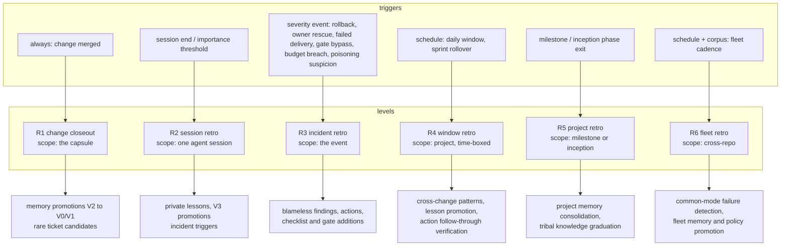

---
# Copyright (c) 2025-2026 Juliusz Ćwiąkalski (https://www.cwiakalski.com | https://www.linkedin.com/in/juliusz-cwiakalski/ | https://x.com/cwiakalski)
# Apache-2.0 License - see LICENSE file for full terms
source: https://github.com/juliusz-cwiakalski/agentic-delivery-os/blob/main-tools/doc/planning/concepts/retrospectives.md
---
# Concept: retrospectives

Status: Draft (2026-10-26). Design of the ADOS retrospective subsystem:
levels, triggers, process, memory integration, action follow-through,
and the autonomy model. Retrospectives are the consolidation engine of
the memory model (memory-lifecycle.md) and the improvement loop of the
delivery system. Tracker anchors: issues #43 (retrospective agent) and
#64 (decision retro lifecycle). Grounded in the pilot workspace's proven
retro machinery, ADOS's existing retro touchpoints, and the 2026-10
external research corpus.

## What exists today

- PM notes carry typed `retro` notes per change (the primary delivery
  retro input); phases record failures, reopens, and lessons.
- The coordinator keeps append-only local retrospective notes.
- Bootstrapper runs per-phase retrospectives during inception (issue
  #137, shipped) plus tribal-knowledge harvest at onboarding.
- Decision records carry a Structured Retrospective section and a
  review date (issue #64 tracks the verification loop).
- The pilot workspace (design partner deployment) runs the mature
  version: a retro command with stable scope keys and idempotent notes,
  a watermarked evidence collector, a coverage registry (merged-but-not-
  reviewed), a generated index over hundreds of notes, a meta-learning
  file where the procedure improves itself, a long-term research program
  with reusable extractors, and daily-ceremony wiring where every step
  is verified by its artifact.

The research corpus adds the failure catalog (15 documented reasons
retros fail to produce change) and the confirmation that no public
fully-autonomous retro loop exists - automated evidence, drafting, and
analysis with human sampling is the state of the art. ADOS aims one
step further: autonomous retro operation with human sampling and veto,
consistent with the memory autonomy model.

## Levels and triggers

Hybrid trigger model: scheduled cadence for learning, event and
severity triggers for incidents, accumulation triggers for sessions,
lifecycle triggers for projects. Triggers are declared in advance
(an incident without a pre-declared trigger rule is itself a finding).

| Level | Trigger | Runs | Frequency |
|---|---|---|---|
| R1 change closeout | Every merged change | Closeout ceremony (memory step) | Always |
| R2 session | Session end, or accumulated significance | The agent itself, inline | Per session |
| R3 incident | Pre-declared severity thresholds | Coordinator + involved agents | Event-driven |
| R4 window | Daily / sprint cadence | Coordinator (curator role) | Scheduled |
| R5 project | Milestone end, inception phase exits | Coordinator + human gate | Lifecycle |
| R6 fleet | Fleet cadence + corpus analysis | Fleet curator; human samples | Scheduled |

Meta-retro is a property of every level, not a level: each procedure
variant records what produced insight versus wasted effort in a
meta-learning file, and the procedure edits itself through the normal
change process (the pilot's proven pattern; research calls this
double/triple-loop learning and shows it is the rarest, highest-value
loop).

## Autonomy is orthogonal to scope

A routine R1 closeout can run at high autonomy while a severe incident
retro stays supervised, on the same ladder. The ladder L0-L6 (manual,
assisted, mixed initiative, supervised autonomous, bounded delegated,
fleet adaptive, lights-out), its level-by-level infrastructure
requirements, and the maturity rule live canonically in
[software-delivery-autonomy.md](software-delivery-autonomy.md).

ADOS operating targets for the retro domain: L4 for routine scopes
(R1, R2, R4), L3 for incidents and projects until evidence accumulates,
L5 capabilities behind the fleet retro as the multi-repos grow. L6 is
explicitly not a target; continuous-operation benchmarks are far below
the assurance a self-modifying system needs.

## The process (five stages, follow-through first)

1. **Verify prior actions.** The first item of every R4+ retro: inspect
   each open action's verification artifact (test, metric, PR, ticket),
   not the owner's status claim. Applied / partial / violated-with-
   consequence; violated fresh rules feed the self-error audit.
2. **Collect evidence mechanically.** One collector per source (git,
   tracker, CI, telemetry event log, owner comments), writing an
   immutable evidence ledger with trace ids; collectors are GET-only,
   watermarked, bounded; a collector finding is evidence, not a
   verdict. Pipeline-truth checks catch vacuous green (a pipeline with
   zero jobs never ran). The evidence plane is outside delivery-agent
   write authority (P0, deep research 2026-10: tested coding-agent
   harnesses let agents delete their own traces): the retro collector
   runs under an independent identity, storage is append-only, and no
   delivery agent can rewrite what the retro will read.
3. **Generate insights.** Mandatory gate before decisions (the
   documented anti-pattern is jumping from data to start/stop/continue).
   Separate observed facts (each linked to evidence) from inferences
   (each carrying confidence); free-form reflection is a hypothesis
   generator, never a truth source. Analysis dimensions with proven
   value from the pilot: self-error audit (my own errors and near-misses,
   including violations of existing rules - a violated rule needs an
   enforcement change, not a restatement), owner-caught escapes (defects
   that survived all my checks - highest signal), adversarial-review
   escapes, expensive loops and cost anomalies, vacuous checks,
   tool-mechanics failures, delivery friction metrics (phase reopens,
   review iterations, branch-open duration) where clusters across
   tickets indicate systemic gaps and one-offs usually do not, and
   near-miss capture (successful defensive interventions - a critic
   catch, a rollback that limited impact, a sandbox block - are
   reinforcement candidates, not just failure analysis).

   Attribution uses three labels, not one: the originating step, the
   propagation or control failure, and the missed detection opportunity.
   Blaming the final visible actor discards the information needed to
   improve the system.

   For incident and severe retros (R3, and R4+ when stakes warrant),
   analysis runs independent-then-merge: two or more analysts work the
   same sealed evidence blind to each other, normalize claims to
   evidence ids, then a challenger tries to falsify each causal claim
   (alternative chains, hindsight bias, correlation-as-causation) and
   returns supported, refuted, or unresolved; an adjudicator resolves -
   disagreement is a valid persistent state, not something to flatten
   into consensus. A facilitator agent may run the procedure
   (completeness, order, deadlines) but holds procedural, not
   epistemic, authority: no extra vote on whether a claim is true.

   **Null retro is a success**: "no supported finding, no action, no
   lesson" is a valid outcome and prevents forced lessons when evidence
   is weak.
4. **Decide.** Two distinct outputs, never conflated:
   - **Memory promotions**: per the memory model routing table, to
     exactly one canonical home, evidence-gated.
   - **Actions**: at most 1-3 per window (improvement WIP limit), each
     with the five-field contract plus proof: named owner (agent role
     or human), verifiable verb (add/remove/change/test/deploy - never
     "review" or "improve"), measurable outcome, real tracker entry,
     due date, verification artifact. Team-owned actions are invalid.
     Actions carry an outcome verifier (a delayed metric window: did
     the intended behavior actually change) and a rollback condition;
     closure distinguishes artifact closure (the guard, test, or change
     exists) from outcome closure (the metric moved as predicted).
5. **Close.** Write the note (fixed schema, machine-readable
   frontmatter: level, trigger, window, scope key, participants,
   evidence refs, facts, interpretations, wins with mechanism, gaps,
   candidate lessons, actions, confidence), update the coverage
   registry, rebuild the index, single commit, bounded summary. Scope
   keys make reruns idempotent; reruns append addenda, never rewrite.

## Memory and action integration

- Every level's promotions flow through the memory model's write gate;
  the retro is the promotion engine, not a parallel system.
- The action registry is the retro's follow-through memory: actions age
  (nudge at 14 days, escalate at 30 or on second miss), close only
  explicitly (done with artifact, deprioritized with reason, or
  superseded), and surface on the board next to owner asks - visible
  aging, never silent drift. "A postmortem without subsequent action is
  indistinguishable from no postmortem."
- Process-class lessons close by standardization: the playbook,
  checklist, or agent definition is updated (kaizen rule: no
  improvement without updating the standard), through the change
  process - the strongest channel, per the memory model.
- Decision records close their own loop (#64): review dates trigger a
  decision retro comparing predicted versus actual outcomes; the
  structured retro section and calibration dimensions are the L4/L5
  input.

## Measuring whether retros work

The key measurement mistake is evaluating the retro artifact instead of
the subsequent system; a polished narrative can be causally wrong, and
an ugly one-line guard can eliminate a defect class. Activity metrics
(lesson count, retro count, prompt length) are vanity metrics - tested
SWE skills showed no pass-rate gain in 39 of 49 cases, mean +1.2
points, some regressing (deep research 2026-10).

The hard rule for behavior-changing lessons:

> A model-authored observation may become a hypothesis immediately. It
> becomes a trusted lesson only after evidence that using it changes
> subsequent behavior in the intended direction.

The progressive evaluation ladder: replay gate (same task with and
without the candidate, frozen environment, predefined threshold) ->
shadow gate (retrieved by an evaluator without production authority)
-> canary gate (bounded cohort, randomized where feasible) -> promotion
gate (efficacy AND safety thresholds - a lesson that raises success
but violates policy does not pass) -> longitudinal gate (revalidate on
fresh work and after model, dependency, or harness upgrades) ->
meta-retro gate (compare procedures: did the second analyst raise
promotion precision enough to justify its cost).

Headline metrics: lesson treatment effect (P(success | lesson) minus
P(success | control)), promotion precision, harmful-promotion rate,
recurrence hazard (repeat rate of the failure class after
intervention), verified versus outcome-verified action closure,
owner-caught and adversarial escape rates, autonomy quality (human
intervention and rollback frequency, autonomous run length), retro
efficiency (tokens per verified useful intervention) and ROI.
Cadence follows value-of-information: cheap deterministic closeout
every change; richer analysis when significance accumulates;
high-assurance analysis for severe or novel incidents; expensive
replay only when resolving the causal uncertainty is worth its cost.

## Autonomy model

Consistent with memory-autonomy-and-visibility.md: agents own evidence
collection, drafting with citations, classification, routine L1/L2
closeouts, indexing, and recurrence detection. The human owns
meta-retro schema and trigger changes, promotion of lessons that change
safety behavior, high-severity/novel findings, and final fleet reports.
Sampling: 100 percent review for high-severity, novel, or irreversible
cases; 10-20 percent random sampling of routine notes once quality is
established (start at 100 percent); every playbook safety-rule change.
Escalation triggers: ambiguity, conflicting agent goals, destructive or
irreversible action, repeated failure signature, low lesson confidence,
owner request.

Blameless across human and agent actors: findings describe conditions
at the system level - the harness, prompt, checklist, gate, or tooling
that made the action reasonable - never "agent X was careless". The
agent is a stochastic policy; the harness is the design surface.
Accountability is forward-looking (named owner of the fix), blame is
backward-looking and banned from notes.

## Failure modes and defenses

| Documented failure | ADOS defense |
|---|---|
| Actions with no owner / vague verbs / no tracker entry | Five-field contract + verification artifact; invalid actions cannot be filed |
| No follow-up; action graveyard | Follow-through-first agenda; aging nudges; board visibility; WIP limit 1-3 |
| Opinion-only discussion | Evidence ledger; facts vs interpretations split; no-artifact claims stay hypotheses |
| Skipping insight generation (Wheel of Fortune) | Insights are a gated stage; decisions cite insights |
| Blame; hidden facts | Blameless system-level findings rule |
| In-the-soup topics | Scope classification: outside-control findings route to owner escalations, not actions |
| Recurring topics mistaken for progress | Recurrence is explicitly reported; recurring-unresolved escalates |
| Metrics as targets (Goodhart) | Metrics are retro inputs, never agent targets; paired tension metrics |
| Hallucinated or surface-attributed synthesis | Every fact links evidence; sampling audits; low-confidence synthesis flagged |
| Playbook context collapse from repeated summarization | Incremental dated deltas; dedup by merging with provenance; never wholesale rewrite |
| Unverified lessons encoding wrong behavior | Evidence gate before promotion; lessons carry first-seen and last-validated dates |
| Agent conformity: many agents, same mistake | R6 aggregates by failure signature across the fleet; common-mode = harness defect, not N agent defects |
| Retro theater (writing rewarded, closing not) | Closure rate and time-to-close are the process meta-metrics; document-only actions invalid |
| Unvalidated lessons regressing performance | Behavior-changing lessons require treatment evidence before trusted status; expiry and revalidation; applicability predicates |
| Memory volume treated as progress | Activity metrics are vanity metrics; treatment effect and promotion precision are the value metrics |
| Rubber-stamping / automation bias at human gates | Sampling design; gates see evidence ids and unresolved disagreement, not polished summaries; override is always available |
| Trace tampering by the reviewed system | Evidence plane outside delivery-agent write authority; independent collector identity; append-only storage |

## Story mapping

- Issue #43 (retrospective agent / automated change retros) is the
  tracker anchor; the M2-S3 ceremony runner already carries the retro
  evidence pass, sprint rollover, and testing-session assessment.
- M2-S3 AC extends with: declared trigger model, follow-through-first,
  the note schema, and idempotent scope keys.
- New M2-S10: the action registry and follow-through enforcement
  (five-field contract, artifact and outcome verifiers, rollback
  conditions, aging, board surface, closure rules).
- M1-S8 (retro pipeline) carries the independent evidence sidecar: a
  collector identity delivery agents cannot write, append-only storage,
  trace ids, pipeline-truth checks.
- The `ados retro` command family (registry) runs levels on demand;
  ceremonies schedule them; the doctor audits the corpus (index
  coverage, schema, dangling evidence links).
- Pilot ladder from the research, mapped: lesson A/B gate and
  expiry/compatibility checks fold into M3-S8 (memory commands); the
  failure-to-regression-test compiler (incidents yield regression
  fixtures, contrastive pairs, and adversarial scenarios - not just
  prose) into M2-S10; the evidence sidecar into M1-S8; blind analyst
  and falsifier experiments, causal replay for severe failures, the
  near-miss lesson exchange (the aviation ASRS analogue: sanitized,
  provenance-preserving, entering local systems only as candidates
  requiring local validation), and the meta-retro experiment stay
  post-M4 candidates until telemetry justifies them.
- Governance note: where deployments fall under regulatory logging and
  retention duties (for example the EU AI Act high-risk regime),
  automatic event logging and bounded retention become compliance
  requirements, not just engineering hygiene; the policy engine is the
  natural home.
- Long-term retro research (corpus mining with reusable extractors,
  per-question analyses, findings) is a fleet capability on the pilot's
  blueprint; candidate for the post-M4 research track.
