# Concept: software delivery autonomy

Status: Draft (2026-10-27, second research pass). The canonical autonomy
model for software delivery: the ladder, the AutonomyContract, maturity
measurement, graduation and demotion, runtime enforcement, and how ADOS
uses it (roadmap vocabulary, user-facing maturity assessment,
governance). The ladder was first adopted in retrospectives.md, then
generalized here; the autonomy deep research (summary pass 2026-10-26,
full report 2026-10-27) verified the core and drove this revision.
Other concepts reference this file as the single home.

## The ladder (L0-L5)

One axis: how much authority agents hold for a given activity class.
Not a property of the org, the agent, or the model - a property of the
delegated authority policy for an activity class in a context. The
levels-of-automation research (independent automation of information
acquisition, analysis, decision, and execution) is what makes per-class
and per-stage assignment the right shape.

| Level | Name | Meaning | Human role |
|---|---|---|---|
| L0 | Manual | Humans do the work; AI absent or transcribing | Everything |
| L1 | Assisted | Human selects context and asks; AI drafts | Approves everything |
| L2 | Mixed initiative | System auto-gathers context and proposes; AI drafts artifacts | Approves all durable writes |
| L3 | Supervised autonomous | Auto trigger and execute; consequential outputs hit a mandatory human gate | Gates every consequential action |
| L4 | Bounded delegated | Routine cases close automatically inside a declared policy envelope; novel and sensitive escalate; the system reaches a safe state without depending on human attention | On the loop: samples routine, handles escalations, owns the policy |
| L5 | Fleet adaptive | Cross-repo experiments, canary rollout, fleet-wide bounded changes from validated lessons | Governs risk budgets, authority classes, schemas |

```mermaid
flowchart LR
    L0[L0 manual] -->|"context packets, citations"| L1[L1 assisted]
    L1 -->|"mechanical collection, trace ids, deterministic validation"| L2[L2 mixed initiative]
    L2 -->|"triggers, pipeline, evidence ledger, action contracts, audit"| L3[L3 supervised]
    L3 -->|"policy as code, verification gates, rollback, circuit breakers, tested fallback"| L4[L4 bounded delegated]
    L4 -->|"replay and canary infra, cross-repo isolation, validated lessons"| L5[L5 fleet adaptive]
```



Two boundary rules carried over from driving-automation practice (the
levels transfer as principles, not as a formal mapping; there is no
numeric equivalence between SAE levels and ours):

- **The L3/L4 boundary is fallback responsibility**: at L4 the system's
  safety may not assume a human will notice and take over. The
  envelope, rollback, and circuit breakers do the protecting; human
  attention is a bonus. A delegation whose safety case is "the owner
  would catch it" is L3, whatever it is called.
- **Self-modification is not a rung on this ladder.** Whether the
  system may change its own policies, harness, or evaluators is a
  separate declaration: agents may propose such changes, only humans
  approve them, and the evaluator and policy planes are outside agent
  write authority (same principle as the retro evidence plane).
  Lights-out operation is a position on that separate axis, not a rung
  to earn.

## Invariants

1. No model upgrade or benchmark score raises authority by itself.
2. Granting authority is an owner-authorized, auditable event.
3. Runtime checks policy as code on a verified contract snapshot
   before every consequential action.
4. When conditions cannot be proven: deny or ask, never default-allow.
5. An agent cannot raise its own authority or lower the requirements
   of its independent verifiers (dual control: request yes, approve
   no).
6. Autonomy is contextual, time-bound, and reversible in proportion to
   the action's reversibility class.
7. Demotion, policy freeze, and emergency stop are first-class process
   states, not failures.

## The AutonomyContract

The Lx label is a projection for communication; the source of truth is
a versioned contract per action family per environment. "Implement at
L4" is not a policy - this is:

```yaml
kind: AutonomyContract
activity_class: integrate_and_merge
level: L4                      # the projection, derived from the fields below
delegation_envelope:           # the operational autonomy domain
  repo_selectors: ["org/service-a"]
  path_allow: ["docs/**"]
  path_deny: [".github/workflows/**", "security/**", "infra/**"]
  action_families: ["merge_pr"]
  max_changed_files: 5
  max_concurrent_actions: 1
  max_actions_per_day: 4
  follow_on_effects: { production_deploy_possible: false }
  reversibility_class: R3
authority: { may_merge: true, may_release: false, may_modify_policy: false }
verification:
  require_checks: ["ci/typecheck", "ci/tests", "policy/paths"]
  require_independent_signals: 2
  forbid_ci_configuration_changes: true
fallback:
  outside_envelope: escalate_to_L2
  verifier_unavailable: demote_to_L3
  policy_unavailable: deny
  safe_state: draft_pr_no_merge
evidence:
  pack_ref: "evidence:merge-docs-2026q4-v3"
  model_fingerprint: "<exact build or config id>"
  harness_fingerprint: "<exact build or config id>"
  valid_until: 2026-11-27
budget:
  max_unattended_actions_24h: 4
  on_exhaustion: demote_to_L3
controls:
  emergency_stop_enabled: true
  model_may_request_promotion: true
  model_may_approve_promotion: false
  owner: "human-principal-id"
```

Field semantics (schema is ours; values are illustrative):

- **Envelope** (the OAD): repositories, branches, paths, action
  families, data classes, tool allowlists, size and rate caps, and
  transitive follow-on effects - a merge that triggers auto-deploy is a
  release, and the policy engine must rate it at its effective
  downstream risk, not by the API name.
- **Authority**: discrete rights per action (trigger, write branch, open
  PR, merge, release, operate, modify policy, change verifier).
- **Verification**: required checks, independent signal count, and the
  rule that the implementation agent cannot modify mandatory pipeline
  configuration.
- **Fallback**: behavior at each failure boundary, the safe state, and
  the escalation route.
- **Evidence**: the pack justifying the level, with model and harness
  fingerprints and a TTL - the grant expires with its evidence.
- **Budget and controls**: aggregate caps (per day, per portfolio -
  ten "safe" changes to one shared dependency have correlated blast
  radius) and the dual-control flags.

Label discipline: Lx is only ever written with the action and scope
("L4 merge: non-protected docs paths, CI required, no external
publishing"), paired with the human role ("observer on routine paths,
consulted on exceptions"). Contracts that are not comparable in risk
are not ranked as "more mature" against each other. And the assessment
carries an honest "unassessed" status for classes without exposure -
absence of evidence is not L0 and not safety.

## Reversibility classes

Fallback and reversibility are not one problem (a revert does not
unsend a secret, undo a migration, or un-publish). Every action family
carries a class, and the class sets the default policy:

| Class | Example | Default safe policy |
|---|---|---|
| R0 pure read | analysis, log reads | data and egress limits, no gate |
| R1 ephemeral | scratch, worktree | auto-cleanup, scoped |
| R2 reversible write | branch, draft PR, tracked file edit | checkpoint, diff, rollback |
| R3 conditionally reversible | merge, flagged deploy | verifiers, canary, tested rollback |
| R4 irreversible or externally visible | data deletion, publishing, payments, secrets | mandatory explicit authority, standing human gate |

## Per-class profiles

A delivery pipeline decomposes into activity classes - clarify,
specify, plan, implement, review, test, integrate and merge, release,
operate, learn - each at its own level with its own contract, and each
decomposable into stages (observe, decide, act). Within review:
analysis and defect detection can run at L4, the approval
recommendation at L3, physical merge under a separate merge contract.
Operational autonomy is never a single bit.

Dependencies, not silos: higher merge needs independent review, CI, and
branch protection; higher release needs observable operate; learn feeds
all others (which is why its promotions are quarantined). A roadmap
raises levels along this graph, one bottleneck at a time.

| Class | Reasonable start | The gate that matters |
|---|---|---|
| Clarify | L1 to L2 | human owns product intent |
| Specify | L2 to L3 | traceability goal to requirement to test; independent ambiguity audit |
| Plan | L2 to L3 | cross-repo and ADR gates |
| Implement | L3 to narrow L4 | isolated worktree; no direct main writes |
| Review | L3, advisory-only L4 | independence from the implementer; missed-defect metrics |
| Test | L3 to L4 | running tests is not changing tests; immutable mandatory pipeline |
| Merge | very narrow L3 to L4 | signed CI, protected paths, freshness, transitive effects |
| Release | L2 to L3, narrow L4 later | separate rights per stage: artifact, staging, canary, promote, rollback, migrate |
| Operate | L1 to L3 | read-only investigation default; safe-state before human-dependent fallback |
| Learn | L2 to L3; L5 only after infra | quarantine before propagation |

ADOS's own honest profile (bash era): clarify L1, specify and plan
L2-L3, implement and review L3-L4 (delegated merge under owner-granted
authority), test L3, release L2, operate L1, learn L2-L3.

## Measurement: three axes, four layers, no single score

| Axis | What it measures | Gated by |
|---|---|---|
| Breadth (adoption) | Which classes run under agent operation at all | Organizational change |
| Depth (authority) | Delegated authority per class with its contract | Verification infrastructure |
| Outcome (evidence) | Whether each delegation improves results net of rework, incidents, and infrastructure cost | Measurement |

The axes interact (adoption generates evidence; authority affects
adoption; the METR randomized result - 19 percent slower while
participants felt faster - is why self-report never substitutes for
measurement), so they are reported separately and their interaction is
analyzed, never averaged.

Within depth, four distinct layers, never conflated: **declared** (the
dashboard says), **authorized** (the policy actually allows),
**exercised** (which actions truly ran unattended), **verified** (which
carry a valid, fresh evidence pack). Status vocabulary instead of
marketing scores: unknown, declared, configured, shadow-validated,
canary-active, qualified, stale, suspended. Only qualified - with
locally defined evidence and outcome thresholds - authorizes L4 in its
approved envelope, and there are no universal thresholds: at n clean
trials the rough upper error bound is 3/n, so "100 green tickets"
proves about 3 percent, and risk-dependent evidence requirements plus
hard loss caps for R4 classes replace any magic number. The
denominators that make reporting honest: eligible actions, unattended
completion rate, policy block rate, escaped defects, rollback rate,
time-to-safe-state, stale-evidence rate, review burden - segmented by
class, repo, model, and policy version, never a global average.

The four theaters, each detectable: adoption theater (usage grows,
bottlenecks and outcomes do not move), autonomy theater (declared L4
on a permissive tool mode with no audit or safe-state tests),
approval theater (a human clicks approve hundreds of times without
information or time - that is not oversight), measurement theater (a
dashboard without denominators or exposure). The ex-post test for any
claim: for a random action, can the system show the policy, the owner,
the context, the decision, the independent evidence, the effects, and
who owns the fallback?

## Graduation and demotion

Graduation: build the target level's infrastructure -> write the
contract (envelope, verifiers, fallback, evidence TTL) -> owner approves
the policy change (dual control; evaluated under the prior policy - a
change can never loosen its own approval requirements) -> shadow run
with authority withheld (weeks in review mode first is the production
precedent) -> canary with hard caps per trigger and per plan, never an
agent-global switch -> sampling verification (100 percent novel and
severe, then 10-20 percent routine) -> declare; declaration and policy
are the same act.

Verifier independence is defined per failure mode, not per agent name:
deterministic oracles (typecheck, lint, policy checks), semantic
(BDD against real expectations, property and mutation testing),
integration, independent analysis (different context, different model
class, human sampling), operational (canary, SLO, rollback). "Reviewer
says LGTM" as the only merge evidence is the canonical anti-pattern -
the same model can misunderstand the requirement, write the code, test
the misunderstanding, and approve the PR.

Demotion has two directions: vertical (L4 to L3 to freeze) and
horizontal (same level, narrower envelope - docs-only, file caps, no
dependency changes). Prefer the smallest restriction that removes the
actual threat. Automatic triggers: policy engine unreachable -> deny
consequential actions (fail closed); verifier changed or unavailable ->
demote; model, prompt, tool, MCP, repo-architecture, or CI-policy
change -> evidence stale, requalify inside the same envelope; secret
exposure -> freeze and rotate; high rollback or incident rate -> narrow
or suspend; operator unavailable for required takeover -> no actions
needing urgent human fallback (prefer pause-and-quarantine over
demanding an absent human); cross-repo cascade -> stop the campaign;
budget exhaustion -> demote. Demotion latency is a KPI.

## Runtime enforcement

The decision sequence at every consequential action: authenticate
principal and session -> evaluate the effective contract -> verify
evidence freshness and constraints -> issue a short-lived scoped
credential (least privilege; an L4 grant is never a standing broad
token) -> execute through the provider adapter -> postcondition checks
(the merge commit exists on the target branch) -> immutable audit event
(policy decision id, evidence ref, tool invocation, effect ref). Agent
self-report is never evidence: "agent says CI green" is not the CI API.

Effective policy is the intersection, never the union:
organization maximum, project maximum, repository policy, temporary
change-scoped grant, tool-provider enforcement, runtime safety state.
Repo-level overrides may only restrict; widening requires an explicit
owner change of the parent policy - an import that happens to widen
rights is a silent-scope-widening defect. Escalations to humans carry a
takeover packet (why escalated, current state, attempted actions,
verification results, remaining options, risk assessment, suggested
safe action, artifact links), and takeover capability is drilled, not
assumed - out-of-the-loop humans cannot absorb a multi-repo exception
they have never seen.

## Human roles at L4+

Not fewer humans doing clicks - different, harder work: policy owner
(sets envelopes and risk), product goal owner (outcomes and
intent), verification owner (verifier effectiveness), incident
commander (takeover and recovery), system operator (measurement,
exceptions, retros), security and data owner (special permissions).
One person may hold several roles in a small setup, but the system
still separates "agent implements" from "agent raises its own
permissions". Autonomy promotion and product release rollout are
separate changes with separate owners, metrics, and rollbacks.

## How ADOS uses this

- **Roadmap vocabulary**: stories declare per-class target levels
  along the dependency graph. The implementation ladder: phase 0
  honest baseline (inventory actions, permissions, declared versus
  exercised) -> phase 1 contract and policy enforcement in one repo
  (fail-closed evaluator, audit stream, scoped credentials) ->
  phase 2 verification and recovery infrastructure (independent
  oracles, rollback drills, fault injection) -> phase 3 behavior
  observability (the four-layer dashboard with drill-down) ->
  phase 4 multi-repo governance (restrict-only inheritance, portfolio
  caps, cross-repo grants) -> phase 5 fleet learning as progressive
  delivery (quarantine, offline eval, canary, reversible rollout).
- **First slice** (the recommended start): docs-only auto-merge in one
  pilot repository - effective policy, CI evidence, dry run, audit,
  simple auto-revoke, operator review. A repeatable end-to-end
  mechanism before any portfolio machinery.
- **User maturity assessment**: bootstrapper maps the profile during
  onboarding using the interview instrument (one action family at a
  time, every answer backed by a document, log, or config - "yes we
  have" without proof is declared, not verified); the doctor derives
  the exercised profile from gating data and reports drift between
  declared, authorized, and exercised.
- **Governance**: contracts live in the policy engine; the memory
  model's promotion authority and the retro autonomy model are
  instances of this ladder in their domains.

## Anti-patterns

Uniform organization level; benchmark-to-authority leaps;
permission-mode-as-security (a bypass switch is not an org decision);
approval everywhere forever (where accountability does not demand it);
the four theaters; self-verification monoculture; green-pipeline
fallacy; no exposure denominator ("100 percent success" on three
trials); silent scope widening via config imports; orphan sessions
continuing after revoke; log laundering (a model summarizing a
violation as a success); monotonic autonomy (a system that can only
rise); maturity-score Goodharting; fast-code slow-release (throughput
up, WIP and rework worse); fleet lessons straight to production;
wrong-way fallback (demanding an absent human instead of reaching safe
state); false reversibility (treating revert as undo for R4 classes);
risk aggregation blindness; agent-global switches; safety cases that
assume human attention; self-loosening.

The systemic lesson: the most dangerous configuration is one where an
agent's output is simultaneously the execution, the control, and the
quality report. ADOS builds contracts, independent evidence paths, and
ordinary reliability engineering - not a super-agent.

## Open questions

- Minimal honest L4 evidence for the merge class beyond docs-only (our
  current deepest delegation).
- Contract schema ownership: core CLI/MCP engine versus optional
  central service; risk-unit semantics and portfolio caps.
- Tenant-isolated policy semantics for multi-tenant deployments;
  portable evidence packs for external auditors and enterprise
  customers.
- Assurance model for agent-to-agent delegation chains (accountability
  must not vanish in the chain).
- Selective prediction and abstention as escalation triggers for novel
  tasks.
