# Concept: software delivery autonomy

Status: Draft (2026-10-26). The canonical autonomy ladder for software
delivery, the three-axis maturity model, graduation rules, and how ADOS
uses it (roadmap vocabulary, user-facing maturity assessment,
governance). The ladder was first adopted in retrospectives.md from the
deep research; it is generalized here and becomes the single home -
other concepts reference this file. The autonomy deep research
(2026-10-26) verified the core and drove the revisions in this version:
the OAD, the three-axis model, the L3/L4 fallback boundary, evidence
TTLs, and the split of self-modification onto its own axis.

## The ladder (L0-L5)

One axis: how much authority agents hold for a given activity class.
Not a property of the org, the agent, or the model - a property of the
delegated authority policy for an activity class in a context. The
classic levels-of-automation research (information, analysis, decision,
execution stages) is what makes per-class assignment the right shape:
authority is granted per function, not per organization.

| Level | Name | Meaning | Human role |
|---|---|---|---|
| L0 | Manual | Humans do the work; AI absent or transcribing | Everything |
| L1 | Assisted | Human selects context and asks; AI drafts | Approves everything |
| L2 | Mixed initiative | System auto-gathers context and proposes; AI drafts artifacts | Approves all durable writes |
| L3 | Supervised autonomous | Auto trigger and execute; consequential outputs hit a mandatory human gate | Gates every consequential action |
| L4 | Bounded delegated | Routine cases close automatically inside a declared policy envelope (scopes, caps, rollback); novel and sensitive escalate | On the loop: samples routine, handles escalations, owns the policy |
| L5 | Fleet adaptive | Cross-repo experiments, canary rollout, fleet-wide bounded changes from validated lessons | Governs risk budgets, authority classes, schemas |

```mermaid
flowchart LR
    L0[L0 manual] -->|"context packets, citations"| L1[L1 assisted]
    L1 -->|"mechanical collection, trace ids, deterministic validation"| L2[L2 mixed initiative]
    L2 -->|"triggers, pipeline, evidence ledger, action contracts, audit"| L3[L3 supervised]
    L3 -->|"policy as code, verification gates, rollback, circuit breakers, sampling, tested fallback"| L4[L4 bounded delegated]
    L4 -->|"replay and canary infra, cross-repo isolation, validated lessons"| L5[L5 fleet adaptive]
```



The edge labels are the point: each step up is earned by infrastructure,
not by model capability. The maturity rule:

> Better model does not mean more autonomy. Better independent
> evidence, better verifiers, better causal tests, bounded authority,
> measured rollout - that is what earns more autonomy.

Two boundary definitions carried over from driving-automation practice
(the levels transfer as a principle, not as a formal mapping):

- **The L3/L4 boundary is fallback responsibility** (NHTSA's rule): at
  L4, the system's safety may not assume a human will notice and take
  over. "Human on the loop" means the envelope, rollback, and circuit
  breakers do the protecting; human attention is a bonus, not a
  safeguard. A delegation whose safety case is "the owner would catch
  it" is L3, whatever it is called.
- **Self-modification is not a rung on this ladder.** Whether the
  system may change its own policies, harness, or evaluators is a
  separate declaration (see below), because a system can be L4 in
  delivery while its governance is fully human-controlled - the two
  change independently.

### Self-modification axis (separate declaration)

Lights-out operation and recursive self-modification are not "more
autonomy" in the same sense as L3 to L5 - they change who controls the
rules. ADOS declares this separately, defaulting to: agents may propose
policy, harness, and evaluator changes; only humans approve them; the
evaluator and policy planes are outside agent write authority (same
principle as the retro evidence plane). This resolves the old L6: it
was two things at once, and neither belongs on the delegated-authority
scale.

## Per activity class, not per organization

A delivery pipeline decomposes into activity classes: clarify, specify,
plan, implement, review, test, integrate and merge, release, operate,
learn (retrospectives and memory). Each class sits at its own level in
its own context (repo, fleet). The maturity of a delivery organization
is the resulting profile, not a single number.

ADOS's own honest profile today (bash era, this repository): clarify
L1 (the owner writes tickets; agents draft questions), specify and plan
L2-L3 (agent-authored artifacts behind PR review), implement L3-L4 (the
lifecycle runs; approved and finalized PRs merge autonomously under
delegated authority), review L4 (reviewer agents plus the coordinator
as merge authority), test L3, release L2, learn L2-L3 (memory and retro
loops running, promotion still largely curator-gated).

The uniform-level assumption is an anti-pattern: a profile with clarify
at L1 and merge at L4 is normal and healthy - authority follows evidence
density, and evidence density differs per class.

Classes also decompose into stages (the classic information, analysis,
decision, execution split; in operations: observe, decide, act). Each
stage can sit at a different level: an agent may autonomously read
telemetry and draft root cause (L2-L3 for analysis) while a production
restart stays human-gated (L0-L1 for execution). "Operational autonomy"
is never a single bit.

## The operational autonomy domain (OAD)

Borrowed from driving automation's operational design domain: a level
declaration is incomplete without its domain. "Implement at L4" is not
a policy; this is:

```text
activity + level + OAD + authority + verifier set + fallback + evidence TTL
```

The OAD names: repositories or services in scope, environment, action
types and risk classes (for example: no auth or schema modifications),
allowed tools, hard blast-radius limits (caps, canary bounds, automatic
halt on guardrail violation), required verifiers (which gates must be
green), the tested fallback, and how long the evidence justifying the
level stays valid.

The market converges on exactly this shape (policy-bounded autonomy):
repository, branch, and workflow limits on hosted coding agents;
risk-scored auto-approval with thresholds; allow, ask, and deny tool
policies; per-plan and per-trigger modes rather than agent-global
switches. The strongest production precedent for the graduation
mechanic below is the SRE-agent pattern: run in review mode for a few
weeks, then flip specific, repeated triggers to autonomous per response
plan.

## The three-axis maturity model

| Axis | What it measures | Gated by | Owned by |
|---|---|---|---|
| Breadth (adoption) | Which activity classes run under agent operation at all | Organizational change: skills, process redesign, culture | Adoption and change management |
| Depth (autonomy) | Delegated authority per class, L0-L5, each with its OAD | Verification infrastructure: evidence, verifiers, rollback, policy | Risk and governance |
| Outcome (evidence) | Whether each delegation actually improves results, net of review, rework, incidents, and infrastructure cost | Measurement: declared vs exercised vs effective authority, escape rates, intervention and rollback frequency, evidence freshness | Engineering measurement |

Deliberately not blended into one score:

- Industry AI-maturity models that blend usage and authority produce a
  single number that hides the decisive variable. An organization can
  score "high maturity" with AI everywhere and every action human-gated
  - adoption theater.
- The outcome axis exists because usage and authority are not results:
  measured effects can contradict confident impressions (a randomized
  study found a 19 percent slowdown while participants believed they
  were faster), so whether a delegation is worth it needs its own
  evidence, per class.
- The axes move independently: high breadth at L1 forever is the
  common stall; a single class at L4 with strong gates is often the
  right first move. The recommended adoption path: one class, one level
  up, with the infrastructure built first.
- For users, the assessment output is a profile card: class -> level
  and OAD, the evidence infrastructure present, the outcome evidence,
  and the next-level gap list.
- External governance frameworks (NIST AI RMF, ISO/IEC 42001 and
  23894, the EU AI Act risk tiers) are an orthogonal layer around all
  three axes - management-system and risk duties, not autonomy levels;
  a level never follows automatically from certification, and
  certification never follows automatically from a level.

## Graduation rules (how a class moves up)

1. Build the infrastructure of the target level (the edge labels
   above) - no level is granted before its mechanisms exist.
2. Write the OAD: scope, risk classes, caps, verifiers, fallback,
   evidence TTL. No level without its domain.
3. Change the authority policy explicitly (owner-approved; the policy
   engine is the enforcement point; decision record when
   precedent-setting). One hard rule against self-loosening: a change
   that touches the approval policy is evaluated under the prior
   policy - it can never use its own new version to loosen the
   requirements governing itself.
4. Shadow run: the class operates at the target level with authority
   withheld; outcomes are compared (the evaluation ladder in
   retrospectives.md). The production-precedent pattern: weeks in
   review mode first.
5. Bounded enablement with circuit breakers: caps, rollback, anomaly
   freezes - enabled per trigger and per plan, never as an agent-global
   switch.
6. Sampling verification: routine outcomes sampled, novel and severe
   at 100 percent; promotion precision and harmful-action rate
   watched.
7. Declare the level: the profile is updated - and because the profile
   is derived from the running policy, declaration and policy are the
   same act.

Demotion is a first-class operation with enumerated triggers: evidence
TTL expiry, a significant incident (the retro subsystem is the usual
trigger source), owner veto, and any change that invalidates the
evidence the level was granted on - a new model, prompt, tool, MCP
server, policy revision, or repository architecture change resets the
justification. Demotion latency is itself a KPI: how fast the system
reacts to invalidated evidence.

## How ADOS uses this

- **Roadmap vocabulary**: stories declare target levels per class.
  M0-M1 bring implement, review, and learn to L4 on pilot repositories;
  M2 pushes learn (ceremonies, retro) toward L4 and adds the supervision
  fabric L4 requires; M3-M4 make the profile configurable per project;
  L5 capabilities stay behind evidence gates. The ladder replaces vague
  "more autonomous" goals with testable per-class ACs.
- **User maturity assessment**: bootstrapper maps a project's current
  profile during onboarding; the assessment names the next class to
  raise, and the next-level infrastructure checklist becomes the
  adoption plan. A future doctor report derives the exercised profile
  from observed gating data (what actually required a human) versus the
  declared policy - drift between the two is a finding.
- **Governance**: the declared ladder IS the authority policy held by
  the policy engine (policy-as-code concept); the memory model's
  promotion authority (memory-autonomy-and-visibility.md) and the retro
  autonomy model (retrospectives.md) are instances of this ladder in
  their domains.

## Anti-patterns

- Autonomy creep: raising a level because the model seems smarter.
- Lights-out envy: chasing lights-out operation; lights-out is a
  position on the self-modification axis, not a rung to earn, and the
  ladder treats it as out of scope for delegation policy.
- The uniform-level assumption: one number for the whole org.
- Adoption theater: measuring breadth while depth stays L1-L2 forever.
- Declaration without policy: claiming a level the authority policy
  does not actually grant (the doctor's drift check exists for this).
- Agent-global autonomy switches: authority is granted per trigger and
  per OAD, never as one toggle for an agent.
- Safety cases that assume human attention (the L3/L4 fallback rule).
- Self-loosening: policy changes approving themselves under their own
  new rules.

## Open questions

- What is the minimal evidence infrastructure that honestly earns L4
  for the merge class (our current deepest delegation)?
- OAD declaration format: policy-engine config versus a dedicated
  document; how much is generated from observed behavior versus
  declared.
- Outcome-axis measurement in practice: which KPIs (declared versus
  exercised versus effective authority, verifier escape rate, evidence
  freshness, demotion latency, policy drift) justify their
  instrumentation cost at ADOS scale.
- Full-report reconciliation pending: the deep-research summary drove
  these changes; the full report (framework mapping tables, L4/L5
  checklists, the KPI set) lands for a second pass when available.
