# Concept: software delivery autonomy

Status: Draft (2026-10-26). The canonical autonomy ladder for software
delivery, the two-axis maturity model, graduation rules, and how ADOS
uses it (roadmap vocabulary, user-facing maturity assessment,
governance). The ladder was first adopted in retrospectives.md from the
deep research; it is generalized here and becomes the single home -
other concepts reference this file. Research prompt for the deep-dive
is out (autonomy-models folder, private); this draft is the pre-research
baseline to verify and extend.

## The ladder (L0-L6)

One axis: how much authority agents hold for a given activity class.
Not a property of the org, the agent, or the model - a property of the
delegated authority policy for an activity class in a context.

| Level | Name | Meaning | Human role |
|---|---|---|---|
| L0 | Manual | Humans do the work; AI absent or transcribing | Everything |
| L1 | Assisted | Human selects context and asks; AI drafts | Approves everything |
| L2 | Mixed initiative | System auto-gathers context and proposes; AI drafts artifacts | Approves all durable writes |
| L3 | Supervised autonomous | Auto trigger and execute; consequential outputs hit a mandatory human gate | Gates every consequential action |
| L4 | Bounded delegated | Routine cases close automatically inside a declared policy envelope (scopes, caps, rollback); novel and sensitive escalate | On the loop: samples routine, handles escalations, owns the policy |
| L5 | Fleet adaptive | Cross-repo experiments, canary rollout, fleet-wide bounded changes from validated lessons | Governs risk budgets, authority classes, schemas |
| L6 | Lights-out | Recursive self-modification without routine approval | Emergency only - explicitly not a production target |

```mermaid
flowchart LR
    L0[L0 manual] -->|"context packets, citations"| L1[L1 assisted]
    L1 -->|"mechanical collection, trace ids, deterministic validation"| L2[L2 mixed initiative]
    L2 -->|"triggers, pipeline, evidence ledger, action contracts, audit"| L3[L3 supervised]
    L3 -->|"policy as code, verification gates, rollback, circuit breakers, sampling"| L4[L4 bounded delegated]
    L4 -->|"replay and canary infra, cross-repo isolation, validated lessons"| L5[L5 fleet adaptive]
    L5 -.->|"independent immutable evaluators - not a production target"| L6[L6 lights out]
```

The edge labels are the point: each step up is earned by infrastructure,
not by model capability. The maturity rule:

> Better model does not mean more autonomy. Better independent
> evidence, better verifiers, better causal tests, bounded authority,
> measured rollout - that is what earns more autonomy.

## Per activity class, not per organization

A delivery pipeline decomposes into activity classes: clarify, specify,
plan, implement, review, test, integrate and merge, release, operate,
learn (retrospectives and memory). Each class sits at its own level in
its own context (repo, fleet). The maturity of a delivery organization
is the resulting profile, not a single number.

ADOS's own honest profile today (bash era, this repository): clarify
L1 (the owner writes tickets; agents draft questions), specify and plan
L2-L3 (agent-authored artifacts behind PR review), implement L3-L4 (the
lifecycle runs; approved and finalized PRs merge autonomously under
delegated authority), review L4 (reviewer agents plus the coordinator
as merge authority), test L3, release L2, learn L2-L3 (memory and retro
loops running, promotion still largely curator-gated).

The uniform-level assumption is an anti-pattern: a profile with clarify
at L1 and merge at L4 is normal and healthy - authority follows evidence
density, and evidence density differs per class.

## The two-axis maturity model

| Axis | What it measures | Gated by | Owned by |
|---|---|---|---|
| Breadth (adoption) | Which activity classes run under agent operation at all | Organizational change: skills, process redesign, culture | Adoption and change management |
| Depth (autonomy) | Delegated authority per class, L0-L6 | Verification infrastructure: evidence, verifiers, rollback, policy | Risk and governance |

Deliberately not blended into one score:

- Industry AI-maturity models that blend usage and authority produce a
  single number that hides the decisive variable. An organization can
  score "high maturity" with AI everywhere and every action human-gated
  - adoption theater.
- The axes move independently: high breadth at L1 forever is the
  common stall; a single class at L4 with strong gates is often the
  right first move. The recommended adoption path: one class, one level
  up, with the infrastructure built first.
- For users, the assessment output is a profile card: class -> level,
  the evidence infrastructure present, and the next-level gap list.

## Graduation rules (how a class moves up)

1. Build the infrastructure of the target level (the edge labels
   above) - no level is granted before its mechanisms exist.
2. Change the authority policy explicitly (owner-approved; the policy
   engine is the enforcement point; decision record when
   precedent-setting).
3. Shadow run: the class operates at the target level with authority
   withheld; outcomes are compared (the evaluation ladder in
   retrospectives.md).
4. Bounded enablement with circuit breakers: caps, rollback, anomaly
   freezes.
5. Sampling verification: routine outcomes sampled, novel and severe
   at 100 percent; promotion precision and harmful-action rate
   watched.
6. Declare the level: the profile is updated - and because the profile
   is derived from the running policy, declaration and policy are the
   same act.

Demotion is a first-class operation: evidence decay, incident findings,
or owner veto drop a class a level; the retro subsystem is the usual
trigger source.

## How ADOS uses this

- **Roadmap vocabulary**: stories declare target levels per class.
  M0-M1 bring implement, review, and learn to L4 on pilot repositories;
  M2 pushes learn (ceremonies, retro) toward L4 and adds the supervision
  fabric L4 requires; M3-M4 make the profile configurable per project;
  L5 capabilities stay behind evidence gates. The ladder replaces vague
  "more autonomous" goals with testable per-class ACs.
- **User maturity assessment**: bootstrapper maps a project's current
  profile during onboarding; the assessment names the next class to
  raise, and the next-level infrastructure checklist becomes the
  adoption plan. A future doctor report derives the exercised profile
  from observed gating data (what actually required a human) versus the
  declared policy - drift between the two is a finding.
- **Governance**: the declared ladder IS the authority policy held by
  the policy engine (policy-as-code concept); the memory model's
  promotion authority (memory-autonomy-and-visibility.md) and the retro
  autonomy model (retrospectives.md) are instances of this ladder in
  their domains.

## Anti-patterns

- Autonomy creep: raising a level because the model seems smarter.
- Lights-out envy: treating L6 as the goal; it is explicitly not a
  production target.
- The uniform-level assumption: one number for the whole org.
- Adoption theater: measuring breadth while depth stays L1-L2 forever.
- Declaration without policy: claiming a level the authority policy
  does not actually grant (the doctor's drift check exists for this).

## Open questions (for the deep research)

- Is L5 meaningfully one level or several (experiment infra vs rollout
  authority)?
- Should the ladder carry named sub-levels for the human-gate position
  within L3 (pre-action vs post-hoc veto)?
- How do external frameworks (levels-of-automation research, SAE-style
  tiering, regulatory risk tiers) map onto L0-L6, and should we adopt
  their vocabulary instead of our own?
- What is the minimal evidence infrastructure that honestly earns L4
  for the merge class (our current deepest delegation)?
