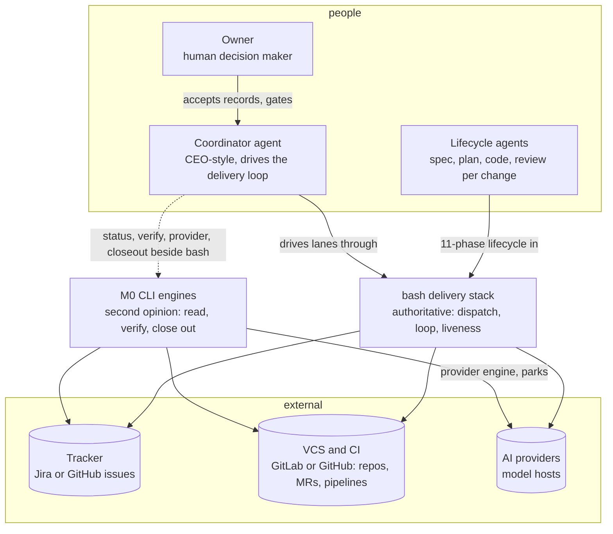
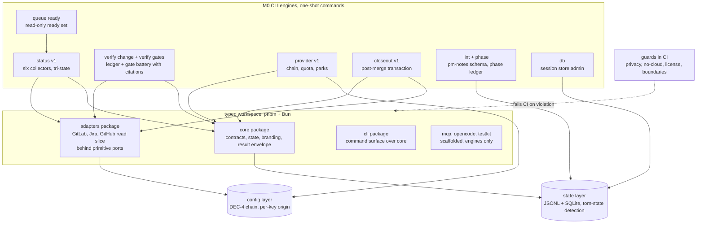

# M0 outcome architecture: trust substrate (delivered)

Backfill: the system as it stood at M0 completion (all 20 stories merged).
The M0 CLI engines exist beside the bash delivery stack; the bash stack
stays authoritative for dispatch and merge throughout M0. Story numbers
reference [../../backlog.md](../../backlog.md).

## C4 Level 1: system context (M0 end state)

M0 in one sentence: every read the coordinator relies on (status, verify
change, verify gates, provider, closeout, lint, phase, db, queue ready)
has a truthful, artifact-verified typed engine running beside the bash
stack, so its signals can be trusted before anything replaces the bash
paths.

## C4 Level 2: containers (M0 end state)

## What M0 deliberately is not

- No dispatch replacement: the bash stack runs lanes end to end; M0
  engines are read-and-verify surfaces plus closeout.
- No daemon, no queue state: the lanes-or-queue status section reads
  `not-delivered` by design until M1-S17.
- No merge automation: the merge gate battery exists as `verify gates`
  evidence; the merge act stays manual.
- The minimal GitHub read slice serves this repository only; full adapter
  completion is M3-S3.

Exit state at handover to M1: the dual-run pilot (status, verify change,
provider, closeout beside bash) is the recorded path to M0 exit; the
thirteen Proposed decision records await owner acceptance.
