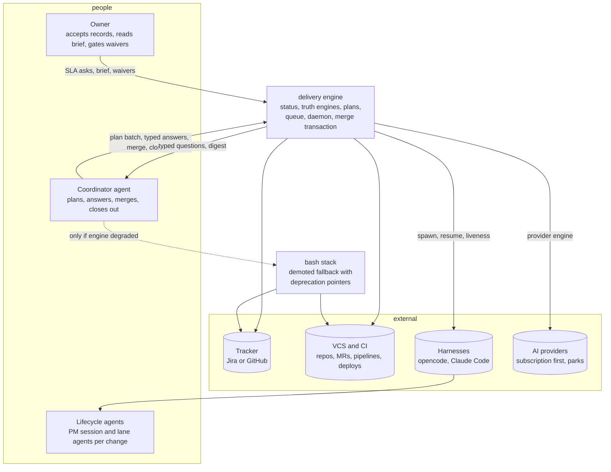
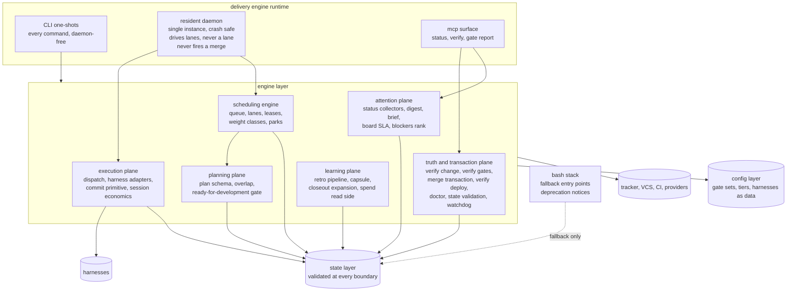
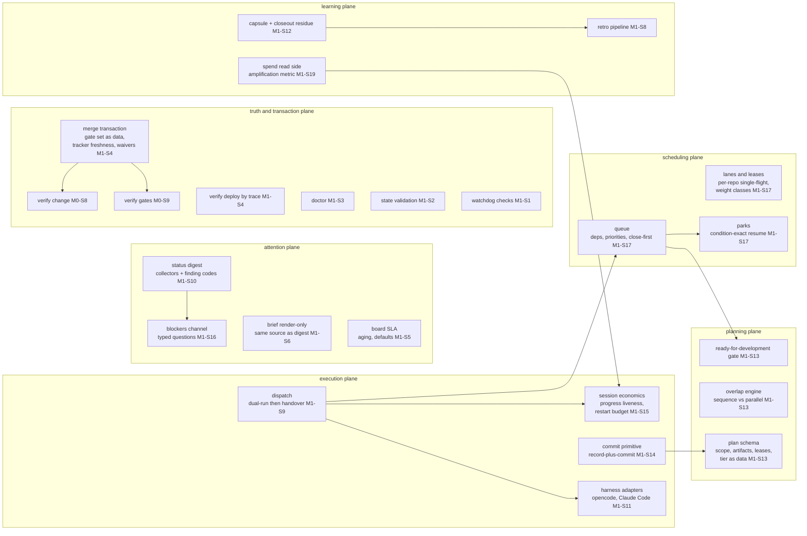
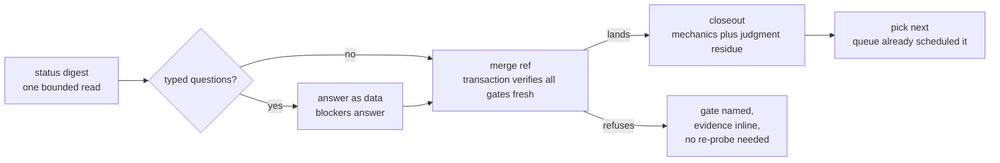
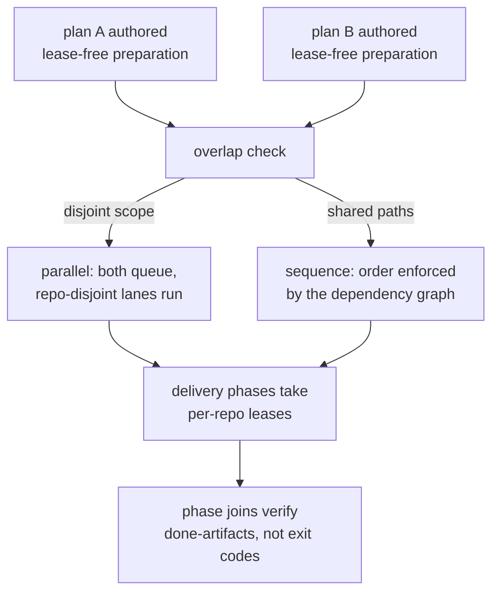
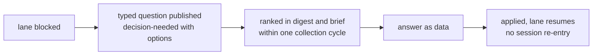
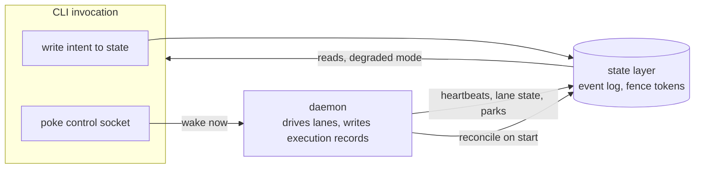

# M1 outcome architecture: delivery engine and autonomous dispatch (planned)

The system at M1 exit: the bash delivery stack is demoted to fallback and
the typed engine is authoritative on pilot repositories. Planned state;
story numbers reference [../../backlog.md](../../backlog.md). The pack
conventions are in [../README.md](../README.md); the recorded operator
input is
[../../operator-requirements-2026-11.md](../../operator-requirements-2026-11.md).

## C4 Level 1: system context (M1 end state)



M1 in one sentence: the coordinator plans (priorities, repos, dependencies
as one artifact), the machinery schedules and verifies, the coordinator
answers typed questions, merges, and closes out; between iterations zero
coordinator tokens go to waiting, polling, scheduling, or re-verification
of healthy paths.

## C4 Level 2: containers (M1 end state)



## C4 Level 3: components (M1 end state)



## Key flows

### The coordinator iteration (M1 end state)



Zero-coordinator-token zones: waiting for CI, polling lanes, discovering
parallelism, re-verifying healthy paths, session babysitting (daemon owns
all five).

### Parallel planning versus leased delivery



### Blocker round-trip (hours become seconds)



## Daemon communication (command to daemon contract)

Principle: **state-mediated truth, socket as optimization.** The state
layer is the only shared truth; the daemon is a state-machine driver over
it, not a server that owns data. Commands talk to the daemon through two
channels:

1. **State writes (always available, daemon or not).** Commands write
   intent records to the state layer: queue entries, dependency edges,
   blocker answers, resume notes. The daemon consumes the event log and
   reconciles; anything written while it was down is picked up on start
   (idempotent convergence).
2. **Control socket (optimization, never the only route).** A local
   control endpoint (unix domain socket at a path derived from the state
   dir; named pipe equivalent on Windows) carries wake-now notifications
   (so `queue add` takes effect in milliseconds, not at the next poll)
   and bounded live streams (`status --watch`, `lanes --watch` tail
   semantics). Reads of live process facts (uptime, current spawn,
   restart counters) come from the daemon's heartbeat record in state,
   written every few seconds; the socket serves immediate queries.

**Writer ownership (single-writer discipline under the state layer's
fence tokens):**

| Writer | Writes |
|---|---|
| commands (any invocation) | intent: queue entries, priorities, dependency edges, blocker questions and answers, resume notes, waivers |
| daemon | execution: lease acquisition and release, lane state, liveness heartbeats, park transitions, restart events and reasons |
| lifecycle agents | ledger: phase transitions, capsule events (through `phase` and `commit`) |

No writer ever mutates another writer's record class; conflicts are
prevented by fence tokens, not by convention.

**Every interaction has a state-only fallback:**

| Command (daemon up) | Daemon down |
|---|---|
| `queue add` | writes the entry; daemon reconciles on start |
| `queue plan` | computes from state; heartbeat age declared stale |
| `blockers answer` | answer and resume note land in state; lane resumes when the daemon (or a one-shot `dispatch --resume`) applies it |
| `status` / `lanes` | reads state; `--watch` degrades to bounded polling in a declared degraded mode |
| `dispatch` | one-shot execution path (the queue names the next action; the command executes it) |
| `phase complete` / `commit` | ledger writes; unaffected (never daemon-mediated) |

The daemon wakes on: control-socket poke, state-change notification, or a
bounded poll interval, in that order of preference.

### Control protocol v1 (the wire contract)

- **Transport:** unix domain socket at a path derived from the state dir
  (named pipe equivalent on Windows). Filesystem permissions are the
  authorization model: the socket lives in the 0700 state dir, same-user
  only; cross-user connections are refused with a classified error.
  No network transport, no ports, no tokens (multi-host is a parked
  concept; the protocol gains an auth story then, not before).
- **Wire format:** newline-delimited JSON frames, the same serialization
  discipline as the state layer's JSONL event log. Every frame carries
  `v` (protocol version), `id` (correlation), `kind` (one of `request`,
  `response`, `event`, `error`), and `type`. Errors use the one internal
  error table (code, category, retryable, consequence, remediationHint)
  exactly as CLI errors do.
- **Versioning:** the daemon serves v(n) and v(n-1); an unsupported
  version is refused with `daemon.protocol.unsupported` naming the
  versions offered. Frame shapes are stable contracts like command
  output.
- **No business truth on the wire.** Every frame is derivable from state;
  losing or ignoring any frame leaves the system correct (side effects
  are at-most-once; the daemon reconciles from the event log). The only
  mutating frames are control-plane (`stop`, `drain`, `takeover`), each
  also expressible without the socket (signal or state).
- **Interaction classes:**
  1. `poke` (request): "state changed at event cursor N" - the daemon
     re-reads state. No business logic crosses the wire.
  2. `query` (request/response): immediate facts (`daemon status`,
     live lane state). Responses bounded, labeled `live`.
  3. `subscribe` (request then event stream): `status --watch`,
     `lanes --watch` receive bounded, deduplicated, finding-coded
     frames. Slow consumers never stall the dispatcher: each
     subscription has a bounded buffer and, on overflow, the daemon
     drops the subscriber to a declared degraded mode (re-poll state)
     rather than blocking dispatch - the dispatcher is never a lane,
     including for its own watchers.
  4. `control` (request/response): `stop` (drain: finish current lane
     bookkeeping, stop spawning), `takeover` guarded by the fence token.
- **Secrets never cross the wire:** credential facts are variable names
  only, consistent with the blockers channel contract.

Example frames (illustrative):

```
-> {"v":1,"id":41,"kind":"request","type":"poke","cursor":"e-004211"}
<- {"v":1,"id":41,"kind":"response","type":"poke","data":{"applied":true}}
-> {"v":1,"id":42,"kind":"request","type":"subscribe","topic":"lanes"}
<- {"v":1,"id":42,"kind":"response","type":"subscribe","data":{"ok":true}}
<- {"v":1,"kind":"event","type":"lane.state","data":{"lane":"L2","state":"delivering","phase":"delivery"}}
<- {"v":1,"id":43,"kind":"request","type":"stop","payload":{"mode":"drain"}}
<- {"v":1,"id":43,"kind":"response","type":"stop","data":{"draining":true,"lanes":3}}
```



## Boundary invariants at M1 exit

1. The daemon never executes a merge; it prepares and queues (roadmap
   constraint 9). The merge transaction stays an explicit coordinator
   action.
2. Per-repo single-flight is the only structural lane cap; capacity,
   bandwidth, and CI slots never gate lane count. Weight classes are
   resource classes, not caps.
3. Truth before dispatch: the scheduling engine hard-depends on the merge
   transaction, session economics, state validation, and the plan schema;
   the daemon hard-depends on those plus the scheduling engine.
4. Daemon failure degrades to CLI one-shots; the bash stack remains
   installed as fallback with deprecation pointers (removal is M4-S5).
5. Deterministic render paths (digest, brief, plans, scheduling) contain
   no LLM calls; judgment sits on top of their output.
6. Gate sets, ceremony tiers, harness choices, and lane policies are
   configuration data, never code changes and never wizards.
