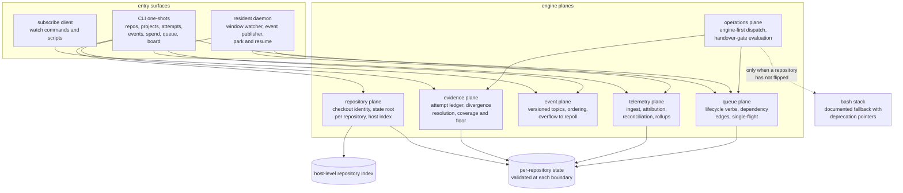
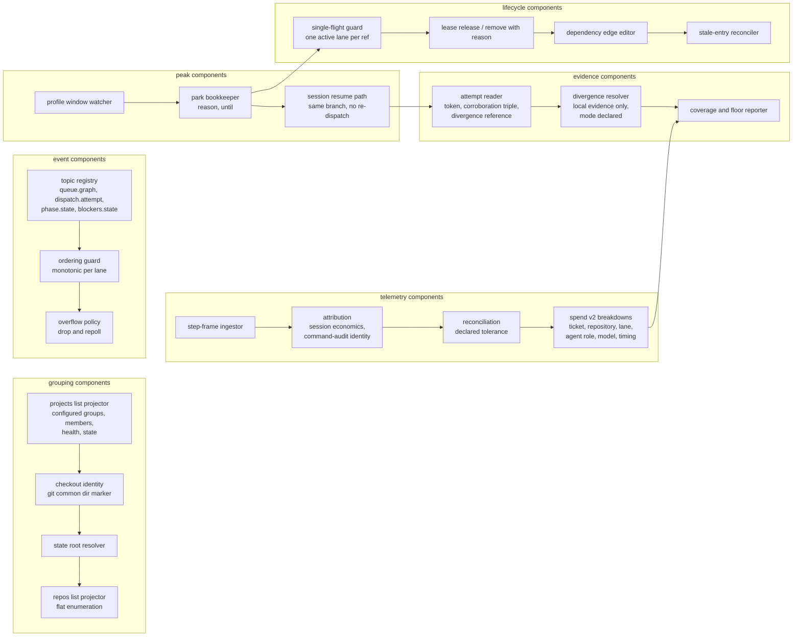
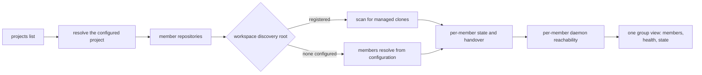
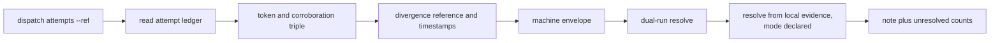
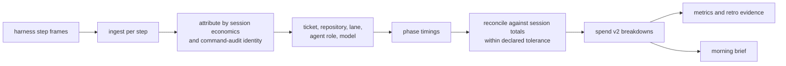
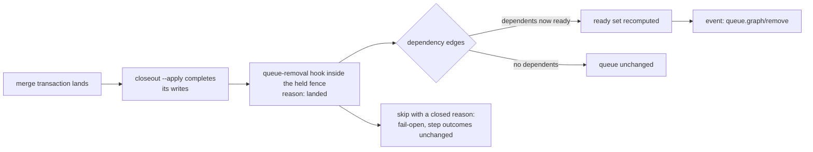
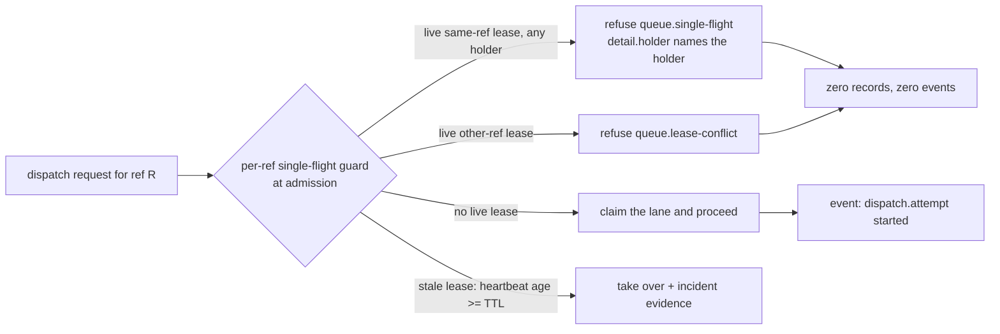
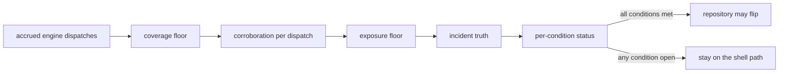
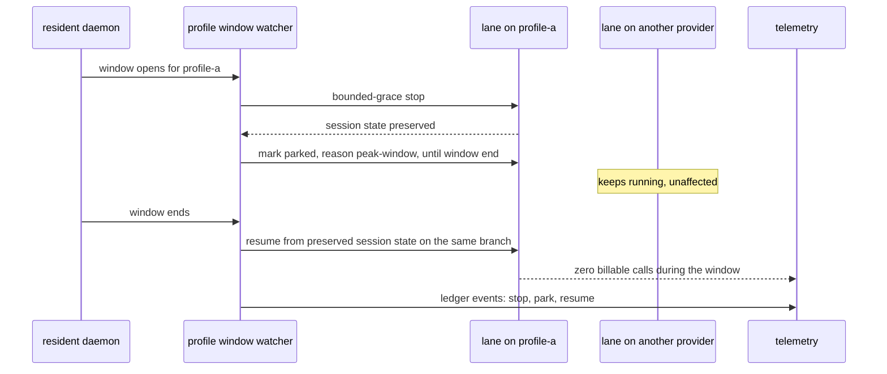
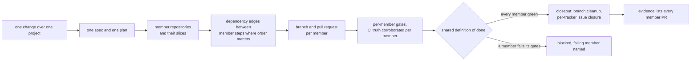

# M2 outcome architecture: engine-first operations and multi-repository workstations (planned)

The system at M2 exit: one workstation manages several delivery repositories,
grouped as configured projects, while the typed engine carries day-to-day
delivery, the queue lifecycle closes itself, the daemon publishes a versioned
event taxonomy, and telemetry turns spend, metrics, and retro into stated facts.
Planned state; story numbers reference [../../backlog.md](../../backlog.md).
Pack conventions are in [README.md](README.md); contract detail is in
[contracts.md](contracts.md).

## C4 Level 1: system context

```mermaid
flowchart TB
    subgraph people
        OWNER[Owner<br/>accepts records, reads brief, steers]
        COORD[Coordinator agent<br/>plans, merges, closes out]
        LANE[Lane agents<br/>one change per lane]
    end
    subgraph external
        TRACKER[(Tracker<br/>issues and state)]
        VCS[(VCS and CI<br/>branches, merges, pipelines)]
        HARNESS[(Harness step stream<br/>per-step frames)]
        PROFILES[(Provider profiles<br/>windows, holds, multipliers)]
    end
    subgraph model [three levels of the domain model]
        PROJECT[project<br/>configured group of repositories]
        MEMBER[member repositories<br/>one checkout each and the delivery unit]
        WS[workspace (optional)<br/>persisted discovery root]
    end
    ENGINE[delivery engine<br/>repository plane, queue,<br/>dispatch, events, telemetry,<br/>handover gate]
    HOST[(Host-level repository index<br/>one entry per managed checkout)]
    PROJECT -->|membership declared in configuration| MEMBER
    WS -.->|discovery root only, never required| PROJECT
    MEMBER --> HOST
    OWNER -->|asks, brief, steering notes| ENGINE
    COORD -->|plan, merge, closeout| ENGINE
    ENGINE -->|typed questions, digest| COORD
    ENGINE -->|spawn, resume, park| LANE
    ENGINE --> HOST
    ENGINE --> TRACKER
    ENGINE --> VCS
    LANE --> HARNESS
    HARNESS -->|step frames| ENGINE
    ENGINE -->|peak windows, holds| PROFILES
```

M2 in one sentence: the host knows every repository it manages, each
repository owns its own state and stays the delivery unit, a project is a
configured group of those repositories, a workspace is an optional directory
that only helps discovery, the engine can prove what it dispatched and what
it spent, and a provider peak parks one lane without touching the rest.

The three levels are fixed in meaning. A **repository** is one git checkout
and the delivery unit: always the leaf, always present. A **project** is a
named group of repositories that belong together, and its membership is
declared in configuration rather than inferred from a directory or a name. A
**workspace** is a persisted directory usable as a discovery root for a
project's clones; it is never required, so a project whose members live in
unrelated directories behaves identically to one whose members share a
workspace directory. No member repository is required to live inside a
workspace, and the workspace adds discovery only. A directory scan only
locates declared members and never admits an undeclared clone: configuration
is the sole source of membership.

The discovery workspace root is an optional directory used for discovery; it
is distinct from the state layer's fixed `default` workspace identifier,
which is the workspace key inside every per-checkout state root.

## C4 Level 2: containers



## C4 Level 3: components



## Key flows

### Multi-repository overview



### Attempt-history inspection and divergence resolution



### Telemetry attribution



### Queue auto-release after merge and closeout



The hook runs inside the fence closeout already holds, after the closeout
writes, and only when the merged delivery request is observed: it appends the
park withdrawal when a park is active, then one `queue.removal` record with
reason `landed`, and exactly one `queue.graph/remove` event is later
observable in the ref's lane. Plan mode removes nothing and reports
`would-remove`; no merge truth, a live lease, unreadable queue state, or a
non-canonical ref reports `skipped` with the closed reason; a re-run over an
already-removed ref, and a ref that never had an entry, report `satisfied`
at exit 0. The hook never changes a step outcome or closeout's exit code
and adds no step to the declared inventory.

### Single-flight refusal across dispatch paths



The guard is path-specific (TDR-0026 DC-2/DC-3): the dispatch family —
`dispatch run` and a composed daemon supervision claim — refuses any live
same-ref lease regardless of holder, because the dispatch path claims with
the fixed holder `dispatch` and never renews mid-flight, so a live same-ref
lease can only name a dispatch that is already running. `queue claim` keeps
its holder-aware outcomes: the caller's own holder's same-ref lease returns
`renewed` (one record, no session), another holder's same-ref lease refuses
`queue.single-flight`, and any other-ref live lease refuses the delivered
`queue.lease-conflict`. A refusal appends nothing and publishes no event —
no lease record, no attempt record, and no `dispatch.attempt` refused event;
it happens before the fence. A lease at or over its TTL is not active on any
path and keeps the delivered stale takeover. Renewal is narrowed to one
(repository, ref, holder), so a same-holder claim for a different ref
refuses `queue.lease-conflict` and the lease's recorded ref is never
rewritten.

### Handover-gate evaluation



### S17 park and resume under a provider peak



With no resident daemon there is no window watcher to park mid-flight: peak
control degrades to the existing iteration-start gating, the engine does not
claim a park that did not happen, and the difference is declared to the
operator. The S17 contract carries both branches.

### Cross-repository change



One lifecycle, one spec and plan, one definition of done: a cross-repository
change still runs the phases once, and each member repository receives its
own branch and pull request under per-member gates. The change holds one
queue entry per member keyed by that member's ref, with per-member dependency
edges; release drops each member's lease while the entries stay, removal
happens per member with the change's reason, and one member's landing removes
only its entry. One lane per member entry, never a cross-repository lane. A
member that fails its gates blocks the shared definition of done and is
named, so a partly landed change never reads as done.

## Persistence and concurrency deltas

M2 changes where state lives, not only what it contains.

- **Per-repository state.** The state root resolves from the checkout identity
  (the git common dir marker), so two checkouts on one host never share phase
  state, queue entries, or lane leases. The host-level index names each
  repository key, root, and state location; it is the only host-wide index
  file, and the host-wide owner-hold marker also lives at the host root.
- **Migration.** Existing single-store users get a migration note and a
  one-step move into the per-repository root; no state file is rewritten in
  place.
- **Concurrency.** One active lane per ref is enforced across every dispatch
  path, not only the queue path, so a second session on the same ref is
  refused with a classified error naming the holder. Lane leases stay
  repo-exclusive with stale takeover.
- **Ordering.** Event topics are ordered per lane with monotonic sequence
  numbers; a slow consumer overflows to a repoll instead of receiving a
  reordered stream.
- **Telemetry storage.** Telemetry lands in schema-versioned local event
  storage; a version bump migrates by re-reading, never by mutating old rows.
- **Park state.** A parked lane records its reason and an until timestamp;
  the record survives a daemon restart, so resume is idempotent.

## Boundary invariants at M2 exit

- The naming boundary holds by reference to the rename rule: `repos` is the
  flat record set of managed checkouts, `projects` is the group surface, and
  no page gives the two names the same meaning.
- Membership is configuration-only and declared in configuration. A project's
  members are the repositories its configuration declares, not the checkouts
  a directory scan happens to find.
- One queue entry per member for a cross-repository change, with per-member
  dependency edges; release drops each member's lease while the entries stay,
  and one member's landing removes only its entry.
- A workspace is optional and never required: it is a discovery root only, and
  a project whose members live in unrelated directories behaves identically.
- One lifecycle per cross-repository change: one spec and plan, one definition
  of done, and a branch and pull request per member repository.
- No two repositories on one host observe each other's phase state, queue
  entries, or lane leases.
- Every dispatch records its nominated provider profile on the lane and on
  the attempt record.
- One active lane per ref, whichever dispatch path is used.
- A queue entry leaves the queue when its work lands or is abandoned, with a
  recorded reason; stale entries reconcile against tracker truth without
  editing state files.
- Event topics are versioned, documented, and ordered per lane; overflow is a
  declared repoll, never silent loss.
- Telemetry reconciles with harness-reported totals within the declared
  tolerance, and telemetry absence is a classified outcome.
- A provider peak parks only lanes on that profile; other providers keep
  running, and resume loses or duplicates no branch, artifact, or queue
  state. Without a resident daemon the behaviour degrades to iteration-start
  gating, and the declared difference — not an implied park — is what the
  operator sees.
