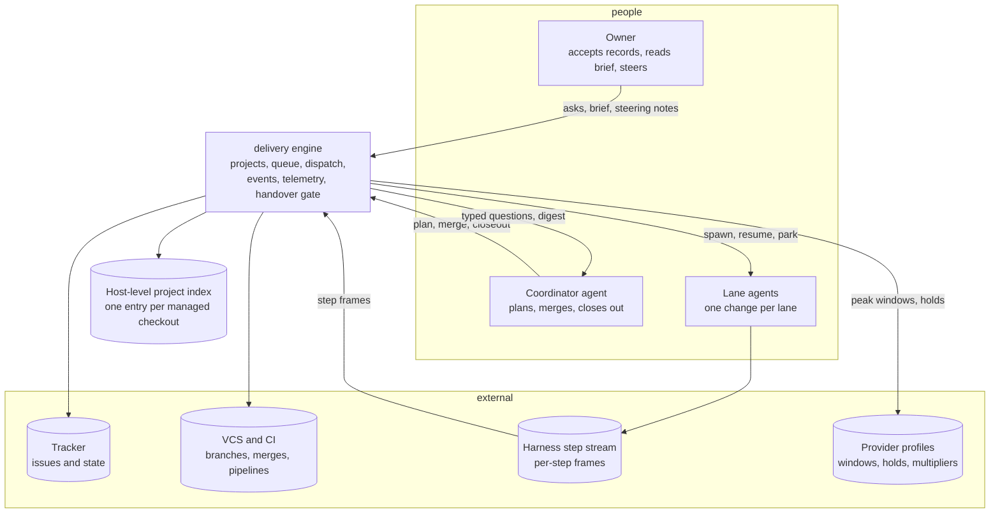
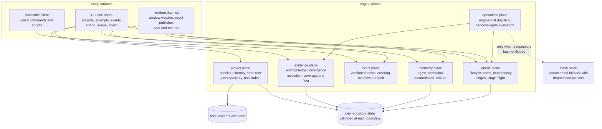
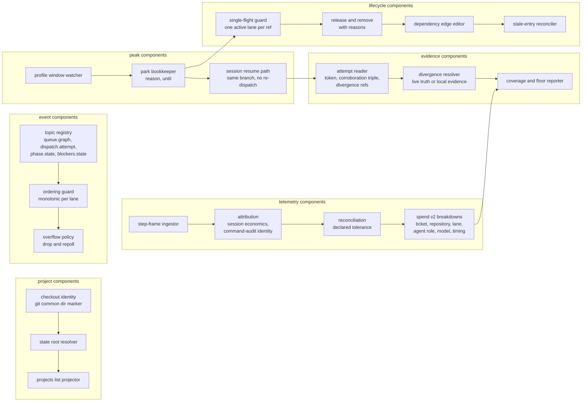
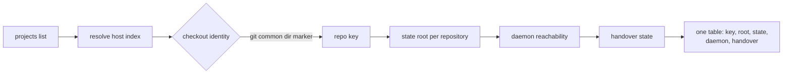
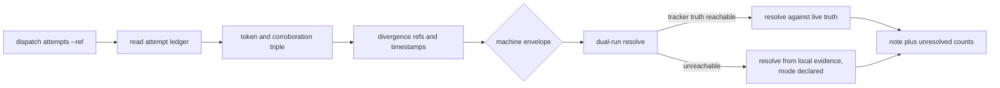
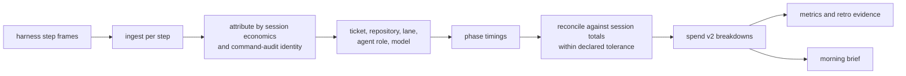
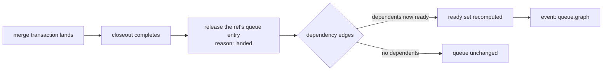
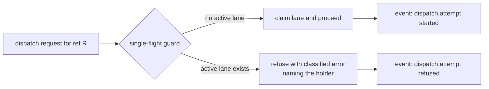
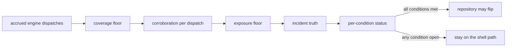
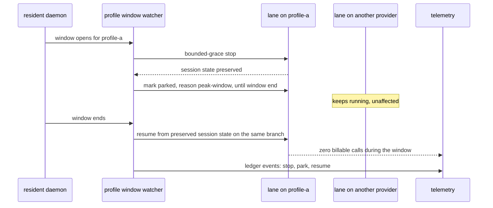

# M2 outcome architecture: engine-first operations and multi-repository workstations (planned)

The system at M2 exit: one workstation manages several delivery repositories
as first-class projects, the typed engine carries day-to-day delivery, the
queue lifecycle closes itself, the daemon publishes a versioned event
taxonomy, and telemetry turns spend, metrics, and retro into stated facts.
Planned state; story numbers reference [../../backlog.md](../../backlog.md).
Pack conventions are in [README.md](README.md); contract detail is in
[contracts.md](contracts.md).

## C4 Level 1: system context

M2 in one sentence: the host knows every repository it manages, each
repository owns its own state, the engine can prove what it dispatched and
what it spent, and a provider peak parks one lane without touching the rest.

## C4 Level 2: containers

## C4 Level 3: components

## Key flows

### Multi-repository overview

### Attempt-history inspection and divergence resolution

### Telemetry attribution

### Queue auto-release after merge and closeout

### Single-flight refusal across dispatch paths

### Handover-gate evaluation

### S17 park and resume under a provider peak

## Persistence and concurrency deltas

M2 changes where state lives, not only what it contains.

- **Per-repository state.** The state root resolves from the checkout identity
  (the git common dir marker), so two checkouts on one host never share phase
  state, queue entries, or lane leases. The host-level index names each
  project key, root, and state location; it is the only host-wide file.
- **Migration.** Existing single-store users get a migration note and a
  one-step move into the per-repository root; no state file is rewritten in
  place.
- **Concurrency.** One active lane per ref is enforced across every dispatch
  path, not only the queue path, so a second session on the same ref is
  refused with a classified error naming the holder. Lane leases stay
  repo-exclusive with stale takeover.
- **Ordering.** Event topics are ordered per lane with monotonic sequence
  numbers; a slow consumer overflows to a repoll instead of receiving a
  reordered stream.
- **Telemetry storage.** Telemetry lands in schema-versioned local event
  storage; a version bump migrates by re-reading, never by mutating old rows.
- **Park state.** A parked lane records its reason and an until timestamp;
  the record survives a daemon restart, so resume is idempotent.

## Boundary invariants at M2 exit

- No two repositories on one host observe each other's phase state, queue
  entries, or lane leases.
- Every dispatch records its nominated provider profile on the lane and on
  the attempt record.
- One active lane per ref, whichever dispatch path is used.
- A queue entry leaves the queue when its work lands or is abandoned, with a
  recorded reason; stale entries reconcile against tracker truth without
  editing state files.
- Event topics are versioned, documented, and ordered per lane; overflow is a
  declared repoll, never silent loss.
- Telemetry reconciles with harness-reported totals within the declared
  tolerance, and telemetry absence is a classified outcome.
- A provider peak parks only lanes on that profile; other providers keep
  running, and resume loses or duplicates no branch, artifact, or queue
  state.
